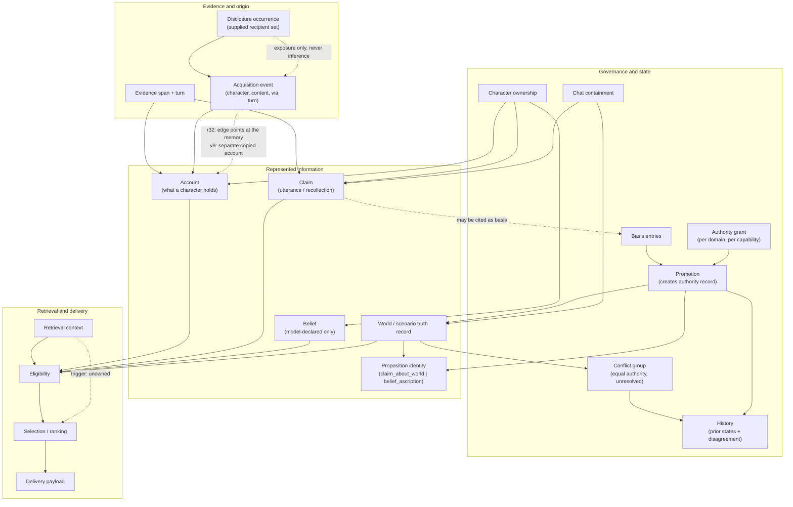

# MEMORY-09 — Phase 1A: Conceptual Object Investigation and Reconciliation

**Status: INVESTIGATION AND DECISION SUPPORT ONLY. No architecture decided, approved or replaced.
No implementation, no test, no probe, no model call. Nothing executed.**

| Field | Value |
|---|---|
| Mode | READ-ONLY / RESEARCH / DESIGN ANALYSIS |
| Primary audit reference | `MEMORY-09 — ARCHITECTURE BASELINE RECONCILIATION` (2026-11-19), findings **E-1** and **E-2** |
| Recorded | **2026-11-19 17:32 CST (−0600)** = 2026-11-19 23:32 UTC |
| Authority created by this record | **None.** It records evidence, reconciles text, and identifies decisions for the owner |
| Implementation authorisation | **None.** Gate 2's original authorisation is not extended, renewed or exercised here |
| Testing authorisation | **None.** No test, probe, import, compile or benchmark was run |
| Files changed | **One new file only** — this record. No canonical artifact altered |
| Identifier namespace | `CO-*` (findings), `PH1A-*` (unresolved items), `TR-*` (traces), `RX-*` (reconciliation rows). Chosen to avoid the project's existing `D-*`, `E-*`, `F-*`, `Q-*`, `U-*`, `S-*` and `K-R*` namespaces, which already collide |

**Evidence labels used exactly as the work order requires:** **Observed** · **Source-derived** ·
**Calculated** · **Inferred** · **Unestablished** · **Superseded**.

**Authority tiers (O-6a):** **T1** owner-confirmed decisions · **T2** r32 normative mechanisms
(90 `K-R` rules, 18 invariants) where in scope · **T3** v9 rules (57) where T1 and T2 do not govern.

**Standing discipline applied throughout:** recency is not precedence; an implemented behaviour is not
proof of correctness; a ratified design is not proof of execution; silence is not endorsement; an
inference is labelled and never promoted to a decision.

---

## 1. Executive findings

**CO-01 — The experiment directory contains two different object models, and the harness drives the
one that is not the ratified engine.**
`eval/mem1/model.py` (398 lines) implements r32's A′ model: `MemoryRecord`, `AcquisitionEvent`,
`KnowledgeEdge`, `ScopeState`, `ActiveState`. `eval/mem1/m09/` (1,951 lines) implements v9's record-class
model: `Record` with `record_class ∈ {claim, account, belief, world_truth, scenario_truth}` and no
acquisition events at all. Nothing outside `m09/` references `m09` (**Observed**: `grep -rn m09
--include=*.py eval/`, excluding the package, returns nothing). The conversation driver, formation,
retrieval and assembly all use `model.py`. This is not a documentation divergence; it is two parallel
implementations in one experiment, with no bridge. **[Observed; audit §12 P9 independently records the
same absence]**

**CO-02 — r32 and v9 are not two vocabularies for one model. Each is missing a capability the other
has, and the missing pieces are in different dimensions.**
r32 has acquisition history, episode folding, `(turn, seq)` ordering and a read-time join between
knowledge and memory state — but its `MemoryRecord` has **no character owner field** (§6.1: `id`,
`owner_chat_id`, `scope`, `knowledge_class`, `subject`, `predicate`, `value`, `attribution`, `status`,
`established_turn`, `supersedes`/`superseded_by`, `correction_of`, `conflict_group`, `confidence`,
`importance`, `surfacing_priority`, `source_span`, `formation_method`, `asset_ref`). Knowledge of a
record is held only on `KnowledgeEdge`. v9/engine has character-exclusive ownership of the original
private record (T1: O-1) and recipient-specific copied accounts (rule 12, §8) — but no acquisition
event stream, no ordering and no join. **Neither model can express the other's central guarantee.**
**[Observed for both field sets; Inferred as the statement of mutual incompleteness]**

**CO-03 — The decisive unresolved question is not "record vs event". It is what relation holds between
a knower and the content they hold.**
r32 uses **shared reference**: one memory record, many edges pointing at it, status joined at read time
(K-R1, K-R13, §8.1). v9 uses **copied account**: each recipient gets a new record with its own identity,
"never a view, alias or projection" (rule 12; §8). For a *public* event, r32's shape is the only one that
supports "one authoritative record, many knowers" and the R4 retraction display. For *private
disclosure*, T1 (O-1) forces v9's shape: B receives "a separate acquired record containing only what was
disclosed" and gains no access to A's original. No document states which relation applies to which
situation, and each implementation applies one relation to everything. **[Inferred from: r32 §6.1/§8.1;
v9 rule 12/§8; O-1; engine `disclose()`]**

**CO-04 — E-1 is not one yes/no question about four classes. The four values name four different
conditions, and at least three separable decisions are hidden inside "approve the four classes".**

| r32 value | Question it actually answers | Dimension |
|---|---|---|
| `ambient_authored` | May this content be available without any acquisition, and who authored that availability? | authorship + declared availability |
| `restricted_authored` | Does access require an explicit grant or discovery? | access condition |
| `experiential` | Must an acquisition event exist before anyone holds this? | origin requirement |
| `character_specific` | Is this exclusively one character's? | ownership / exclusivity |

A single stored enum conflates them; that is why it collides with v9's `record_class` + owner + domain.
**[Inferred; premises are r32 R3/K-R8/I13, v9 §3, O-1, O-12]** No owner record withdraws the four
values, and none approves them (§6).

**CO-05 — The frozen experiment still uses the four-class taxonomy, so "retire the classes" is not a
documentation decision.**
The preregistration's probe quota is expressed as `character-specific 4 · ambient 2 · restricted 2 ·
experiential 2 · correction 1 · retraction 1 · unanswerable 1` (`MEMORY-09-PREREGISTRATION-2026-11-15.md`
§5, lines 96–99; mirrored in `eval/mem1/__init__.py` `PROBE_QUOTAS`), and `SCOPES` in the harness's
`model.py` includes `restricted`. The 118-requirement map, by contrast, never uses those four names.
**The instrument is built on the taxonomy the ratified requirements do not contain.** The preregistration
is frozen; changing its categories is an amendment, not an edit. **[Observed; consequence Inferred]**

**CO-06 — Both implementations lose the retraction guarantee, at different layers, in the same way.**
r32 requires that a retraction change only the record's truth status while the knower still holds what
they acquired, with "you were told X; it has since been retracted" available at read time (R4, K-R13,
§8.4; map A2a, E1a–E1c, H10). Harness: `retrieve.eligible()` admits only `status == ACTIVE`, so the
retracted record vanishes from the character's candidate pool. Engine: `retract()` sets `REVOKED` on any
non-belief, non-truth record — including B's own account, since the operation takes no actor — and
`retrieval.perspective()` filters `status != "revoked"`, so that account vanishes from its owner's view.
In both, "retracted" and "never existed" become observationally identical for the knower. A retraction of
the *source* rather than the account is the mirror-image failure: because B's account is a separate
record with copied text, B is never told (see §7.5). **[Observed in both sources; requirement
Source-derived T2 + T3]** This single behaviour is the cheapest discriminator between the two object
models and is therefore the recommended first follow-up (§13).

**CO-07 — "Revoked" carries two incompatible meanings and must not be normalised.**
In r32, `via=revoked` is an **acquisition** event meaning the character no longer knows (K-R3, K-R19:
a forgotten pair has *no edge*). In the engine, `status=revoked` is a **record-retraction** state meaning
the content is withdrawn (engine `retract()`). In the harness, `REVOKED` is a record status *and* a `via`
value. Same token, three referents. **[Observed]** Any future contract that unifies the vocabularies
without preserving the distinction would make "A forgot X" and "X was retracted" one state.

**CO-08 — Rule 22 is contradicted by the engine's `claim()`.**
Rule 22 (T3): "Creation is open — any participant, human or model, may create conversational
information." `Engine.claim()` raises `OwnershipError` when `contributor_kind == "human"`, on the
reasoning that a human "has no character-private memory stream". Requirement L1 expects a human
contribution to be recorded with contributor provenance. **[Observed]** Either the human participant's
speech is represented through a character (and L1 is about the human *behind* a character model), or the
engine cannot satisfy L1. The engine's docstring states the reasoning; no owner decision states which
reading is correct. **[Unestablished]**

**CO-09 — Retrieval invocation is unowned.**
r32 specifies that every retrieval call names its context and defaults fail-closed (K-R5, I12) — a
property of a *call*, not of a trigger. v9 assigns "eligibility per retrieval context" to the memory
system (§1) and defines no trigger. The harness invokes retrieval **on every turn**, using the turn's
text as the query and the probe owner (or Sable by default) as the perspective. Nothing in r32, v9, the
owner decisions, the 118 requirements or the preregistration defines **when** retrieval is invoked or
**how the system recognises that memory is needed**. **[Observed for the sources; the absence is
Source-derived by exhaustive reading of the cited sections]** This is a genuine Howl/MEMORY-09 boundary
gap, not a detail (§9, §10).

**CO-10 — The harness cannot represent most of the lifecycle the requirements describe.**
It has no testimony (`told` is never formed; `_admit` passes `via="witnessed"` for every record), no
multi-recipient disclosure, no belief operation, no promotion, no authority registry, no conflict group,
no incompatibility assertion, and no `seq`. Of the 118 requirements, the instrument can currently
represent the ownership/visibility/retraction subset and little else. **[Observed]** This is the concrete
form of the audit's P9: the bridge is not just missing code, it is a missing object model on the harness
side.

**CO-11 — The committed engine is materially newer than every review of it.**
The committed tree is 1,951 lines; the latest covering source review (R2) and the Gate 2 supplement
describe 1,632 and 1,803 lines. R2's two most consequential findings — conflict by target equality
(class B) and the absent belief-versus-truth carrier (class C) — describe a revision that no longer
exists in that form: the committed engine has explicit proposition identity and a closed two-value
proposition kind. Whether those findings are closed, partially closed or merely relocated is
**Unestablished**, because no review covers the committed tree and no test exists. **[Observed for
counts and fields; audit §4.2/§4.4 establish the same gap]**

**CO-12 — The two most load-bearing R2/REV 2 questions are still unanswered, and they are object-model
questions, not implementation questions.** Q-R2-1 (how incompatibility is established and represented)
and Q-R2-2 (whether a structural carrier for "this record is about a character's belief" is authorised)
were answered *in source* by REV 2's proposition registry, but REV 2 records the owner's input as
"recommendations, not registered decisions" and the engine's docstrings cite it as adopted. Precedence
therefore does not establish that the proposition registry governs. **[Observed; status Unestablished]**

---

## 2. Source inventory and evidence quality

### 2.1 Primary sources read for this investigation

| Source | Identity | Extent read | Evidence quality |
|---|---|---|---|
| `MEMORY-09-ARCH-STAGE-CONTRACT-2026-11-15.md` (r32) | `e88ef2d1…b4ef598d`, 91,311 B, 1,028 lines | §1–§11.3, §14, §15 in full; §12 sampled | **Frozen and intact.** Untracked, no git history (ARCH-03 §1). Declared open defects F2/F3/F5/F6/F7/F15 govern how far it may be relied on. Unregistered in `docs/DOCUMENT-REGISTRY.md` (F18) |
| `MEMORY-09-CONTRACT-NORMATIVE-2026-11-15.md` | `87154a9b…ae14ff`, 350 lines | Rule, invariant and open-question text | **Verbatim extract.** It omits r32 §2 prose entirely (session correction #1), so it is reliable for rule text and unreliable as a substitute for r32's surrounding argument |
| `MEMORY-09-ARCHITECTURE-v9-2026-11-17.md` | `698254ca…a4fe95b`, 236 lines | Full | **Ratified T3 (O-6b)**, but its header is stale (Gate 2 "unanswered", "0 implemented", D-4 "open") and §4 is headed "Rules 1–27" while holding 57 rules |
| `MEMORY-09-OWNER-DECISIONS-2026-11-17.md` | `da3e7239…c6f86b4`, 636 lines | Full | **Highest available authority for T1**, with two defects: confirmations are conversation-recorded (no signature), and one stale sentence survives inside O-6b ("v9 and the 87-test map are proposals awaiting owner approval") |
| `MEMORY-09-CONFORMANCE-MAP-2026-11-17.md` | `b4ba33cc…01df34d4`, 211 lines | Full | **Ratified requirements (O-6b).** Header's "0 implemented" is stale; the map has not been re-performed against the committed tree |
| `MEMORY-09-SESSION-CORRECTIONS-2026-11-17.md` | 111 lines | Full | Reasoning trail, no authority. Corrections 1, 9–13 and 19–24 matter for this investigation |
| `MEMORY-09-EVENT-REPRESENTATION-DECISION-STUB-2026-11-17.md` | 374 lines | Full | **D-E1/D-E2/D-E3 closed**; D-E2 = B2 (owner). Its own §2c records that the pre-B2 `disclose()` derivation was "superseded architecturally" |
| `MEMORY-09-ARCH-03-R3-INDEPENDENT-REVIEW-RECORD-2026-11-17.md` | 294 lines | Full | Findings F2–F27 about **r32 only**; retargeting validates nothing (its §1.4). F6 (`seq`), F5 (status suppression), F7 (asset gating), F15 (I4/K-R43) are load-bearing here |
| `MEMORY-09-ARCH-CONTRACTS-R2-FOUR-QUESTIONS-REV-2-2026-11-17.md` | 558 lines, "PROPOSAL REV 2" | §0–§1, §2, §3, §4, §6, §7, §8 | **Proposal, not decision.** Its §1 explicitly records the owner's U-1…U-8 input as *recommendations, not registered decisions* |
| `MEMORY-09-ARCH-CONTRACTS-R2-FOUR-QUESTIONS-REV-13-2026-11-17.md` + `MEMORY-09-SNAPSHOT-CONTRACT-ACCEPTANCE-2026-11-17.md` | REV 13 276 lines; acceptance 136 lines | §5–§7; acceptance §1–§2 | **Accepted** snapshot contract; §2–§5 operative. Applies to canon capture, not to the object model |
| `MEMORY-09-IMPLEMENTATION-REVIEW-R2-2026-11-17.md` | 205 lines | Full | Source inspection at the **886→1,632-line** state. Its anchors no longer resolve to the committed tree; its findings are historical evidence, not current status |
| `MEMORY-09-CURRENT-STATE-AND-COMPLETION-AUDIT-2026-11-18.md` | 755 lines | §3–§5, §11–§12, §15 | Current authoritative status record. Used for counts, authorization and prerequisites, not for architecture |
| `eval/mem1/m09/` reference engine | 6 modules, **1,951 lines**; `engine.py 7505e9ac…`, `records.py ad2d4d11…`, `retrieval.py cd2d380b…`, `authority.py f3445823…`, `errors.py 5f33e710…`, `__init__.py 2b72a75f…` | **All six modules read in full** | Hashes match audit §4.1 exactly (**Observed**). Clean against HEAD `830cba4` |
| `eval/mem1/` harness | 6,152 lines across 19 modules | `model.py`, `form.py`, `retrieve.py`, `assemble.py`, `probe.py`, `conversation.py`, `__init__.py` in full | **This is the instrument that exists.** No review record covers its object model as a whole |
| `MEMORY-09-PREREGISTRATION-2026-11-15.md` (frozen) | §5 excerpt (lines 96–113) | Probe taxonomy and quota | **Frozen.** Used only to establish that the four class names are operational requirements of the instrument |

### 2.2 What the evidence base can and cannot support

- **Can support:** exact field sets, exact operation semantics, exact rule text, exact requirement text,
  and precedence relations between documents.
- **Cannot support:** any claim about runtime behaviour (nothing has run), any claim that the committed
  tree satisfies a requirement (no review covers it), any claim about production Howl (not inspected),
  and any claim that a proposal (REV 2, REV 8, §10.1 rev 2) is approved.
- **Deliberately not used:** the earlier DeepSeek semantic failure-point report, prior chat summaries of
  r32 or v9, and any inference from code to architectural correctness.

---

## 3. Candidate conceptual object inventory

Each candidate is classified by **kind**, because the work order's fifth question ("is it genuinely a
distinct object?") is answered by what sort of thing it is, not by how often it is named.

### 3.1 Evidence and origin

| Candidate | What it must preserve | Kind | Evidence | Status |
|---|---|---|---|---|
| Evidence span / turn reference | That a claim came from somewhere inspectable, and where | Attribute (of an event or record) | r32 `source_span`, `established_turn`; v9 `provenance`; harness `EvidenceLog` span ids | **Established** as an attribute; not an object |
| Turn ordinal | Sequence position within a conversation | Attribute | r32 `turn`; K-R15 `(turn, seq)`; harness `established_turn` | **Established**; `seq` missing (§7.4) |
| Disclosure occurrence | That A communicated content to an established recipient set, at a turn | Event | O-3; v9 rules 46–48; D-E2 = B2; J3 | **Established** (T1) as an event; authoring side settled by B2 |
| Recipient set | Exactly who was exposed | Attribute of the disclosure event | Rule 11; J5; B2 §2b; `Record.disclosure["recipients"]` | **Established** (T1). Must be supplied, never inferred |
| Acquisition by a recipient | That this character came to hold this content, by which route | Event **and** resulting state (two things) | r32 `AcquisitionEvent` + `KnowledgeEdge`; v9 rule 9 + account | **Split across documents** — see CO-03 |
| Origin class | Whether the account is backed by an acquisition event | Attribute | O-4 (T1): `own_account` / `event_acquired`; engine uses `acquired` | **Established** (T1); engine's token differs from the decision text (§Appendix A) |
| `via` | The evidence route by which content entered knowledge | Attribute, ordered | O-4; K-R26 fixed order; rule 50 | **Established** (T1 + T2). Not a statement about memory of learning (O-4) |

### 3.2 Represented information

| Candidate | What it must preserve | Kind | Evidence | Status |
|---|---|---|---|---|
| Claim | That someone said something, and what | Record (non-truth-apt) | Rule 25; §3; engine `claim` | **Established** (T3) |
| Private recollection | What a character remembers or makes of something, as they present it | Record — **not a separate class in the engine**: a `claim` with `contribution_kind="recollection"` | Rules 25–26; O-12; C6/C9 | **Established**; class-vs-kind is a modelling choice already made in source |
| Account | What a character holds, with origin and evidence | Record (non-truth-apt) | Rules 9, 50–52; §7 step 4 | **Established** (T3); its relation to r32's edge is unresolved (CO-03) |
| Belief | What a character currently accepts | Record, model-declared only | O-5 (T1); rules 53–57 | **Established** (T1) |
| World / scenario truth record | What is authoritative in a domain | Record (truth-apt) | Rules 7, 17, 24; O-8a | **Established** (T1 + T3) |
| Proposition / claim identity | That two records concern the same claim without comparing text | Identity (separate from any record) | REV 2 §3.1; engine `_propositions`; rule 41 | **Implemented, status Unestablished** — REV 2 is a proposal built on recommendations; no review covers the committed registry |
| Applicability (`domain` + `target`) | Where something applies, never who knows or owns it | Attribute pair | Rule 6; K-R5; REV 13 §3 (opaque labels) | **Established** (T2 + T3 + accepted snapshot contract) |
| Scope / visibility marker | Whether a fact is public to a domain | Attribute | D1 (T1): scopes are not owners; v9 §3 `character_public` is a visibility marker | **Established** (T1) |
| Relationship between represented items | Equivalence, incompatibility, or succession | Relationship | K-R48–K-R52; REV 2 §3.2–§3.3 | **Established for incompatibility as an assertion**; equivalence normalisation open (Q14a) |
| Asset / definition | Reusable authored content, versioned, non-experiential | Object outside MEMORY-09 | D3 (T1); §10 (outside experiment); K-R8 puts `knowledge_class` on assets | **Out of scope by decision**; its class field is one source of E-1's confusion |

### 3.3 Governance and state

| Candidate | What it must preserve | Kind | Evidence | Status |
|---|---|---|---|---|
| Chat containment | Exactly one containing chat per record | Attribute / boundary | D-01 (T1); rule 2; engine constructor | **Established** (T1) |
| Character ownership | Exclusive control of the original private record | Attribute / access relation | O-1 (T1); rule 3; engine `owner_character` | **Established** (T1); **absent from r32's record model** (CO-02) |
| Authority holder | Who may promote, in which domain | Relationship (actor × domain × capability) | O-8a-1/3/6; rules 24, 35; `AuthorityRegistry` | **Established** (T1) |
| Grant | Standing delegated authority, revocable | Object | O-8a-6; `Grant` | **Established** (T1); engine implementation unreviewed at committed state |
| Promotion | The act that creates authority, with basis | Operation (produces a record) | Rules 17, 24, 28; O-11 | **Established** (T1) |
| Basis entry | Why the promotion was authorised to happen | Attribute set on the promotion | O-8a-2; `BasisEntry` | **Established** (T1) |
| Conflict group | That two authoritative records cannot both stand, unresolved | Object (state) | Rule 41; O-10; REV 2 §3.3; `_groups` | **Established** (T1); closure of the group is human-gated |
| Incompatibility assertion | Who claims the two records are incompatible, on what applicability | Event | REV 2 §3.3 (recommendation-shaped); J13 | **Implemented, status Unestablished**; Q-R2-1 remains the owner-level question |
| Correction / supersession / revocation / retraction | Four different changes to four different things | Operations (not objects) | O-10 (T1) "three operations, three meanings"; rule 42; K-R3 for forgetting | **Established** (T1) as operations; status vocabulary conflicts (§7.5) |
| History | That prior states and the fact of disagreement survive | Property of the store + retrieval | I4; O-10b; rules 20, 44 | **Established** (T1 + T2) |

### 3.4 Retrieval and delivery

| Candidate | What it must preserve | Kind | Evidence | Status |
|---|---|---|---|---|
| Retrieval context | Which question is being answered (character / world / narrator / inspection) | Call parameter | K-R5, I12; v9 §1 | **Established for r32's four contexts**; v9's engine has three surfaces (`perspective`, `world`, `belief_facts`) and no `narrator` or `inspection` |
| Retrieval request / query | The need being served | Input | Harness `retrieve(query, …)`; no doc defines query formation | **Unestablished** — no governing text |
| Retrieval trigger | Why retrieval happens now | Policy | **None found** in r32, v9, owner decisions, map or prereg | **Unowned** (CO-09) |
| Candidate pool | Everything eligible before ranking | Derived set | I1; K-R5; harness `eligible()` | **Established** (T2) |
| Eligibility | Which records may be seen here, by this requester | Operation (filter) | Rules 5, 7; I5; F4/F5 | **Established**; two divergent implementations |
| Selection / ranking | Which eligible items are delivered | Operation | I2; K-R24; harness BM25 | **Established** as a stage; no threshold authorised |
| Perspective | Whose view is being answered | Parameter + ownership filter | Rule 5; O-1; v9 §7 | **Established** (T1) |
| Delivery payload | What the model receives, in what shape | Output | §9 channels C1–C5; harness `AssembledBlock` | **Partly established.** r32 defines channels; v9 defines none; harness delivers bullets with source/confidence, never truth status |
| Retrieval outcome / evaluation evidence | Whether the delivered memory was used, and whether selection was appropriate | Instrumentation | Map M1/M2; prereg §5 | **Instrument exists**; no mechanism to attribute a wrong answer to a stage (§11) |

### 3.5 The collapse test

The work order asks whether a candidate is a distinct object or "an attribute, relationship, state,
event, projection, operation, or policy". Applying that test produces **seven distinctions that survive**,
each because collapsing it loses information, violates an invariant, or makes a required operation
impossible:

1. **Utterance vs belief** — rule 25 vs rule 53; collapsing makes speech into psychology, which O-5 and
   D8 forbid. *(Claim vs belief.)*
2. **Account vs claim** — an account carries origin and evidence (`via`, `origin_class`); a claim carries
   a declared contribution kind. C9 requires them distinguishable. Collapsing loses `via`.
3. **Acquisition vs existence** — D2/I9; collapsing is the defect the whole workstream exists to prevent.
4. **Record identity vs proposition identity** — REV 2 §3.1; collapsing forces text comparison to decide
   "same claim", which rule 34 forbids.
5. **Disclosure event vs acquisition** — J3/J4/J5; the event establishes exposure, the account records
   holding. B2 confirms they are written by one operation but remain two things with different authority.
6. **Authority record vs source record** — O-11; promotion creates a new record and leaves the source
   unchanged. Collapsing makes promotion a mutation.
7. **History vs current status** — I4 plus K-R12; collapsing is exactly the F8 defect.

**Candidates that do *not* survive as objects** (they are attributes, derivations, operations or
instrumentation):

| Candidate | Correct kind | Why |
|---|---|---|
| `audience`, `known_by`, "current knowledge" | Derivation | r32 §5 names them deliberate non-fields; storing them creates the competing-source failure R1 exists to prevent (and the harness stores `audience` — §7.8) |
| Public statement vs private recollection | One record class + attributes | Both are `claim`; `contribution_kind` and `owner_character` carry the difference (engine already does this) |
| Correction, supersession, revocation, retraction | Operations on different targets | O-10's "three operations, three meanings"; adding a "Correction" object would duplicate the operation |
| `knowledge_class` (as one enum) | Four attributes in four dimensions | §6.4 |
| Retrieval outcome | Instrumentation | Not part of the memory the system holds |
| Decay / surfacing priority | Policy over delivery | D5: never truth, ownership, scope, eligibility or history; r32 K-R24 |

---

## 4. Object and relationship map

Legend: **solid** = established by an owner decision or by an agreed tier-1/tier-2 mechanism;
**dashed** = unresolved, r32-only, v9-only, or implemented without review.

**What the dashed edges mean, precisely:**

- `DISCL → ACQ` dashed: the exposure→acquisition relation is established by decision (rule 11, J5, B2),
  but *which object records the acquisition* is unresolved (event+edge vs account). The obligation is
  settled; the carrier is not.
- `ACQ ↔ ACCOUNT` dashed: this is CO-03. r32 has one memory with many edges; v9 gives each holder a
  separate record. Both cannot be the general rule.
- `CTX → SEL` dashed: no document assigns the invocation decision (CO-09).
- `CLAIM → BASIS` dashed: permitted (O-9) but not automatic; authority is separate.

**Deliberately absent from the map:** any node for "memory" as a thing distinct from a record, any node
for "knowledge" as a projection, and any node for `knowledge_class`. Omitting them is the finding, not an
oversight: no governing source requires a single "memory" object, and the projection that r32 calls
knowledge is precisely what v9 replaces with accounts.

---

## 5. r32 → v9 → engine reconciliation

Classifications are exactly the eight the work order defines: **EQ** equivalent representation · **PM**
partial mapping · **TO** terminology-only difference · **SD** substantive divergence · **ABS** absent
from implementation · **NEW** new architecture / gap-fill · **OPEN** unresolved owner decision · **NA**
not applicable to MEMORY-09's established boundary.

A fifth column for the harness is added because the harness is the third implementation of the object
model and the work order's §6 requires the harness to be connected to the model.

| # | Concept or requirement | r32 (T2) | v9 (T3) | Engine (1,951-line tree) | Harness (`eval/mem1`) | Relationship / status |
|---|---|---|---|---|---|---|
| RX-01 | Retrievable unit | Record content, gated by edge (§4 R2, K-R5) | Record owned by character | Record (`Record`) | Record (`MemoryRecord`) | **SD** — three answers; see CO-03 |
| RX-02 | Record identity | `MemoryRecord.id` | `record_id` | `record_id` | `record_id` | **EQ** |
| RX-03 | Claim identity | `subject`+`predicate`+`scope` (implicit) | `proposition_id`, truth records only | `proposition_id`, truth records only; refused on private classes | none | **NEW** (REV 2) / **OPEN** (REV 2 is proposal-shaped) |
| RX-04 | Acquisition | `AcquisitionEvent`, authoritative | Rule 9: knowledge exists only as accounts | none — `via` is a field on the account | `AcquisitionEvent` list | **SD** — engine has no event stream |
| RX-05 | Ordering | `(turn, seq)`, per-chat monotonic (K-R15) | none | none | `turn` only | **ABS** in both implementations; F6 reproduced |
| RX-06 | Current-knowledge projection | `KnowledgeEdge`, fold of events (K-R1, K-R19) | Account itself | Account itself | `KnowledgeEdge` built 1:1 from every event, including revocations | **SD** — r32's projection is a fold; the harness's is a copy |
| RX-07 | Projection rebuild check | Required; mismatch is integrity failure (K-R2, §6.4) | none | none | none | **ABS** |
| RX-08 | Status as field vs stream | K-R12: status/class/scope are projections, not mutable fields | Rule 20: history preserved (no stream specified) | Mutable `status` on the record | Mutable `status` on the record + event log | **SD / ABS** — tier-2 mechanism unimplemented in both |
| RX-09 | Status vocabulary | `provisional, active, superseded, retracted, corrected` §5; `established, superseded, corrected, retracted` K-R12 | no vocabulary | `active, superseded, revoked` | `active, superseded, revoked` | **SD** — three vocabularies; "revoked" means different things (CO-07) |
| RX-10 | Retraction | Changes record status only; knower keeps knowledge; read-time join (R4, K-R13) | No rule; accounts independent | `retract()` → `REVOKED`; `perspective()` filters it out | `eligible()` admits `ACTIVE` only | **SD + ABS** — the guarantee is unimplemented twice (CO-06) |
| RX-11 | Correction | `correction_of` chain; content change | Rule 42: changes content, never resolves authority | `correct()` mutates `text`, appends `corrected_by` | supersede with `kind=state_change` | **PM** — three mechanisms, one meaning |
| RX-12 | Supersession | New authoritative state; history retained (K-R23) | Rule 37/42; human-controlled (43) | `supersede_authority()`, human-gated | `supersede` on any record | **SD** — harness has no authority gate; engine does |
| RX-13 | Revocation of authority | Explicit; history retained (8a-4/O-10b) | Rule 37/43 | `revoke_promotion()`, human-gated | none | **ABS** in harness |
| RX-14 | Forgetting | `via=revoked` event; pair has no edge (K-R19) | No concept | No concept | `revoke()` sets record status | **SD** — forgetting and retraction are one state in both implementations |
| RX-15 | Ownership | Chat only (`owner_chat_id`); character access via edges | Chat + character (rule 2 + rule 3, separate fields) | `chat_id` + `owner_character` | `owner_id` + `owner_kind` (character/chat/world/scenario) | **SD** — r32 cannot express O-1's character ownership (CO-02); harness reintroduces owner-kind as identity |
| RX-16 | Containment | `owner_chat_id` | `chat_id`, exactly one | `chat_id`; one Engine per chat | `conversation_id` | **EQ** |
| RX-17 | Scope / applicability | `scope` + `established_turn`; audience derived | `domain` + `target` | `domain` + `target` | `scope` + owner kind + active state | **SD** — r32's scope and v9's domain are different axes |
| RX-18 | Knowledge class | `knowledge_class` on memories and assets (K-R8, I13) | Withdrawn as stored classification; behaviour carried by classes/accounts/domains | absent | absent as field; four of seven probe categories are its names; `restricted` is a scope | **SD** — see §6; the divergence was never registered under O-6a |
| RX-19 | Ambient availability | `ambient_authored`: no edge required (R3, §8.2) | Declaration coverage creates accounts (rules 10–11; B1–B9) | `declare_available()` → `narrator_grant` accounts | `world` scope, `audience=("all",)`, visible only in `world_state` | **SD** — three mechanisms; only r32 makes it edge-free |
| RX-20 | Restricted access | `restricted_authored`: explicit grant edge required | No class; access by ownership | No class; access by ownership | `restricted` scope with audience=(owner,) | **SD** — harness's restricted is effectively owner-only |
| RX-21 | Audience | Derived, never stored (I3, §5) | Declarations have explicit audience lists | `_declarations[].audience` (stored) | `MemoryRecord.audience` (stored) | **SD** — both implementations store a field r32 forbids |
| RX-22 | Disclosure | No concept (0 occurrences of "disclos"); `told` is evidence | Rules 46–49; §7 lifecycle | `disclose()` with supplied content + recipients (B2) | none — no disclosure path; "between us" forms a speaker-owned restricted record | **NEW** (v9 gap-fill, D-3) / **ABS** in harness |
| RX-23 | Recipient provenance | `source_memory_id` + `from_character_id` on the event | Non-resolving descriptor (rule 12, §8) | Descriptor `{speaker, record_class, turn, event}`; no source id | none | **SD** — r32's link is resolvable; v9's is deliberately not |
| RX-24 | Belief | `MemoryRecord` with `attribution.kind=believes`; edge to believer | Rule 53–57; own record class | `declare_belief()` / `revoke_belief()`, model-gated | none | **ABS** in harness |
| RX-25 | Conflict detection | Application-owned (I8, D6); `conflict_group` field | Rule 13; system may identify, never adjudicate | Explicit `assert_incompatible()` by domain authority | none | **SD** — r32 automatic detection vs v9 authorised assertion |
| RX-26 | Equal-authority conflict | Not a state in r32 (unequal authority is not a conflict; equal-authority state is O-10, later) | Rules 41, 43; J13–J16 | `_groups`, `unresolved_relation`, `conflict` | none | **NEW** (T1 gap-fill) / **ABS** in harness |
| RX-27 | Materiality | D6 five conditions; §10.1 rev 2 three conditions + E1–E3, `[P]` | §10 excludes materiality from the experiment; §9 says D6's predicate remains open | none | none | **OPEN** (D-2; F3) |
| RX-28 | Promotion | Not a template field; authority/corroboration per kind (§11) | Rules 17, 24, 28–37; O-8a | `promote()`, registry-gated | none | **NEW** / **ABS** in harness |
| RX-29 | Basis | none | Rules 28–30; O-8a-2 | `BasisEntry`, `validate_basis()` | none | **NEW** (T1) |
| RX-30 | Human contribution | D2/D1 allow any participant to create | Rule 22; L1 expects a human record | `claim()` refuses `contributor_kind="human"` | n/a (responders are scripted) | **SD** — rule 22 vs engine (CO-08) |
| RX-31 | Cross-chat reach | K-R45–K-R48 specify transfer (contradicts O-13) | Rules 31, 45: outside MEMORY-09 | No symbol; absence is structural | n/a | **NA** (T1 O-13 governs; D-1) |
| RX-32 | Retrieval contexts | Four: character, world_state, narrator, inspection (R2) | Not enumerated; eligibility per context | Three: `perspective`, `world`, `belief_facts` | Two: `character_perspective`, `world_state` | **SD** — four, three, two |
| RX-33 | Retrieval trigger | Call-site responsibility; no trigger rule | none | none | every turn, query = turn text, perspective = probe owner or Sable | **OPEN / unowned** (CO-09) |
| RX-34 | Ranking | Eligibility precedes ranking; reranker may only reorder (I1, I2) | Not specified | lexical bag-of-words; tie-break `(-score, record_id)` | BM25; tie-break by sort stability only until R2's fix | **PM** — both are placeholders, neither is governed |
| RX-35 | Delivery | Channels C1–C5, truth status out-of-band (§9) | Not specified | returns records/entries with state, no prompt block | bullets + `(source: …)` + `[confidence …, established turn …]` | **SD** — r32's truth status does not travel in the harness's payload |
| RX-36 | Temporal applicability | K-R50–K-R57 interval algebra, `[P]` conventions | §10: temporal intervals not included | none | none | **OPEN** — tier 2 exists, tier 3 excludes, implementation absent |
| RX-37 | Event vs definition (B3) | Event-kind memories cannot be declared (B3) | No marker on a record | No marker; `declare_available` documents the omission | `kind` includes `event`, but no declaration operation | **OPEN** — no representation anywhere |
| RX-38 | Replay determinism | Fold determinism (K-R15, §6.4) | Not specified | No operation log, no replay | `snapshot_sha256()` only | **ABS** — F7 NA in both |

---

## 6. E-1 — `knowledge_class` and the four classes

### 6.1 Where the values are defined

**r32 (T2), §3 R3, lines 209–222:**

| Class | Access without an edge? | Rule |
|---|---|---|
| `ambient_authored` | **Yes** — "available to any character in scope by default"; must be authored, never auto-promoted from an event | K-R8; §8.2 |
| `restricted_authored` | **No** — requires an explicit grant edge (`read`/`told`/`witnessed`) or in-world discovery | K-R8; §8.3 |
| `experiential` | **No** — requires an acquisition event | K-R8; §8.1 |
| `character_specific` | **No** — edge to that character only, ever | K-R8; §6.5 |

Supporting rules: **K-R8** puts the field on memories *and* assets; **K-R9** forbids ambient-by-popularity
(`[D]`); **K-R10** forbids class change by repetition or age; **I13** requires class to be authored, not
inferred; **K-R12** makes class a projection of the memory event stream, not a mutable field. §5 lists
it as a dimension; §6.1 lists it in the record schema. The normative extract reproduces the field and
rules (`MEMORY-09-CONTRACT-NORMATIVE-2026-11-15.md` lines 40, 106, 152).

**Naming defect inside r32:** the class table says `restricted_authored`; §5 and the normative extract
abbreviate it to `restricted`. No rule defines `restricted` as a separate value. **[Observed]**

### 6.2 Where the values are required

- **r32 Q7** (line 1012): "approve the four classes, and decide who may author an `ambient_authored`
  record" — two decisions in one question.
- **r32 §8.1–§8.3** use the classes as the worked behaviour of eligibility.
- **r32 probes S29/S32** depend on ambient access; ARCH-03 F11 records that they contradict each other
  about whether an edge is required. **[Source-derived]**
- **The frozen preregistration's probe taxonomy** (§5) uses `character-specific`, `ambient`,
  `restricted`, `experiential` as scored categories, and the harness reproduces them as `PROBE_QUOTAS`
  and as `SCOPES = (owner, restricted, world, chat_state, scenario_state)`. **[Observed]**
- **No ratified v9 requirement uses the names.** The 118 map's nearest equivalents are "declaration and
  coverage" (B), "acquisition origins" (C), "private ownership and isolation" (H). **[Observed]**

### 6.3 Where they are withdrawn, and on what authority

- **v9 §2** is the only withdrawal: "The withdrawn four-class architecture … as a stored classification
  is **not revived**. Behaviour it was trying to express is carried by declarations, accounts, beliefs
  and domains."
- That sentence carries **no claim label** (v9's labels are `[D-01 conf]`, `[OC]`, `[P]`, `[SO]`,
  `[UA]`), cites no decision, and names no earlier instrument that withdrew the classes. **[Observed]**
- **No owner record** in the ledger withdraws them. The ledger's nearest items are O-8a-5 (shared
  authoring-authority regime with "Q7 ambient authorship" — which *assumes* Q7 exists as an open
  question) and O-12 (contribution kind). **[Observed]**
- **No register entry** records the withdrawal. The O-6a register contains D-1…D-4 only; none of them
  concerns the classes. **[Observed]**
- **Conclusion:** the withdrawal is an unlabelled assertion in a tier-3 document. Under O-6a case 2, a
  v9 statement that contradicts an applicable r32 mechanism is a **divergence**, not a gap-fill, and
  "neither rule is implemented until explicitly decided". `knowledge_class` is an applicable r32
  mechanism (`K-R8`, `I13`), so the withdrawal cannot govern by itself. **E-1 is a register-grade
  divergence that was never entered in the register.** **[Inferred from O-6a; premises stated]**

### 6.4 What Q7 and U-5 actually leave unresolved

| Question | What exists | Status |
|---|---|---|
| Are the four classes approved? | r32 Q7 asks; nothing answers | **OPEN** |
| Who may author an `ambient_authored` record? | O-8a-5 (T1) establishes one shared authoring-authority regime with distinct operations; REV 2 §6.2/§7 splits capability into `promotion` and `authorship`; engine implements `author_ambient` | **T1 regime confirmed; representation not decided.** REV 2's own §1 records the owner's U-5 as a *recommendation*, and U-5 asked only whether reuse was semantically valid |
| Is `ambient_authored` a record class? | REV 2 §6.1 reuses `claim` + `declaration` and explicitly says a new class "would also amend §3's table"; engine follows that | **Implemented, unreviewed.** The decision it rests on is a recommendation |
| Is `restricted` a distinct class or a scope? | Harness: a scope. r32: a class *and* requires an edge. v9: no class; ownership + declarations | **OPEN** |
| Does `experiential` add anything to `account`? | r32: "requires an acquisition event". v9: every account has `origin_class`/`via`. Behaviourally the same condition | **TO/PM** — likely expressible as `origin_class`, but no decision says so |
| Does `character_specific` add anything to ownership? | r32: edge to one character. O-1: private records are character-owned | **TO/PM** — likely expressible as `owner_character` |

### 6.5 What the four values actually describe (the analytical core of E-1)

The four values do not partition one domain. They answer four different questions, and each maps onto a
different mechanism that already exists in tiers 1–3:

| Value | Question | Existing carrier | Consequence of forcing it into one enum |
|---|---|---|---|
| `ambient_authored` | Is availability authored, and does it need no acquisition? | Declaration/coverage (rules 10–11, B1–B9); authorship capability (O-8a-5, U-8) | Collides with `claim`+`declaration`: an ambient record is a declaration, not a class of memory |
| `restricted_authored` | Is an explicit grant required? | Eligibility gate (rule 5, K-R5, I5) | Duplicates scope/visibility; makes "restricted" a property of content rather than of access |
| `experiential` | Must an acquisition event exist? | `origin_class` + `via` (O-4, rule 50) | Duplicates origin; an account with `origin_class=own_account` is *not* experiential, so the two dimensions disagree |
| `character_specific` | Is it exclusively one character's? | `owner_character` (O-1, rule 3) | Duplicates ownership; a world truth can be character-specific in *access* without being character-owned |

**Inference:** "approve the four classes" cannot be answered as one yes/no without first deciding which
dimension each value names. At least three separable owner decisions sit inside Q7: (i) whether
availability is declared by authorship or carried by a class; (ii) whether "restricted" is an access rule
or a content category; (iii) whether "experiential" is an origin class. `character_specific` is arguably
already answered by O-1. **[Inferred; premises are the rows above]**

### 6.6 Can the classes coexist with v9's record-class/domain model?

Only if each value is re-expressed as the dimension it names. As a **single stored enum** the collision
is direct:

- `experiential` vs `account`/`claim` — the same record would need both an `experiential` class and a
  record class.
- `character_specific` vs `belief` — a belief is by definition character-specific; the enum adds nothing.
- `ambient_authored` vs `claim`+`declaration` — an authored ambient record is already a claim with a
  declaration kind.
- `restricted_authored` vs `scope` — the harness already implements it as `scope="restricted"`.

**This investigation does not decide whether to retain, decompose or retire them.** It records that the
question is dimension-level, that the withdrawal lacks authority, and that the frozen instrument depends
on the names.

---

## 7. E-2 — Record, event and projection

### 7.1 What the retrievable unit is

| Source | Unit | Gate on retrieval | Evidence |
|---|---|---|---|
| r32 | The **record's content**, admitted only if an edge exists (or the record is ambient) | Edge + scope + class + context | §4 R2; K-R5; §6.4 "truth of current access is the join" |
| v9 | The **record**, owned by the character | `owner_character` + record class | Rules 5, 7; engine `perspective()` |
| Engine | The **record**, owned by the character | owner + `status != revoked` | `retrieval.perspective()` |
| Harness | The **record**, admitted by scope/ownership/audience/activation | `eligible()` | `retrieve.py` |

**Answer:** the retrievable unit is a record in every implementation, but *what makes it retrievable*
differs: an edge (r32), an owner (v9/engine), or a scope+audience (harness). **The record is not the
contested object; the knowledge relation is.** **[Inferred]**

### 7.2 Whether event-sourcing is required

- r32 requires it for **acquisition**: R1 `[X]` ("acquisition history is authoritative; the edge is its
  projection"), I11, K-R1–K-R3. It also requires a second, separate stream for **memory lifecycle**
  (K-R12), with status/scope/class as projections.
- v9 is **silent** on acquisition events. It says knowledge exists "only as accounts, with attributable
  origins and evidence by origin" (rule 9) and specifies a disclosure lifecycle that creates recipient
  accounts (§7). It does not say accounts are projections, and rule 12/§8 say each recipient record "has
  its own identity … never a view, alias or projection".
- v9 §10 excludes temporal intervals from the experiment but does **not** exclude acquisition
  event-sourcing.
- **Status:** acquisition event-sourcing remains a T2 obligation wherever T1 has not displaced it, and
  T1 has displaced it only for the private-disclosure case (O-1 requires a separate recipient record).
  The **lifecycle** stream (K-R12) is not displaced by anything and is unimplemented in both
  implementations. **[Source-derived + Observed]** Whether K-R12 survives v9's record model is an owner
  question, because v9's rules 20/37/42 describe the *effects* of lifecycle operations and are silent on
  whether status may be a mutable field.

### 7.3 How acquisition history is represented and reconstructed

| | r32 | Harness | Engine |
|---|---|---|---|
| Event store | `AcquisitionEvent[]`, append-only | `_events: list[AcquisitionEvent]` | **none** |
| Reconstruction | Fold per `(character, memory)` pair; episode = learn→revoke | None: `edges()` maps every event to one edge | None |
| Multi-cycle | learn/revoke/learn with episode semantics (K-R17–K-R23) | Not representable; a revoke does not close an episode, it creates an edge | Not representable |
| History view | `knowledge_history` inspection view; `revoked_turn` derived | `events()` | `history()` returns records by turn, not acquisitions |

**Observed defect in the harness's projection:** `MemoryStore.edges()` returns one `KnowledgeEdge` per
event, including `revoked` events. r32 K-R19 says a forgotten pair has **no edge**, and K-R1 says the
edge is the fold. The harness's projection is therefore not r32's projection; it is an event log with a
second name. **[Observed]**

### 7.4 Whether `(turn, seq)` ordering is required and supportable

- **Required** by K-R15 for acquisition events, with `seq` a monotonic per-chat counter, and by S38 for
  same-turn resolution.
- **Not representable** in r32's own schema: §6.2's `AcquisitionEvent` has `turn` but no `seq` and no
  chat field (ARCH-03 F6, still open).
- **Not representable** in the harness: `AcquisitionEvent.turn` only.
- **Not representable** in the engine: there are no acquisition events.
- **No v9 rule requires ordering.** K9's timestamp remains `P` for the same family of reasons (turn
  ordinal ≠ timestamp).
- **Status:** a T2 requirement that no artifact can satisfy as specified. Fixing the schema is not this
  investigation's decision. **[Observed + Source-derived]**

### 7.5 How revocation, retraction, correction and supersession affect views

| Operation | r32 | Engine | Harness |
|---|---|---|---|
| Forgetting (character no longer knows) | New `via=revoked` event; edge disappears; history intact | no concept | `revoke()` sets record `REVOKED`; edge still emitted |
| Retraction (content withdrawn) | Memory-stream event; record `retracted`; **knower unaffected**; join shows "told X; since retracted" | `retract()` sets record `REVOKED`; **owner can no longer retrieve it**; no notice record | `retract()` revokes target + writes a retraction **event record**; owner can no longer retrieve the target; retraction record is retrievable |
| Correction | `corrected`, `correction_of` chain | `correct()` mutates `text` in place, appends prior text to `corrected_by` | supersession with `kind=state_change` |
| Supersession | New authoritative state; prior retained | `supersede_authority()`, human-gated; prior `SUPERSEDED` | `supersede` on any record, no authority gate |
| Effect on current view | Joined at read time | Record status mutated | Record status mutated + event log |

**Two observations matter more than the table:**

1. **The harness is closer to r32 on retraction than the engine is** — it writes an explicit retraction
   record, which is evidence a character could retrieve. But it still removes the retracted target from
   the eligible pool, so the *join* r32 requires ("you were told X; it has since been retracted") is not
   produced by retrieval; it is approximated by a separate record whose text contains the retracted
   value. That is a different mechanism with different failure modes (the retraction record can be
   selected without the original, or neither can be).
2. **The engine's `retract()` is a record-status mutation applied to a private account**, which is the
   one thing A2a/E1b say must not remove knowledge. It is the clearest single implementation-vs-requirement
   failure in the committed tree, and it is observable without any model call. **[Observed]**

### 7.6 Whether a projection can be authoritative

- r32: **no.** A projection that cannot be rebuilt from its events is an integrity failure, never a
  policy question (K-R2); "no independently maintained audience or knowledge projection is authoritative"
  (map F1).
- v9: does not use the term; it has records and derivations (audience, coverage).
- Engine: accounts *are* the knowledge representation; there is nothing to rebuild from. Whether that
  makes the account authoritative or merely unverified is **not stated**. **[Unestablished]**
- Harness: `KnowledgeEdge` is documented as a projection, but is produced 1:1 from events and never
  checked against a fold; nothing depends on it for retrieval.

### 7.7 How proposition identity and account identity differ

- **Proposition identity** is a claim identity, minted or referenced by a promoting actor, belonging to
  one domain and target, with a closed two-value kind (REV 2 §3.1; engine `_resolve_proposition`).
- **Account identity** is a record identity, owned by one character, with no proposition (refused by
  construction in `records.py`: "a private record cannot be attached to a proposition").
- **Consequence:** two characters holding "the same" claim hold two unrelated records. There is no
  shared identity to ask "how many characters know this?" except by text comparison, which no rule
  permits. r32 answers that question structurally (`known_by(memory)`); v9 deliberately refuses it. This
  is a privacy guarantee and a provenance limitation at the same time. **[Observed for both; consequence
  Inferred]**

### 7.8 Character-specific perspective vs shared/domain content

| Mechanism | r32 | v9 / engine | Harness |
|---|---|---|---|
| Private perspective | Edge to the character | `owner_character` | `scope="owner"` + `owner_id` |
| Shared world content | `scope=world` + `ambient_authored` (no edge) | `world_truth` record, domain+target | `scope="world"`, `audience=("all",)`, visible only in `world_state` |
| Declared availability | (no equivalent) | `declare_available()` → coverage accounts | none |
| Belief contradicting world truth | Separate record with `attribution.kind=believes`, `character_specific` | Separate `belief` record; world truth untouched | not representable |

**The harness cannot express "a character knows an ambient world fact".** `character_perspective`'s
visibility table excludes the `world` scope, and the `ambient` probe category is routed to `world_state`
by `_context_for`. So the r32 §8.2 behaviour ("a newcomer may be given the north-gate fact as ordinary
public knowledge") is not modelled as character knowledge at all in the instrument. **[Observed]**

### 7.9 Cost of choosing either representation (for each substantive divergence)

| Divergence | Choosing r32's shape loses | Choosing v9's shape loses |
|---|---|---|
| Shared record+edges vs copied accounts (RX-01/04/23) | O-1's exclusive ownership of the original: r32 has no character owner field, so "A owns the original" is unrepresentable | The read-time join: a retracted source cannot update what recipients see; each recipient's copy is frozen at disclosure |
| Event-sourced projection vs stored accounts (RX-06/08) | Simplicity and the ability to answer without a fold | Reconstructability: no answer to "how did they learn this?" distinct from the record's `via`; F1/F8 unmeetable |
| Stored `knowledge_class` vs class+owner+domain (RX-18) | The four access behaviours become expressible only through several mechanisms, and the prereg's categories become labels rather than fields | One authored property that answers "may anyone access this without acquisition?" is lost; it must be reconstructed from coverage records |
| `(turn, seq)` vs turn only (RX-05) | Determinism of same-turn ordering and replay | Nothing: v9 does not require same-turn ordering |
| Mutable status vs memory-event stream (RX-08) | Direct mutation and simple code | Reconstructability of status history; the F8 defect becomes structural |
| Explicit incompatibility assertion vs target equality (RX-25) | Automatic detection; every conflict needs an actor | False conflicts (R2's class B finding) or silent agreement |
| Four contexts vs three vs two (RX-32) | `narrator`/`inspection` surfaces: discovery and dramatic irony | Simplicity; but a character-perspective-only instrument cannot test discovery |
| r32's resolvable `source_memory_id` vs v9's descriptor (RX-23) | Recipient-side audit of exactly which record was disclosed | Rule 12's no-bypass guarantee and J8 |

---

## 8. Representative situation traces

Each trace states what the model must be able to represent, not which classes to implement. `TR-*` IDs are
local to this report.

**TR-01 — A character personally witnesses an event.**
Input: turn text plus span, speaker, turn. Objects: evidence span; claim (what was said); acquisition
event (`witnessed`); account. Relationships: acquisition → account; span → claim. Ownership/scope:
character-private. Provenance: span + turn + `via=witnessed` + event reference. Operations: form claim,
append acquisition, project knowledge. Must stay distinct: the *event* and the *character's knowledge of
it* (D2). Harness observes: record forms with `via="witnessed"`, retrievable in `character_perspective`.
Failure: knowledge appears without an event (A1/A3), or the record is truth-apt.

**TR-02 — A character is told something by another character.**
Input: disclosure occurrence + recipient set + content + turn. Objects: disclosure event; recipient
acquisition (`told`); recipient account; source record (unchanged). Relationships: disclosure → one
acquisition per exposed character; account descriptor → speaker, not source id. Ownership: recipient owns
the new account; source stays with the discloser. Provenance: speaker + turn + event, non-resolving.
Harness observes: **nothing** — `form._admit` hardcodes `via="witnessed"` and there is no disclosure
path. Failure: recipient gains access to the source, or account is missing while the claim exists.
**[Harness gap]**

**TR-03 — A character hears an unverified rumour.**
Input: same as TR-02, content marked as report. Objects: claim with `contribution_kind`; recipient
account `via=told`; no truth record. Relationships: none to domain truth. Must stay distinct: unverified
report vs witnessed (C6/C9; r32 C4). Harness observes: no `told`, no unverified channel; the `confidence`
field is a number, not an epistemic status. Failure: rumour promoted, or origin indistinguishable.

**TR-04 — A character believes something that is false.**
Input: model declaration (declarer = character, role = character_model). Objects: belief record;
optionally a contradicting account and a world truth record. Relationships: belief is not an account and
not truth; no edge between them. Operations: `declare_belief`; world truth unchanged. Must stay distinct:
belief vs truth (D2/D10), belief vs utterance (D8). Harness observes: **nothing** — no belief operation.
Failure: belief created from speech, or truth mutated.

**TR-05 — Two characters provide conflicting accounts.**
Input: two claims, two accounts, each owned. Objects: two accounts; optionally two truth records + an
incompatibility assertion + conflict group. Relationships: conflict is a property of authoritative
records, not of private accounts; private disagreement is not a conflict group. Must stay distinct:
disagreement between characters vs conflict between authoritative records (rule 41/O-10). Harness
observes: both records exist, each retrievable only by its owner; no conflict representation. Failure:
one displaces the other, or a private account is treated as conflict material.

**TR-06 — A world or scenario fact is explicitly promoted.**
Input: authorised actor, domain, target, proposition, basis (≥1 typed entry), text. Objects: promotion
record; truth record; proposition identity; basis entries; authority reference. Relationships: source
unchanged; new record authoritative within applicability; no account created. Must stay distinct:
promotion vs creation (rule 27), authority vs ownership (O-11). Harness observes: **nothing** — no
promotion, no authority. Failure: characters acquire knowledge, or the source record is mutated.

**TR-07 — An established item is later corrected or superseded.**
Input: human actor + record id + new content (correction) or new authoritative text (supersession).
Objects: new version; prior version retained; correction chain or supersession chain. Relationships:
correction changes content, supersession changes which record governs; neither closes an authority
conflict (J15). Harness observes: supersession with `kind=state_change`; prior retained. Failure: text
rewritten in place, or conflict silently resolved.

**TR-08 — A character acquires information in one scenario and later enters another.**
Input: scenario activation declaration at a turn; record owned by a scenario; requested scenario.
Objects: scope/activation state (not a record); record ownership by scenario. Relationships: activation
changes eligibility only. Must stay distinct: applicability vs knowledge; activation vs creation.
Harness observes: `record_is_active`, `requested_scenario` matching, `state_transitions` receipts —
this is the harness's strongest area. Failure: a scenario's records visible from another scenario, or a
transition changes the store.

**TR-09 — A character asks about an old event.**
Input: query text, perspective, context, turn. Objects: query; candidate pool; eligible records;
selection; delivery block. Relationships: eligibility precedes ranking. Must stay distinct:
retrievability vs authority (I7); absence of a record vs absence of an event (I15). Harness observes:
`RetrievalResult` with candidates/selected/rejected/reason. Failure: the model cannot tell whether the
system abstained or the event never happened.

**TR-10 — A character asks an indirect question whose answer depends on a remembered relationship.**
Input: query that names neither the subject nor the predicate. Objects: dependency; materiality;
retrieval miss as a first-class state. Relationships: materiality is not exposure (§10.1 rev 2 `[P]`).
Must stay distinct: "not retrieved" vs "immaterial" (E3). Harness observes: lexical scoring will miss;
nothing records the miss as a retrieval failure. Failure: the system excuses its own miss, or invents an
answer. **[Requires an unapproved predicate — do not build]**

**TR-11 — A disclosure has multiple recipients; recipient-specific acquisition must be preserved.**
Input: one disclosure occurrence, recipient list [B, C], content, turn. Objects: one disclosure claim
with the recipient tuple; one account per recipient. Relationships: one supplied set, used once (B2 §5.3).
Must stay distinct: the shared event vs the per-recipient holdings. Harness observes: **nothing**;
`restricted` scope has `audience=(owner,)`, so only the speaker can see it. Failure: one recipient's
account is missing, or the source is reachable from a recipient.

**TR-12 — A source retracts an account after another character has acquired it.**
Input: retraction of record R at turn T, after B acquired R's content at turn T−k. Objects: retraction
(memory state); B's acquisition (unchanged); B's account; optionally a notice account. Relationships:
retraction ≠ correction of minds (R4); B still holds what B acquired; whether B learns of the retraction
is a separate acquisition. Must stay distinct: the record's truth status vs B's knowledge. Harness
observes: B's account remains `ACTIVE` (it is a separate record); R becomes `REVOKED` and vanishes from
the pool; no notice, so B is never told. Engine observes the same for a retraction of R, because B's
account is a copy. If the retraction is instead applied to **B's account** — which `retract()` permits,
since it applies to any non-belief, non-truth record and takes no actor — the account is `REVOKED` and
vanishes from B's view, and the guarantee fails in the opposite direction. Failure: B's knowledge
disappears (A2a/E1b), or retraction notice appears without an acquisition event (E1c).

---

## 9. Howl / MEMORY-09 responsibility matrix

Status key: **E** established by a tier-1 decision or an explicit tier-2/3 mechanism · **S** split, but
the split is stated · **U** unowned or unspecified · **C** contested between documents.

| # | Capability | Howl-owned input / orchestration | MEMORY-09 responsibility | Harness observation | Status |
|---|---|---|---|---|---|
| 1 | Turn and utterance capture | Produces turns, speakers, spans, token accounting | Records what it is given; does not invent spans | `EvidenceLog`, `TurnSpec`, span ids | **E** (v9 §1; plan §3.1) |
| 2 | What was actually said | Establishes the utterance | Records it verbatim with attribution | `evidence.append(...)` | **E** |
| 3 | Who was exposed to a disclosure | Establishes the recipient set (B2) | Persists the supplied set; creates one account per recipient; never infers exposure | **none** | **E** (T1: B2/O-3) but **unimplemented in harness** |
| 4 | Whether disclosure occurred | Establishes the event | Records it; does not decide it | none | **E** |
| 5 | What qualifies for memory formation | Supplies candidate contributions | Applies formation rules; refuses records without provenance | Deterministic regex rules (`form.py`), `MIN_CONFIDENCE` | **C** — v9 gives no formation criteria; the harness's rules are instrument choices |
| 6 | What must *not* become memory | Nothing | Must not invent scope, class, attribution; must not infer knowledge from presence | Refuses spans with no evidence; refuses user/persona speech | **E** (formation stage table) |
| 7 | Contribution kind | Model declares it | Records it; records `Unspecified claim` when absent; never reclassifies | `contribution_kind` not implemented | **E** (T1: O-12) |
| 8 | Belief declaration | The character's own model declares | Creates the belief; refuses any other origin | none | **E** (T1: O-5) |
| 9 | Ownership assignment | Supplies speaker/character identity | Assigns exactly one owner to a private record; one chat to every record | `owner_id`/`owner_kind` at formation | **C** — r32 has no character-owner field; harness's owner kinds mix owner and scope |
| 10 | Scope / applicability | Supplies the active world/scenario; does not decide truth | Stores domain+target; never derives either from content | `ScopeState`, `ActiveState`, `requested_scenario` | **E** (T1 D1; T2 rule 6) |
| 11 | Provenance capture | Supplies spans and event facts | Stores origin, evidence, descriptor; never fabricates | `source_span` resolution; `descriptor` | **E** |
| 12 | Acquisition recording | Establishes exposure/telling/reading | Records the acquisition; knowledge exists only by acquiring | Event list (no fold) | **C** — engine has no acquisition object |
| 13 | Authority grant management | Declares domains; delegates | Stores grants per domain and capability; enforces them | none | **E** (T1: O-8a) |
| 14 | Promotion execution | Requests it (human or standing grant) | Creates the authoritative record, the basis, the history | none | **E** (T1) |
| 15 | Basis sufficiency | The authorised actor judges | Validates structure and resolution only | none | **E** (T1: O-8a-2) |
| 16 | Conflict detection | — | May identify incompatible records; never arbitrates | none | **E** (T2 D6/I8; T3 rule 13) |
| 17 | Conflict materiality | Application decides relevance to the turn (D6) | None specified | none | **C/U** — D6 retained by O-10, predicate open (D-2), v9 excludes materiality |
| 18 | Incompatibility representation | Domain authority asserts it | Stores the assertion and the open group | none | **C** — REV 2 recommendation, unreviewed implementation |
| 19 | Correction / retraction initiation | Human edit (authority changes) | Applies the operation; preserves history | Deterministic retraction cues only | **E** for authority changes; **U** for who may retract a non-authoritative record (engine's `retract()` takes no actor) |
| 20 | Human edit enforcement | Identifies the human operator | Refuses non-human authority changes | none | **E** (T1: O-10b) |
| 21 | **Retrieval invocation (trigger)** | — | — | Every turn, unconditionally | **U** — no document assigns it (CO-09) |
| 22 | **Recognition that memory is needed** | — | — | None; query = turn text | **U** |
| 23 | Query / perspective selection | Supplies the speaking character | Answers for the requested perspective | Probe owner, else Sable | **S** — v9 §1 assigns eligibility, not perspective choice |
| 24 | Eligibility | — | Decides what may be seen, by context and requester | `eligible()` | **E** (T2 K-R5/I5; T3 rules 5/7) |
| 25 | Selection / ranking | — | Selects within the eligible set; may abstain | BM25 + budget | **E** as a stage; no threshold authorised |
| 26 | Delivery format | — | — | `assemble.py` bullets + source + confidence | **U** — r32 §9 defines channels; v9 defines none; no owner decision assigns rendering |
| 27 | Timing / injection point | Howl composes the prompt | None | Memory paid for out of a declared budget | **C** — plan fixes the budget; no architecture decision |
| 28 | Judging whether selection was appropriate | — | — | M1/M2 scoring, receipts | **U** — no stage-level attribution |
| 29 | Whether the model used the returned memory | — | — | M2 `SUPPORTED` via citation/support check | **C** — instrument-specific, not an architecture requirement |
| 30 | Cross-chat transfer | Howl orchestrates; user decides | **Nothing** | none | **E** (T1: O-13 / D-4 Option B) |
| 31 | Chat deletion | Howl owns lifecycle | Nothing (outside scope); r32 K-R43 contradicts this | none | **C** — F15, boundary defect, not MEMORY-09's to resolve |
| 32 | Reusable assets / definitions | Howl owns them | References only; no asset lifecycle | none | **E** (T1: D3; v9 §10) |

**The three rows that matter most for the owner:** 21, 22 and 28 are unowned. 6, 9, 12, 17 and 18 are
contested. Everything else has an owner and a source.

---

## 10. Full lifecycle and retrieval responsibility analysis

### 10.1 The eighteen lifecycle questions

| # | Question | Answer from the governing sources | Status |
|---|---|---|---|
| 1 | What incoming information qualifies for memory formation? | Not specified in v9 or r32. r32's Formation stage extracts records from an evidence log with assigned scope/class/attribution. The harness uses ten deterministic surface patterns. | **Unestablished** architecturally; instrument-specific |
| 2 | What should not become memory? | Nothing may invent scope, class or attribution; knowledge is never inferred from presence (D2/I9); an event never becomes ambient; a private observation never becomes world truth (formation stage table) | **Established** as prohibitions, not as criteria |
| 3 | How is information represented and classified? | Contested: r32 record+class+edge; v9 record class+owner+domain | **C** (§5–§7) |
| 4 | How is ownership determined from established inputs? | From the speaker/character identity and the chat; never inferred (rules 2–3; O-1) | **E**; r32 lacks the field |
| 5 | How are scope and applicability represented? | Domain + target (rule 6); scope is not audience | **E** |
| 6 | How are origin and provenance preserved? | `via`, `origin_class`, spans, descriptors, non-resolving source for recipients | **E** |
| 7 | How are authority and permitted operations enforced? | Per-domain grants, per capability; human gate on authority changes | **E** |
| 8 | How are conflicts represented? | An explicitly represented unresolved state between authoritative records; never a verdict | **E** (T1: O-10) |
| 9 | How are corrections, retractions and supersessions handled? | Three operations, three meanings; history preserved; minds untouched | **E** as operations; **C** as status vocabulary; **fails** in implementation (CO-06) |
| 10 | How is a retrieval need presented to MEMORY-09? | Not specified | **U** |
| 11 | What causes retrieval to be attempted? | Not specified; harness attempts every turn | **U** |
| 12 | How is retrieval eligibility determined? | Context + ownership + scope/class + coverage + activation; fail closed | **E** (two divergent implementations) |
| 13 | How are candidates selected and ranked? | Eligibility first, then ranking; ranking cannot change membership | **E** as constraints; no algorithm governed |
| 14 | How is perspective preserved? | Owner-only private records; disclosure creates separate records | **E**; mechanism contested |
| 15 | What is returned to the model? | r32: channels C1–C5 with truth status out-of-band. v9: unspecified. Harness: bullets with source and confidence | **C/U** |
| 16 | When is it returned? | Not specified | **U** |
| 17 | How does the harness judge timing and selection? | M1 correctness/abstention categories; span-departure proof; no timing criterion | **Instrument exists; no architectural criterion** |
| 18 | How is quality evaluated against the response? | M1 (answer correctness/abstention), M2 (support), paired A1-vs-A0/A1-vs-D comparisons | **Instrument exists**; cannot attribute a failure to a stage (§11) |

### 10.2 The three questions that must not be conflated

| Question | Governing text | Finding |
|---|---|---|
| **When is retrieval invoked?** | None. r32 K-R5 governs a call's context, not its occasion. v9 §1 assigns "eligibility per retrieval context". | **Unspecified.** The harness invokes on every turn. No decision, requirement or preregistration rule defines an occasion. |
| **How does the system recognise that retrieval is needed?** | None. No document describes a need-detector, a salience signal, or a model-initiated request. | **Unowned.** D5's decay "affects surfacing only" implies a surfacing stage, but not a trigger. r32 K-R24 makes recall difficulty a surfacing property, not an eligibility one. |
| **What is eligible and selected for delivery?** | Extensively specified: K-R5, I1/I2/I5, rules 5/7, F4/F5, map J14, REV 13's capture contract. | **Specified, with divergent implementations.** |

**The Howl/MEMORY-09 boundary for invocation is therefore not merely undocumented; it is unassigned.**
Two readings are consistent with the sources and must not be chosen by this investigation:

- **(a) Howl decides when**, and calls MEMORY-09 with a query and a context. This matches r32's
  call-parameter model (K-R5, I12) and leaves the memory system passive.
- **(b) MEMORY-09 decides when**, given the turn and the character, and returns either a selection or an
  abstention. This matches v9 §1's assignment of "eligibility per retrieval context" and the harness's
  current behaviour, but no rule authorises a trigger inside the memory system.

Both are plausible; neither is confirmed. **[Inferred; the absence is Observed]**

### 10.3 Preserved boundaries

The following are established and were not reopened: Howl supplies established disclosure facts and the
exact recipient set, and MEMORY-09 never infers exposure (B2, rule 11, J4/J5); chat containment is
separate from character ownership (D-01, O-1, v9 §5); character ownership is exclusive among characters
and not transferable (O-1, I2); promotion authority is manual and per domain, with human control over
authority changes (O-8a, O-10b); cross-chat transfer is outside MEMORY-09 (O-13, D-4 Option B); truth
promotion never confers knowledge or belief (O-11, O-8b, rules 18–19).

---

## 11. Harness capability coverage matrix

**"Representable" means the instrument has the objects and operations to express the scenario.** It does
not mean a test exists, is authorised, or would pass. No test was run.

| # | Object / relationship | Governing requirement | Required operation | Test scenario | Expected observable | Failure condition | Representable now? | Blocking gap |
|---|---|---|---|---|---|---|---|---|
| HC-01 | Private record + owner | H1–H3, A3 | form, retrieve | Owner asks; other asks | Owner sees; other abstains | Any leak | **Yes** | none |
| HC-02 | Multi-recipient disclosure | H4, J3–J8, TR-11 | disclose | One event, two recipients | Two accounts, one event, no source link | Missing account; source reachable | **No** | no disclosure object; `restricted` audience is owner-only |
| HC-03 | Testimony | C1, C9, J2 | acquire with `told` | A tells B | `via=told`, teller recorded | `witnessed` substituted | **No** | `form._admit` hardcodes `witnessed` |
| HC-04 | Own account without event | C7 | acquire `own_account` | "I remember X" | No event; `via=none` | Fabricated event | **No** | no origin class in harness |
| HC-05 | Stated source as content | C8 | form recollection | "My mother told me…" | No acquisition involving mother | Event manufactured | **No** | no recollection concept |
| HC-06 | Belief, independent of truth | D1–D10 | declare/revoke belief | Belief + contradicting fact | Both persist; truth unchanged | Revision or truth mutation | **No** | no belief object |
| HC-07 | Corrected item | E2, J15 | correct/supersede | Correction after acquisition | Both versions; conflict untouched | Rewrite or deletion | **Partial** | supersede exists; no correction-vs-conflict distinction |
| HC-08 | Retraction with knower unaffected | A2a, E1a–E1c, H10 | retract | Source retracted after B acquired | B still holds; notice only if acquired | B's knowledge disappears | **Partial** | separate record survives, but target vanishes from pool; no join |
| HC-09 | Promotion | K1–K27 | promote | Authorised promotion | Truth record; no accounts | Knowledge conferred | **No** | no authority, no promotion |
| HC-10 | Basis structure | K13–K20 | validate basis | Weak but valid basis | Accepted, recorded | Rejected on relevance | **No** | no basis object |
| HC-11 | Equal-authority conflict | J13–J16, rule 41 | assert incompatibility | Two promotions, assertion | Unresolved group; no winner | Silent selection | **No** | no proposition, no group |
| HC-12 | Human edit gate | K22, K26 | supersede/revoke | Model attempts supersession | Refused | Succeeds | **No** | no grants |
| HC-13 | Ambient world fact as character knowledge | B1, B2, G1, G2, r32 §8.2 | declare coverage | Newcomer asks about north gate | Knows via declaration | Inherits everything, or nothing | **No** | `world` scope invisible in `character_perspective`; ambient probes routed to `world_state` |
| HC-14 | Late arrival abstention | G1, G3 | retrieve | Newcomer asks about unwitnessed event | Abstains | Inherits | **Yes** | demo fixture only; no corpus |
| HC-15 | Scenario transition | (instrument) | activate | Character moves scenario | Eligibility changes; store unchanged | Cross-scenario leak | **Yes** | none — strongest area |
| HC-16 | Same-turn ordering | F7, S38, K-R15 | ordered acquisition | Two events, one turn | Deterministic order | Insertion-order dependence | **No** | no `seq` |
| HC-17 | Replay | F7 | replay log | Replay operation list | Identical snapshot | Divergence | **No** | no operation log |
| HC-18 | Retrieval abstention vs absence | F4, F5, I15 | retrieve | Empty eligible set | Explicit abstention | Silent widening | **Yes** | reason recorded in result |
| HC-19 | Stage attribution of a wrong answer | map M1/M2 | receipt | Wrong answer | Stage identified | Answer scored, cause unknown | **No** | receipts record selection and response, not stage-level cause |
| HC-20 | Both canon views | rule 41, J14 | world/belief_facts | Conflict in canon | Presented unresolved | Settled selection | **No** | no canon model in harness (engine only) |

### 11.1 Smallest representative suite (architectural behaviours, not edge cases)

Twelve behaviours cover the distinct object-model claims. Each is one scenario, not one requirement row.

| # | Behaviour | Why it is in the minimum |
|---|---|---|
| S-01 | Existence without knowledge | Separates record from knowledge (D2) |
| S-02 | Private ownership and isolation | Separates ownership from containment (O-1/D-01) |
| S-03 | Witnessed acquisition | The base case for `via` and provenance |
| S-04 | Told acquisition with recipient-specific copy | The copied-account vs shared-reference discriminator |
| S-05 | Multi-recipient disclosure, one event | B2's supplied-set guarantee |
| S-06 | Belief contrary to world truth | Belief vs truth (D10) |
| S-07 | Retraction with knower unchanged | The A2a/E1b/H10 discriminator |
| S-08 | Correction vs supersession vs revocation | O-10's three meanings remain three |
| S-09 | Authorised promotion, no conferred knowledge | Creation vs authority (rule 27) |
| S-10 | Equal-authority conflict, no winner | O-10's unresolved state |
| S-11 | Late-arrival abstention vs declared coverage | G1/G2; ambient vs experiential |
| S-12 | Scenario transition without store mutation | Eligibility vs existence |

**Additional tests, required but not part of the minimum:** multi-cycle learn/forget/relearn ordering
(K-R15–K-R23); correction while a belief persists (D1/D4); re-disclosure from an acquired account (H9);
declaration withdrawal with existing accounts intact (B6); authority revocation with existing promotions
intact (K22–K24); long-run accumulation (records, turns, budget) with stable abstention; resolution of a
conflict by human edit with history retained (J16); same-turn ordering determinism (S38).

**No performance targets, quality thresholds or pass criteria are proposed here.** M1/M2 categories and
the `MMD`/alpha constants are frozen instrument parameters; this report does not reinterpret them.

---

## 12. Unresolved decisions and dependencies

| ID | Question | Type | Tier | Why it blocks | What would resolve it |
|---|---|---|---|---|---|
| PH1A-01 | Is the four-class model retained, decomposed into dimensions, or retired? | Owner decision | T1 vs T2/T3 | Determines whether the prereg taxonomy and the engine's record classes can both stand | An owner ruling on the three sub-questions in §6.5 |
| PH1A-02 | Is knowledge a shared reference (r32) or a copied account (v9)? | Owner decision | T1 constrains it (O-1) | Determines whether retraction can propagate and whether "how many know" is answerable | A decision on the relation type, plus whether it varies by disclosure vs public event |
| PH1A-03 | Does acquisition event-sourcing survive v9? | Owner decision / source reading | T2 vs T3 | Determines whether accounts must be rebuildable projections | A ruling that v9's silence is gap-fill (event-sourcing stands) or a divergence (v9 governs) |
| PH1A-04 | Does K-R12's memory-lifecycle stream survive? | Owner decision | T2 | Determines whether status may be a mutable field | Same structure as PH1A-03 |
| PH1A-05 | Is `(turn, seq)` required, and in which structure? | Owner decision | T2 | Same-turn determinism is unrepresentable | A schema decision; F6 must be addressed first |
| PH1A-06 | Must a knower be shown that an acquired item was retracted? | Source review + owner | T1/T2/T3 | A2a/E1b and R4 require it; no implementation does it | Source review of A2a/E1a–E1c against each model; then an owner ruling on the join |
| PH1A-07 | How is incompatibility established? (Q-R2-1) | Owner decision | T1/T2 | Without it, conflict is either target equality (false conflicts) or undefined | An owner answer; REV 2's assertion is a recommendation, not a decision |
| PH1A-08 | Is materiality in scope? (D-2) | Owner decision | T1 (O-10) vs T3 (§10) | O-10 retains D6; v9 excludes materiality; no requirement tests it | An owner ruling on scope, not on the predicate |
| PH1A-09 | Event vs definition (B3) | Owner decision | T3 | Declaration coverage cannot refuse an event-kind memory | A representation decision, or an explicit scope exclusion |
| PH1A-10 | May a human contribution be recorded as a claim? | Owner decision | T3 (rule 22) vs implementation | L1 cannot pass while `claim()` refuses humans | An owner reading of rule 22 |
| PH1A-11 | Who owns the retrieval trigger? | Owner decision | none | No source assigns it (CO-09) | A boundary decision between Howl and MEMORY-09 |
| PH1A-12 | Which subject does the experiment test: `eval/mem1/model.py` or `eval/mem1/m09/`? | Owner decision | none | Audit §15.2 item 7; every downstream artifact depends on it | A written answer; then a bridge requirement |
| PH1A-13 | Does REV 2's proposition registry govern? | Source review + owner | T3 | It is implemented but rests on recorded recommendations | An owner ratification of REV 2 §3, or a register entry recording its status |
| PH1A-14 | Do K-R46–K-R48 have any enforcement anywhere? | Source review | T1 (O-13) | D-4 closed the MEMORY-09 boundary; the guarantees are now application-level and untested | An application-level requirement set, outside MEMORY-09 |
| PH1A-15 | Which revision does the current engine review cover? | Source review | none | The committed tree is 148 lines newer than every report | A fresh source review of `830cba4` |

**Dependency order (Inferred, not decided):** PH1A-02 and PH1A-03 are the roots; PH1A-06, PH1A-05 and
PH1A-04 follow from them; PH1A-01 is partly independent (it is a taxonomy question) but its answer
determines whether the prereg taxonomy needs an amendment; PH1A-12 gates all experiment work and none of
the architecture work.

---

## 13. Recommended next investigation

The work order asks what should happen next. The recommendation below is ordered by *what unblocks the
most with the least new authority*, not by importance.

**1. Phase 1A-1 (source review, no owner decision required): retraction and knowledge persistence
conformance.**
Scope: trace one behaviour — "a source is retracted after a character acquired it" — through r32 R4 /
K-R13 / §8.4, v9 rules 46–49 / A2a / E1a–E1c / H10, the engine's `retract()` and `perspective()`, and the
harness's `retract()`/`eligible()`. Produce a four-column behaviour comparison and state exactly which
requirement each implementation fails. **Why first:** it is the one place where all four artifacts make
observable, mutually inconsistent claims, it requires no model, no corpus and no new authority, and its
answer discriminates between PH1A-02's two candidate relations better than any conceptual argument.

**2. Phase 1A-2 (owner decision brief, one page per question): the knowledge relation and the four
classes.**
Two questions only: PH1A-02 (shared reference vs copied account, and whether the answer varies by
disclosure vs public event) and PH1A-01 (which dimension each of the four class values names). Each brief
states the two options, what each loses (§7.9), which tier governs, and what would have to be amended.
**Why second:** these are the only two decisions that change the object model rather than its
implementation, and both are currently being made implicitly by code.

**3. Phase 1A-3 (scope decision): experiment subject and bridge.**
Audit §15.2 item 7 already identifies this as the smallest action that repeats nothing. This
investigation adds the reason: the harness cannot represent disclosure, testimony, belief, promotion,
conflict or canon at all, so if `m09` is the subject, the bridge is not a connector — it is a second
instrument. **Why third:** it gates corpus work, and building a corpus before answering it risks building
against the wrong subject.

**4. Only then: a conceptual design contract.**
Not this investigation, and not before PH1A-01/02 are answered. A design contract that fixed the object
model first would have to guess which tier governs, which is precisely what O-6a forbids.

**Explicitly not recommended now:** corpus construction, probe authoring, embedding or reranker work,
local-model experiments, and any implementation of the unresolved items. None is blocked by a missing
document; all are blocked by PH1A-02, PH1A-03 and PH1A-12.

---

## 14. What this investigation did NOT establish

1. **It did not establish which object model is correct**, and it makes no recommendation to adopt either.
2. **It did not establish that the four classes are withdrawn, retained, or required.** It established
   that the withdrawal has no located authority and that the taxonomy is dimensionally mixed.
3. **It did not establish that the committed engine conforms to any requirement.** No test was run and no
   review covers the committed tree.
4. **It did not establish runtime behaviour of anything**, including whether `disclose()` works, whether
   conflict presentation works, or whether the harness forms correct records.
5. **It did not establish the current status of REV 2, REV 8's remainder, or the materiality predicate.**
   REV 2 is labelled a proposal; its owner input is recorded as recommendations.
6. **It did not establish that r32's K-R45–K-R48 are dead.** They are outside MEMORY-09's authority under
   O-13/D-4, but their application-level obligation is unresolved (PH1A-14).
7. **It did not establish that `(turn, seq)` should be added**, only that it is required by K-R15 and
   unrepresentable in every current structure.
8. **It did not establish the meaning of "material", "relevant" or "appropriate" retrieval**; no
   definition exists in the governing set.
9. **It did not inspect production Howl**, and makes no claim about it.
10. **It did not read every document in the repository.** §16 of the audit lists exclusions; this
    investigation read the sources in §2.1 and no others in full.
11. **It did not resolve any identifier collision**, and deliberately introduced a new prefix (`CO-`,
    `PH1A-`, `TR-`, `RX-`) to avoid adding to them.
12. **It did not evaluate the earlier DeepSeek semantic failure-point report**, and does not rely on it.

---

## Appendix A — Documentation observations (reported, not applied)

These are wording/consistency defects found while reading. None was edited. They are listed so the owner
can decide whether any falls inside the existing standing authorization for wording corrections.

| # | Observation | Source | Consequence |
|---|---|---|---|
| A-1 | r32 names the class `restricted_authored` in R3 but `restricted` in §5 and in the normative extract | r32 lines 216, 314; extract line 40 | Two names for one value; a reader may treat them as two values |
| A-2 | r32's status vocabulary is not one list: §5 gives `provisional/active/superseded/retracted/corrected`; K-R12 gives `established/superseded/corrected/retracted`; §11 gives `provisional/active/superseded/corrected/retracted` | r32 §5, K-R12, §11 | "established" vs "active" vs "provisional" is unresolved; F8 already records status as both field and projection |
| A-3 | v9 §4 is headed "Rules 1–27" and contains 57 rules | v9 line 89 | A reader counting rules from the heading undercounts by 30 |
| A-4 | v9's header still says Gate 2 is unanswered, D-4 is open, and 0 implemented | v9 header | Stale on all three (audit §14.1) |
| A-5 | v9 §2's withdrawal sentence carries no claim label | v9 lines 63–66 | An unlabelled architectural assertion in a labelled document |
| A-6 | The conformance map's header still says "0 implemented" | map header; audit §3 | Stale since `830cba4` |
| A-7 | The owner ledger's O-6b section still contains "v9 and the 87-test map are proposals awaiting owner approval" | ledger, inside O-6b | Contradicts the ratified status recorded immediately above it |
| A-8 | The engine's `ORIGIN_CLASSES` are `("acquired", "own_account")`; O-4's decision text names `event_acquired` | `records.py`; O-4 | Token differs from the tier-1 wording; matters if receipts or persisted records are compared to the decision text |
| A-9 | r32's revision changelog duplicates itself with divergent wording for r4–r21 | ARCH-03 F17 | The only place r3 is attested is a self-divergent splice |
| A-10 | Neither r32 nor this record is registered in `docs/DOCUMENT-REGISTRY.md`, which claims exhaustive coverage | ARCH-03 F18; audit §13 | The registry's completeness claim is understated by at least two files |
| A-11 | `MEMORY-09-CONTRACT-NORMATIVE-2026-11-15.md` omits r32 §2 prose entirely | session correction #1 | Rule text is reliable; surrounding argument is not |
| A-12 | REV 2's engine anchors (`engine.py:131`, `:191`, `:255`, `:385`) do not resolve to the committed tree | R2 §"Anchor" table vs committed `engine.py` | R2's findings cannot be re-checked by line; they must be re-derived by symbol |

---

## Owner-review summary

**What is already established (no decision needed).**
That a record, a claim, an account, a belief, a truth record, a promotion and an authority grant are
distinct things; that disclosure facts and the recipient set are supplied by Howl and never inferred;
that private records have exactly one owning character and exactly one containing chat; that promotion
changes authority and never knowledge, belief or ownership; that authority changes are human-controlled;
that transfer is outside MEMORY-09; that history is preserved. These are T1 decisions or T2/T3 mechanisms
and this investigation did not reopen any of them.

**What appears structurally necessary (inference, for challenge).**
Seven distinctions survive the collapse test: utterance vs belief; account vs claim; acquisition vs
existence; record identity vs proposition identity; disclosure event vs acquisition; authority record vs
source record; history vs current status. Removing any one of them makes a required operation or test
impossible. That is an argument about necessity, not about implementation classes.

**What is genuinely undecided.**
(1) Whether the four class values are retained, decomposed, or retired — and they are not one dimension.
(2) Whether knowledge is a shared reference with a read-time join (r32) or a copied account (v9). (3)
Whether acquisition event-sourcing and the lifecycle stream survive v9. (4) How incompatibility is
established. (5) Whether materiality is in scope. (6) Who owns the retrieval trigger.

**Which decisions require owner input.**
PH1A-01, 02, 03, 04, 05, 07, 08, 09, 10, 11 and 12. Of these, **PH1A-02 and PH1A-12 are the two that
unblock everything else**; the rest can be sequenced after them.

**Which findings can be resolved by further source review (no decision).**
PH1A-05's exact schema requirement (F6); PH1A-06's per-requirement retraction failure; PH1A-13's status
of REV 2; PH1A-14's application-level obligation; PH1A-15's coverage of the committed tree. Each is a
reading of existing text, and each should be done before any owner decision that depends on it.

**Which questions require experiments.**
Whether a selected memory is actually used by the model; whether selection timing changes an answer;
whether any of this survives long conversations. None of these can be answered from source, and none is
authorised. The harness cannot currently distinguish a formation failure from a selection failure from a
model-use failure (HC-19), so an experiment run before that instrumentation exists would produce a score
without a cause.

**The one thing this report most wants the owner to see.**
E-2 is not "records or events". It is that r32 and v9 each hold one half of the guarantee: r32 can say
*this one thing is known by many, and its retraction is visible to all of them*, but cannot say *this
record belongs to this character*; v9 can say *this is A's alone and B holds only what was disclosed*,
but cannot say *what B holds is the same thing A held, now retracted*. The committed engine implements the
second half; the harness implements the first; nothing implements both. Choosing between them — or
deciding that the relation must differ between public events and private disclosure — is the architectural
decision that precedes every other item in this report.
