# DESIGN — Howl TTS Helper Architecture

**Date:** 2026-11-06  
**Repository:** `C:\Users\StoneWolfPC\HOWL_Chat`  
**Branch / HEAD:** `master` / `9c7d2a1`  
**Status:** GOVERNING ARCHITECTURE CONTRACT — Stage 0 contract frozen in §17 and amended by adopted Clarification A2 (§17.19). This document authorizes no implementation, dependency addition, build, launch, Windows spike, inference, model/voice operation, production edit, commit, or push.  
**Decision context:** The project owner has selected a separate helper process as the intended direction for Howl's optional native Kokoro/G2P capability. This document does not reopen the in-process-versus-helper decision.  
**Controlling register:** `docs/t2.9.5b-authorization-decision-register-r14.md`.  
**Stage 0 status:** Stage 0 was authorized by the project owner; the contract was frozen for review on 2026-11-06. Clarification A2 was adopted on 2026-11-07 from accepted Revision 6. Section 17.19 now controls the matters it identifies; the pre-adoption text remains in place, with only the additive A2 edits identified in the adoption record. This is still design-only and authorizes no implementation, Stage 1, Stage 2, or Stage 3 work.

**Adoption record:** `docs/review/ADOPTION-howl-tts-capability-policy-c1-17.19-2026-11-07.md`  
**Accepted Revision 6 SHA-256:** `dc5852adbc70641dbe8f233851eaec44266330fce197b78a0ab2641e7f73f784`  
**Revision 6 audit SHA-256:** `19bd7202a605600f23cc7556a1dc899fc97365eff13f245ba0483fd345ff91e2`

---

## 0. Design summary

The proposed architecture is:

1. **Howl keeps its existing pure-Go release shape.** `build_howl_cgo.bat:15` continues to build the main application with `CGO_ENABLED=0`. The main application gains no CGO import, no ONNX Runtime dependency, and no native DLL load.
2. **The native TTS implementation lives in a separately built helper executable.** The helper may use CGO, Go 1.25+, ONNX Runtime, and provider-specific dependencies. It is never imported by Howl's main module.
3. **The helper is an optional capability provider.** Its absence, incompatibility, crash, or hang produces a typed TTS failure. Chat, ASR, image generation, and the rest of Howl continue.
4. **The stable application surface remains `types.TTSSynthesizer`.** A main-side helper adapter implements the existing interface. Provider identity, readiness, capabilities, and rich voice discovery are exposed through a small additive inspector interface, not by changing `TTSSynthesizer`.
5. **The helper protocol is versioned and provider-neutral.** Kokoro/G2P is one provider behind the boundary. Voice catalogs, model loading, synthesis, dependencies, and provider-specific options are protocol data, not hard-coded Howl assumptions.
6. **IPC uses parent-owned standard input/output with newline-delimited JSON frames.** The helper's stdout is protocol-only; stderr is diagnostics. There is no TCP listener in the initial design. The transport is isolated behind a main-side interface so it can be replaced later without rewriting the audio application interface.
7. **The helper is started lazily, owned by Howl's Windows job object, and observed by exactly one `Wait()` owner.** A hung native call is not assumed cancellable; bounded termination is the fallback.
8. **Audio crosses the boundary as a file path in an app-owned cache directory.** No large audio buffer is transferred over IPC. The helper writes a temporary file and atomically publishes the final WAV; the main process validates the path and metadata before returning it to the existing audio pipeline.

The initial provider is the previously investigated Go-native Kokoro/G2P stack. This design does not approve a particular ONNX Runtime version, model, voice archive, licence, or Windows build.

---

## 1. Evidence and actual constraints

### 1.1 Source-observed constraints

| Fact | Source | Design consequence |
|---|---|---|
| Main release sets `CGO_ENABLED=0` | `build_howl_cgo.bat:13-19` | The main executable must not import CGO or ONNX Runtime. |
| Launcher auto-build sets only `GOFLAGS` | `start-howl-chat.bat:19-20` | The launcher is not a release guarantee. The design does not rely on the launcher to build or package the helper. |
| Launcher dev mode also sets only `GOFLAGS` | `start-howl-chat.bat:28-36` | A development helper must be built separately; it must not become an accidental main-module dependency. |
| Main module declares Go 1.23.8 | `go.mod:3` | The helper's Go 1.25+ requirement must not raise the main module's build floor. A separate helper module is proposed. |
| Current TTS contract is file/path oriented | `internal/audio/types/interfaces.go:55-75` | A helper can return `AudioPath` plus metadata; it does not need to return audio bytes. |
| Existing synthesizer interface is small but not inspectable | `internal/audio/types/interfaces.go:127-144` | Keep `TTSSynthesizer`; add an optional inspector for identity, readiness, and catalog data. |
| `GetVoices()` has no context, error, or availability | `internal/audio/types/interfaces.go:138` | Rich catalog data must use a separate, context-aware surface. |
| TTS configuration contains Kokoro-specific paths | `internal/audio/types/interfaces.go:148-160` | The main adapter maps these to provider-neutral load data plus a namespaced extension. |
| Per-character voice override carries engine/voice/speed | `internal/audio/types/interfaces.go:308-318` | Character configuration stays in the renderer and is resolved before the helper. |
| Current request resolution supports explicit per-character engines without replacing the global engine | `internal/audio/pipeline.go:247-371`; `docs/review/IMPLEMENTATION-character-request-scoped-voice-resolution-2026-11-06.md` | The helper design must permit more than one provider instance if character engines differ. |
| Explicit engine loading is serialized and kept in a request-only map | `internal/audio/pipeline.go:418-458` | A helper pool can be keyed by resolved engine/model identity and reused by later requests. |
| TTS synthesis is cached by a complete request identity | `internal/audio/pipeline.go:834-864`; `docs/review/IMPLEMENTATION-tts-cache-correctness-performance-2026-11-06.md` | The helper result must preserve engine/model/voice/language/speed identity and return a stable file path. |
| The cache stores a path and metadata, not a copied waveform | `internal/audio/tts/cache/manager.go:58-84`, `:143-159` | The helper must write to a persistent app-owned cache location, not a temp file deleted after the response. |
| Managed audio currently has no request deadline | `app-audio.go:42-44` | The helper adapter must enforce its own bounded request and termination policy. |
| Voice catalog is currently engine-specific and filesystem-oriented | `app-tts-catalog.go:49-103`, `:106-216` | The helper's catalog should become the authoritative source for a helper-backed engine; the existing profile/UI shape should remain. |
| Character voice configuration is renderer-owned | `frontend/dist/js/audio-service.js:432-470`; `internal/backend/types/entities/entities.go:21-29`, `:48` | The helper receives resolved request fields only. It does not own character settings. |
| `proc.Start` starts suspended, assigns the job, then resumes | `internal/proc/job_windows.go:84-120` | Reuse this for the helper so it cannot escape ownership before it runs. |
| Job close kills attached descendants | `internal/proc/job_windows.go:13-58`, `:187-198` | A helper started under the job cannot outlive a crashed or force-killed Howl. |
| Orphan reaping only knows llama-server and sd-server | `internal/proc/job_windows.go:200-218` | Do not rely on `ReapOrphans` for the helper. Job ownership is mandatory. |
| One `Wait()` owner is an established pattern | `internal/image/engine/sdcpp/supervisor.go:6-12`, `:99-124` | The helper supervisor must have one authoritative exit observer; HTTP/pipe state is not liveness. |
| Shutdown order is chat save → llama stop → image stop → audio close → job close | `app.go:283-313` | Helper shutdown belongs to audio/pipeline release before the final job close. |
| Current launcher does not stage helper or ORT | `start-howl-chat.bat`; `build_howl_cgo.bat` | Packaging needs a new, separate release step and a clear missing-helper state. |

### 1.2 Accepted research basis

This design relies on, but does not re-prove:

- `docs/review/INVESTIGATION-go-kokoro-architecture-packaging-2026-11-06.md` — accepted comparison of in-process and helper hosting.
- `build/tmp/ort-windows-runtime-probe/RESULTS.md` — exact isolated ORT probe results; not production approval.
- `build/tmp/kokoro-g2p-feasibility/G2P-TECHNICAL-FEASIBILITY.md` — source-level G2P feasibility; Windows build remains unestablished.
- `docs/review/AUDIT-kokoro-g2p-feasibility-challenge-2026-11-06.md` — ORT ownership, packaging, tokenizer, and licensing caveats.
- `docs/review/IMPLEMENTATION-character-request-scoped-voice-resolution-2026-11-06.md` — the current character engine/voice routing contract.
- `docs/review/IMPLEMENTATION-tts-cache-correctness-performance-2026-11-06.md` — the current cache identity and path semantics.

The exact candidate runtime remains unimplemented in Howl. The 1.22.0 and 1.25.0 probes established a narrow Windows foundation, not a production runtime choice. The helper design does not promote those files to approved dependencies.

### 1.3 What this design does not assume

- It does not assume the candidate `go-g2p` Windows build works.
- It does not assume Kokoro and G2P can share one ONNX Runtime environment without a provider-specific ownership decision.
- It does not assume the Python `scripts/kokoro-tts.py` bridge is the native provider.
- It does not assume any native call can be interrupted in place.
- It does not assume a helper is faster, smaller, or safer in measured terms.
- It does not assume technical compatibility grants redistribution rights.

---

## 2. Architecture overview and component boundaries

### 2.1 Component diagram

```mermaid
flowchart LR
  subgraph Howl["Howl Chat — CGO_ENABLED=0"]
    UI["WebView / audio-service.js"] --> Bind["Wails audio bindings"]
    Bind --> Manager["audio.Manager"]
    Manager --> Pipeline["audio.Pipeline"]
    Pipeline --> Adapter["Helper TTS adapter<br/>implements TTSSynthesizer"]
    Adapter --> Supervisor["Helper supervisor<br/>one Wait() owner"]
    Adapter --> Inspector["Optional provider inspector"]
  end

  subgraph Helper["howl-tts-helper.exe — CGO + ORT"]
    Server["NDJSON protocol server"] --> Registry["Provider registry"]
    Registry --> Catalog["Catalog / asset validation"]
    Registry --> Loader["Model + voice loader"]
    Registry --> Synth["Synthesis"]
    Synth --> Writer["WAV output writer"]
  end

  Supervisor -->|"stdin/stdout NDJSON"| Server
  Supervisor -->|"proc.Start / job object"| Job["Windows job object"]
  Job --> HProc["helper process"]
  HProc --> Server
  Writer -->|"file path + metadata only"| Adapter
  Writer --> Cache["App-owned cache/tts"]
  Adapter -->|"SynthesisResult"| Pipeline
```



### 2.2 Responsibility boundaries

| Component | Owns | Must not own |
|---|---|---|
| **Howl application interface** | Wails bindings, `SynthesisRequest`, `SynthesisResult`, audio manager leases, cache policy, character settings | Provider model paths, ORT loading, native process details |
| **Helper supervisor** (main process) | Discovery, process start/stop, job ownership, protocol health, restart budget, exit observation | Kokoro-specific catalog rules or synthesis |
| **Protocol client/server** | Versioned request/response envelopes, request IDs, typed errors, cancellation, shutdown | Character configuration ownership |
| **Provider adapter** (main side) | Mapping `TTSConfig`/`SynthesisRequest` to protocol requests; mapping results/errors back to `types` | Native loading, ORT initialization, model parsing |
| **Provider implementation** (helper side) | Provider descriptor, discovery, model/voice loading, synthesis, provider-specific validation | Howl UI, character persistence, app cache eviction |
| **Asset catalog** | Available voices, languages, default voice, speed/language capabilities, dependency state | Selecting a character's voice |
| **Output writer** | Creating a uniquely named temporary WAV in the app-provided directory, atomic publish, metadata | Deciding whether the result belongs in the app cache |
| **Audio pipeline** | Request resolution, cache lookup/store, audio path returned to renderer | Process spawn, pipe protocol |
| **Character configuration** | Renderer-owned `VoiceConfig`, persisted character record, per-character enabled/engine/voice/speed | Helper-owned persistence |

### 2.3 Stable and replaceable surfaces

| Surface | Stability | Why |
|---|---|---|
| `types.TTSSynthesizer` | Stable | Existing pipeline and tests depend on it; helper support is additive. |
| `TTSProviderInspector` | New, additive, stable for v1 | Needed for truthful availability, version, capabilities, and catalogs. |
| Protocol v1 core operations | Stable within major version 1 | Main and helper must interoperate across independent updates. |
| Protocol transport | Replaceable behind a main-side transport interface | HTTP or named pipes should not force an audio-interface rewrite. |
| Provider implementation | Replaceable | Kokoro/G2P is one provider; future providers implement the same provider contract. |
| Model/voice assets | Provider-specific, replaceable | Asset layout and licensing differ by provider. |
| WAV output | Stable for v1 | Existing pipeline is path-oriented and accepts WAV. |
| Character config schema | Stable; not moved | Existing character voice implementation must not regress. |

---

## 3. Application-facing contract

### 3.1 Keep `TTSSynthesizer` stable

The main-side helper adapter implements the existing interface exactly:

```go
type TTSSynthesizer interface {
    Initialize(ctx context.Context, config TTSConfig) error
    Synthesize(ctx context.Context, req SynthesisRequest, callback ProgressCallback) (*SynthesisResult, error)
    SynthesizeStream(ctx context.Context, req SynthesisRequest, chunks chan<- AudioChunk) error
    GetVoices() []Voice
    SupportsSSML() bool
    Release() error
}
```

No Kokoro-specific method is added to this interface. Existing Piper and MeloTTS adapters continue to satisfy it without change.

The helper adapter additionally implements `GetConfig()` because the current resolver uses the optional method to derive model identity (`internal/audio/pipeline.go:383-390`; `docs/review/IMPLEMENTATION-tts-cache-correctness-performance-2026-11-06.md`).

### 3.2 Additive provider inspector

A small optional interface supplies the information the current interface cannot express:

```go
type TTSProviderInspector interface {
    ProviderStatus(ctx context.Context) (TTSProviderStatus, error)
    ProviderCatalog(ctx context.Context) (TTSProviderCatalog, error)
}
```

Proposed data shapes:

```go
type TTSProviderStatus struct {
    Available       bool
    Ready           bool
    State           string // absent, starting, loading, ready, busy, degraded, crashed, incompatible, stopping
    Engine          string
    ProviderID      string
    ProviderVersion string
    ProtocolVersion string
    Capabilities    []TTSCapability
    Runtime         map[string]string // e.g. helper, ORT, G2P, model
    LastError       *TTSFailure
}

type TTSCapability struct {
    ID        string
    Version   string
    Supported bool
    Detail    string
}

type TTSProviderCatalog struct {
    Engine         string
    ProviderID     string
    DefaultVoice   string
    Languages      []string
    Voices         []TTSVoiceInfo
    Speed          *TTSSpeedRange
    SSMLSupported  bool
    StreamSupported bool
}

type TTSVoiceInfo struct {
    Voice
    Available bool
    Detail    string
}

type TTSSpeedRange struct {
    Supported bool
    Min       float64
    Max       float64
}

type TTSFailure struct {
    Code      string
    Message   string
    Retryable bool
    Field     string
    Detail    map[string]string
}
```

`TTSProviderCatalog` is mapped into the existing renderer-facing `TTSVoiceCatalog` shape in `app-tts-catalog.go`. The existing `Inherited`, `Available`, `DefaultVoice`, `SpeedSupported`, `MinSpeed`, `MaxSpeed`, `Detail`, and `Voices` semantics remain.

### 3.3 Contract behavior

| Concern | Contract |
|---|---|
| **Availability** | `ProviderStatus.Available` is false when the helper, provider, runtime, model, or required voice assets are absent. It is not a whole-application failure. |
| **Identity** | `ProviderID`, `ProviderVersion`, `Engine`, `ProtocolVersion`, and runtime versions are reported separately. A UI engine ID (`kokoro`) is not silently renamed to a provider ID (`kokoro-go`). |
| **Compatibility** | A protocol major mismatch makes the provider unavailable with `protocol_incompatible`; it does not attempt synthesis. |
| **Readiness** | `Ready` means provider-loaded and able to accept synthesis. Process existence or open pipe is not readiness. |
| **Capabilities** | Capabilities are advertised by ID and version. Core v1 includes `synthesize`, `voice_catalog`, `speed`, `language`, `ssml`, and `streaming`; unsupported capabilities are false, not omitted silently. |
| **Catalog** | Voices include availability and detail. A profile-listed but uninstalled voice is not advertised as usable. |
| **Model/dependency state** | Missing model, voice archive, config, helper, ORT, or G2P data produces a typed unavailable state with a field-specific detail. |
| **Synthesis** | Returns the existing `SynthesisResult` with a stable app-facing `AudioPath`, metadata, and duration. |
| **Status** | `ProviderStatus` is available without acquiring a synthesis lease; it may report `busy` while synthesis is active. |
| **Errors** | Typed `TTSFailure` maps to existing `types.AudioError` codes at the adapter boundary. No raw native stack or request text is surfaced. |
| **Cancellation** | The adapter honors `ctx` and sends a cancel frame. If the helper does not terminate within the grace period, the supervisor kills the process. |
| **Shutdown** | `Release` is idempotent: request shutdown, bounded wait, close stdin, terminate tree, publish exit. |

### 3.4 Existing source gaps this design resolves explicitly

These are not existing capabilities and must not be described as already present:

1. `GetVoices()` has no context or error. The inspector is the new path for context-aware catalogs.
2. `GetTTSVoiceCatalog` currently inspects files and static profiles directly (`app-tts-catalog.go:49-216`); it does not query an active provider. The design requires an active-pipeline catalog path for helper-backed engines.
3. `processManagedAudio` has no request deadline (`app-audio.go:42-44`). The helper adapter must enforce a deadline locally; this design does not add a global audio deadline.
4. The cache stores only the path and metadata (`internal/audio/tts/cache/manager.go:58-84`). The helper cannot return a disposable temp path.
5. There is no main-side provider inspector and no generic helper protocol. Both are new interfaces, not hidden existing facilities.
6. There is no existing helper target, packaged ORT runtime, or helper build script.

---

## 4. Helper protocol

### 4.1 Transport decision

**Recommended transport: parent-owned standard input/stdout with newline-delimited JSON (NDJSON), UTF-8.**

| Transport | Existing Howl precedent | Security | Lifecycle | Cancellation | Decision |
|---|---|---|---|---|---|
| **Child stdio NDJSON** | `os/exec` used by current TTS; `proc.Start` owns children | Inherited handles; no listening port; same-user process | Naturally tied to parent; EOF is an exit signal | Cancel frame on stdin; kill fallback | **Recommended for v1** |
| Loopback HTTP | `llama-server` 8080, `sd-server` 8081, ASR ephemeral port, MeloTTS | Needs loopback-only bind, per-launch token, port collision handling | Parent still supervises process; HTTP adds a second lifetime | HTTP context request; helper may not process cancel while native call runs | Not selected for v1; possible future transport behind the transport interface |
| Windows named pipe | No established named-pipe transport found in the inspected Go source | Strong ACL possible; no TCP port | Parent creates/owns pipe; child connects | Read loop can process cancel | Viable, but more Windows-specific code and no existing precedent; not selected |
| Wails binding/event bridge | Existing renderer/backend bridge | Not applicable to a separate process | Not a helper transport | Not applicable | Rejected as a helper transport |

Stdio is selected because this is a **single parent and its child**, not a general service. It avoids a loopback listener and its authorization surface, gives the parent a direct lifecycle handle, and permits a strict small protocol. It does not rely on HTTP merely because other Howl sidecars use HTTP.

The main-side transport is isolated behind an interface so a future HTTP or named-pipe implementation does not alter `TTSSynthesizer` or the audio pipeline.

### 4.2 Framing and envelope

- One JSON object per line, UTF-8, terminated by `\n`.
- The helper writes protocol frames only to stdout; diagnostics go to stderr.
- Maximum frame size: **4 MiB** for v1 (design limit; validated on both sides).
- Maximum text payload: **64 KiB UTF-8** for v1. The adapter rejects a larger request before writing a frame. This is a safety bound, not a claim about model limits.
- A frame has `protocol`, `id`, and exactly one of `op` or `ok`/`error`.
- Request IDs are generated by the main adapter (UUID or monotonic session ID + random suffix) and are unique for the session.
- No audio bytes, base64 audio, or binary blobs are sent over IPC.

Request:

```json
{"protocol":1,"id":"req-7f3a","op":"synthesize","params":{"text":"Hello","voice":"af_heart","language":"en","speed":1.0,"output":{"directory":"C:\\Howl\\cache\\tts","filename":"tts-7f3a.wav"},"extensions":{}}}
```

Success:

```json
{"protocol":1,"id":"req-7f3a","ok":true,"result":{"output_path":"C:\\Howl\\cache\\tts\\tts-7f3a.wav","format":"wav","sample_rate":24000,"channels":1,"bit_depth":16,"duration":1.42,"bytes":68124,"sha256":"…","model_identity":"…"}}
```

Failure:

```json
{"protocol":1,"id":"req-7f3a","ok":false,"error":{"code":"voice_missing","message":"Voice 'af_heart' is not installed","retryable":false,"field":"voice","detail":{"provider":"kokoro-go"}}}
```

### 4.3 Handshake

The main supervisor starts the helper without loading a model, then sends:

```json
{"protocol":1,"id":"hello-1","op":"hello","params":{"client":"howl-chat","client_version":"…","protocol_min":1,"protocol_max":1}}
```

The helper responds with:

- selected negotiated protocol version;
- helper version;
- compiled provider list with provider IDs, versions, engine IDs, and runtime identifiers;
- supported protocol extensions and capabilities;
- no model load and no synthesis.

If no common major version exists, the helper returns `protocol_incompatible`; the supervisor does not send further work and reports TTS unavailable.

### 4.4 Operations

| Operation | Direction | Purpose | Must not do |
|---|---|---|---|
| `hello` | app → helper | Version/provider/capability negotiation | Load a model or write audio |
| `health` | app → helper | Current state, readiness, busy request, queue depth, last typed error | Run inference |
| `catalog` | app → helper | Discover providers, voices, languages, default, speed range, asset availability | Load the model or download assets |
| `load` | app → helper | Select a provider and validate/load model, voice metadata, runtime dependencies | Synthesize |
| `unload` | app → helper | Release the current provider/model when idle | Destroy the process unless requested |
| `synthesize` | app → helper | Produce one WAV file and metadata | Write outside the supplied output directory |
| `cancel` | app → helper | Mark one in-flight request cancelled | Claim a native call was interrupted |
| `shutdown` | app → helper | Graceful exit after acknowledging | Continue accepting requests |

`load` is explicit rather than hidden in `synthesize`. This separates discovery and loading, gives the supervisor a readiness boundary, and lets an error be attributed to model/dependency loading rather than synthesis.

The initial helper enforces **one active `synthesize` per process**. Control requests (`health`, `cancel`, `shutdown`) are handled by a reader/dispatcher even while a synthesis call is running. Additional synthesis requests receive `busy`; the adapter serializes per helper instance rather than building an unbounded queue. This is a v1 policy, not a claim that providers cannot support concurrency.

### 4.5 Core payloads

**Catalog result**

```json
{"protocol":1,"id":"cat-1","ok":true,"result":{"providers":[{"id":"kokoro-go","version":"0.3.0","engine":"kokoro","runtime":{"helper":"0.1.0","onnxruntime":"…","g2p":"…"}}],"voices":[{"id":"af_heart","name":"af_heart","language":"en","available":true,"detail":""}],"default_voice":"af_heart","languages":["en"],"speed":{"supported":true,"min":0.5,"max":2.0},"ssml":false,"streaming":false}}
```

**Load request**

```json
{"protocol":1,"id":"load-1","op":"load","params":{"provider_id":"kokoro-go","engine":"kokoro","assets":{"root":"C:\\Howl\\models\\kokoro","model":"kokoro-v1.0.onnx"},"extensions":{"howl.kokoro":{"voices":"voices-v1.0.bin","config":"hf_cache/config.json"}}}}
```

The app owns these paths. The helper validates existence, regular-file type, architecture, and allowed root. It does not accept a model path from character data or renderer JSON.

**Synthesis request fields**

Core fields: `text`, `voice`, `language`, `speed`, `output.directory`, `output.filename`, `request_id` (the envelope id), and `extensions`.

Provider-specific options are only in namespaced `extensions`. The main adapter constructs them from app configuration for the selected provider; it does not pass arbitrary renderer fields.

**Cancel request**

```json
{"protocol":1,"id":"cancel-1","op":"cancel","params":{"request_id":"req-7f3a"}}
```

The helper acknowledges the cancellation attempt. A cancellation is not proof that a native ONNX call stopped. The supervisor kills the process after the grace period if no terminal response arrives.

**Health result**

```json
{"protocol":1,"id":"health-1","ok":true,"result":{"state":"ready","ready":true,"active_request":null,"queue_depth":0,"last_error":null}}
```

**Shutdown**

The helper acknowledges `shutdown`, stops accepting requests, releases provider resources, and exits. The supervisor then waits, closes stdin, and terminates the process tree if necessary.

### 4.6 Typed errors

| Code | Meaning | Typical mapping |
|---|---|---|
| `helper_missing` | Executable not found | `ErrCodeModelNotFound` |
| `helper_start_failed` | Process could not start or attach to the job | `ErrCodeModelLoadFailed` |
| `protocol_incompatible` | No common protocol major | `ErrCodeModelLoadFailed` |
| `provider_unknown` | Provider ID not compiled into helper | `ErrCodeModelNotFound` |
| `provider_not_loaded` | Synthesis before successful load | `ErrCodeModelLoadFailed` |
| `model_missing` | Model file absent or invalid | `ErrCodeModelNotFound` |
| `voice_missing` | Voice ID/asset absent | `ErrCodeModelNotFound` |
| `voice_unsupported` | Voice not in provider catalog | `ErrCodeSynthesisFailed` |
| `language_unsupported` | Language not advertised | `ErrCodeSynthesisFailed` |
| `speed_unsupported` | Speed outside advertised range | `ErrCodeSynthesisFailed` |
| `unsupported_capability` | Requested optional capability unavailable | `ErrCodeSynthesisFailed` |
| `busy` | One in-flight synthesis already active | `ErrCodeSynthesisFailed`, retryable |
| `synthesis_failed` | Provider synthesis error | `ErrCodeSynthesisFailed` |
| `output_failed` | WAV creation/validation failed | `ErrCodeSynthesisFailed` |
| `cancelled` | Request cancelled | `ErrCodeCancelled` |
| `timeout` | Deadline expired | `ErrCodeTimeout` |
| `helper_crashed` | Process exited or pipe closed unexpectedly | `ErrCodeSynthesisFailed` during synthesis; load error during load |
| `invalid_request` | Core schema/field validation failed | `ErrCodeSynthesisFailed` |
| `shutdown` | Helper is stopping | `ErrCodeSynthesisFailed`, retryable |

Errors carry a stable code, a human-readable message, a retryable flag, an optional field path, and small string detail. They must not contain request text, full local paths beyond what the user already supplied, native stacks, or secrets.

### 4.7 Extensions and strict validation

- Core fields are strictly typed; unknown core fields are rejected with `invalid_request`.
- Provider-specific options live under `extensions` with namespaced keys such as `howl.kokoro`.
- `hello`/`catalog` advertise the extension names and versions the helper supports.
- The main adapter sends only advertised extensions.
- The helper rejects unknown or unsupported extension names with `unsupported_capability`.
- Extension payloads are validated by the owning provider; they cannot alter core fields.
- No generic plugin framework is required. A provider gains an option by adding a namespaced schema and advertising it; Howl's core `TTSSynthesizer` does not change.

### 4.8 Protocol evolution

- `protocol` is an integer major version.
- v1 is the initial contract. A future minor addition must be optional and advertised; it cannot change the meaning of existing fields.
- Unknown operations are rejected; they are not guessed.
- A helper with a newer major version is reported `protocol_incompatible`.
- Independent helper updates are allowed only within a declared compatible protocol/provider contract.

---

## 5. Provider adapter design

### 5.1 Main-side adapter

Proposed package: `internal/audio/tts/helper` (main module, no CGO).

```go
type Synthesizer struct {
    // Implements types.TTSSynthesizer.
    // Owns a Supervisor and a Transport client.
}

func (s *Synthesizer) Initialize(ctx context.Context, cfg types.TTSConfig) error
func (s *Synthesizer) Synthesize(ctx context.Context, req types.SynthesisRequest, cb types.ProgressCallback) (*types.SynthesisResult, error)
func (s *Synthesizer) SynthesizeStream(ctx context.Context, req types.SynthesisRequest, chunks chan<- types.AudioChunk) error
func (s *Synthesizer) GetVoices() []types.Voice
func (s *Synthesizer) SupportsSSML() bool
func (s *Synthesizer) Release() error
func (s *Synthesizer) GetConfig() types.TTSConfig
```

`Initialize` maps the existing `TTSConfig` to a provider-neutral `load` request. It must not start the helper at construction. `GetVoices` returns the last successful catalog snapshot; it does not block on a new child process.

`SynthesizeStream` returns a typed unsupported error in v1. The current Kokoro profile declares no streaming (`internal/audio/types/model_profiles.go:258-263`), so this does not remove an existing capability. A future streaming extension can add a chunk protocol without changing `TTSSynthesizer`.

### 5.2 Helper-side provider contract

The helper owns a provider registry. A provider is compiled into the helper; there is no arbitrary DLL plugin loading in v1.

Proposed provider surface:

```go
type Provider interface {
    Describe() Description
    Discover(ctx context.Context) (Catalog, error)
    Load(ctx context.Context, spec LoadSpec) error
    Synthesize(ctx context.Context, req Request, sink OutputSink) (Metadata, error)
    Unload(ctx context.Context) error
    Close(ctx context.Context) error
}
```

- `Description` identifies provider, engine, versions, runtime dependencies, and capabilities.
- `Discover` reads metadata and asset availability without loading the model.
- `Load` validates dependencies and initializes the provider's runtime/model.
- `Synthesize` writes through the helper-owned `OutputSink`; it does not choose arbitrary file paths.
- `Unload` releases model resources when idle.
- `Close` releases provider resources. It does not own the helper process lifecycle.

The helper, not the provider, owns stdout framing, request dispatch, error envelopes, output-path validation, and process shutdown.

### 5.3 Discovery and loading are separate

| Phase | May read assets | May load model/ORT | May synthesize | Failure state |
|---|---:|---:|---:|---|
| `hello` | No | No | No | `protocol_incompatible`, `helper_start_failed` |
| `catalog` | Yes | No | No | `model_missing`, `voice_missing`, dependency detail |
| `health` | No new I/O | No new I/O | No | `degraded`/`last_error` |
| `load` | Yes | Yes | No | `model_missing`, provider load error |
| `synthesize` | No new discovery | No new load (must be loaded) | Yes | typed synthesis/output error |

This prevents a voice-list request from initializing ONNX Runtime and prevents a synthesis request from silently downloading or discovering a different model.

### 5.4 Kokoro/G2P as one provider

The initial provider is `kokoro-go` (or an equivalent stable provider ID), mapped to the existing UI engine ID `kokoro`.

- The main adapter maps `TTSConfig.ModelPath`, `VoicesPath`, `ConfigPath`, and any future G2P asset root into `assets` plus `extensions["howl.kokoro"]`.
- The helper's Kokoro provider owns tokenizer/G2P/model/voice loading and synthesis.
- The current Python bridge (`scripts/kokoro-tts.py`) remains the existing adapter until a separate owner decision changes the backend. This design does not rename or delete it.
- The helper's `catalog` becomes authoritative for helper-backed Kokoro voices; the current static profile remains fallback metadata, not a claim that an asset is installed.
- Provider-specific tokenizer, G2P, phoneme, or model options stay in the helper. They do not enter `types.SynthesisRequest`, character JSON, or the audio manager.

### 5.5 Multiple providers and process instances

The helper binary may compile multiple providers, but a process loads **one provider instance at a time**.

The main supervisor keys instances by:

```text
provider_id + engine + canonical model identity
```

Initial policy:

- One instance for the active global provider.
- One additional instance only when an explicit character engine/model requires a different key.
- Hard cap: **2 helper processes** per app session.
- An idle instance may be stopped after a bounded idle period (initial policy: 120 seconds; not measured).
- A request for a key at the cap and not resident returns a typed `busy`/unavailable error rather than spawning unbounded processes.

This preserves the current per-character engine behavior without making process count proportional to character count. The cap and idle period are policy values to validate in the implementation spike; they are not performance claims.

### 5.6 Output writer

The helper's output writer is infrastructure, not a provider concern:

1. Accept an app-owned absolute directory and a validated simple filename.
2. Create a unique `.part` file with exclusive creation.
3. Stream provider PCM/WAV output into it.
4. Validate non-empty output and WAV structure.
5. Atomically rename `.part` to the final filename.
6. Return final path, format, sample rate, channels, bit depth, duration, byte count, and SHA-256.

Provider code cannot choose an arbitrary directory, append path components, or overwrite an existing file.

---

## 6. Process lifecycle and failure handling

### 6.1 Supervisor state machine

```text
absent
  -> starting        (helper executable found; proc.Start)
  -> handshaking     (hello sent)
  -> loading         (load requested)
  -> ready           (load acknowledged)
  -> busy            (synthesis active)
  -> ready           (result delivered)
  -> stopping        (shutdown requested)
  -> absent          (normal exit)

starting/handshaking/loading/synthesize
  -> crashed         (Wait exit or protocol EOF)
  -> backoff         (retry eligible)
  -> starting        (next request, if budget permits)

any state
  -> incompatible    (protocol/provider mismatch; no automatic retry)
  -> unavailable     (missing helper/DLL/model; TTS-only failure)
```

### 6.2 Discovery

Resolution order:

1. `HOWL_TTS_HELPER_PATH` (development/test override; explicit path only).
2. `<app executable directory>/runtime/tts/howl-tts-helper.exe`.
3. `<project root>/runtime/tts/howl-tts-helper.exe` in development.

The resolved path must be a regular file. The app does not search `PATH`, `System32`, or the current working directory for the helper or ORT DLL. The helper receives absolute asset paths; it does not infer a model from its current directory.

### 6.3 Startup and ownership

- Build `exec.Cmd` with stdin/stdout/stderr pipes **before** starting.
- Set `cmd.Dir` to the helper directory for DLL-relative assets, but use explicit absolute paths for model/voice files.
- Call `proc.Start(cmd)` (`internal/proc/job_windows.go:84-120`), which starts suspended, assigns the job, and resumes only after ownership succeeds.
- Use `proc.HideWindow` so no console window flashes.
- Wire stdout to the protocol reader and stderr to a bounded ring buffer (for example 8 KiB) for typed startup diagnostics.
- Do not use `CombinedOutput`; logs must not corrupt protocol frames.

If `proc.Start` fails, no unowned helper is left behind: `proc.Start` kills the child and returns the ownership error. The adapter reports `helper_start_failed`.

### 6.4 Readiness

- A process is not ready merely because it started or its pipe is open.
- The supervisor waits for `hello` with a 5-second startup/handshake deadline.
- It sends `load` with a 120-second load deadline (aligned with the existing 120-second ASR sidecar startup policy at `internal/audio/asr/llama/llama.go:28`, `:120-145`; not a TTS performance claim).
- Readiness requires a successful `load` response and a `ready` health state.
- If the child exits during startup or load, the `Wait()` result is the authoritative cause. The supervisor stops polling and reports the exit plus stderr tail.
- The supervisor never uses a health poll as a substitute for process liveness.

### 6.5 Request, timeout, and cancellation

**One in-flight synthesis per helper.**

1. Acquire the per-instance serialization lock.
2. Ensure the helper is ready; load if necessary.
3. Allocate the output path in the app-owned cache directory.
4. Send `synthesize` with a unique request ID.
5. Wait for the matching terminal response or context cancellation, with an initial **120-second synthesis deadline** (configurable; not measured).
6. On success, validate the file and metadata, then return `SynthesisResult`.
7. On error, delete `.part`/final partial output and return a typed failure.

**Cancellation:**

- Context cancellation sends `cancel` for the request ID.
- The helper's reader/dispatcher processes the cancel frame and marks the request context cancelled.
- If a provider checks `ctx` between chunks, it can stop cooperatively.
- A native ONNX `Run` is not assumed interruptible. If no terminal response arrives within a **2-second cancel grace**, the supervisor kills the helper tree and reports `cancelled` or `timeout`.
- The request is never retried automatically inside the same call. Retrying could produce duplicate audio or hide a repeated crash.

A hung request therefore cannot block the Chat UI indefinitely: the adapter's deadline and kill fallback bound it. This is enforced in the helper adapter, not by changing `processManagedAudio`'s general no-deadline policy (`app-audio.go:42-44`).

### 6.6 Crash detection and restart

- The supervisor starts exactly one goroutine that calls `cmd.Wait()` and closes an exit channel. This is the single authoritative exit observer, following `sdcpp/supervisor.go:99-124`.
- No other goroutine calls `Wait()`.
- Protocol EOF is a hint, not a substitute for the exit observer.
- On unexpected exit:
  - mark the instance `crashed`;
  - fail the active request with `helper_crashed`;
  - close the protocol streams;
  - clean partial output;
  - keep Chat alive;
  - do not automatically replay the failed synthesis.

**Restart policy (initial, subject to measurement):**

- Restart only on the next explicit TTS request, not in a tight loop.
- Backoff: 1 second, 2 seconds, then 5 seconds.
- Maximum 3 consecutive restarts in 10 minutes.
- Reset the restart budget after 10 minutes of stable readiness.
- Do not restart for `protocol_incompatible`, `helper_missing`, `model_missing`, or a provider that is not compiled in. These require installation/configuration changes.
- A helper update replaces the executable; a running incompatible process is stopped, not hot-patched.

### 6.7 Shutdown and orphan prevention

1. `Pipeline.Shutdown` releases the helper adapter (`internal/audio/pipeline.go:523-548`).
2. The adapter sends `shutdown`, waits up to 5 seconds, closes stdin, and waits for exit.
3. If it does not exit, `proc.KillTree` terminates the helper and descendants.
4. The supervisor waits for its single `Wait()` observer to finish.
5. `App.OnShutdown` closes the job after the audio manager (`app.go:283-313`), so any remaining helper is killed by `KILL_ON_JOB_CLOSE`.

`ReapOrphans` is not extended for the helper (`internal/proc/job_windows.go:200-218`). Job ownership is the orphan-prevention mechanism; a helper started outside the job is a startup failure, not a supported mode.

### 6.8 Synthesis request, failure, and recovery sequence

```mermaid
sequenceDiagram
  participant UI as WebView / audio-service
  participant App as App + audio.Manager
  participant Adapter as Helper TTS adapter
  participant Sup as Helper supervisor
  participant H as howl-tts-helper
  participant P as Kokoro provider

  UI->>App: SynthesizeSpeechWithVoice(text, voiceJSON)
  App->>Adapter: Initialize / Synthesize
  Adapter->>Sup: ensure(provider, model)
  alt no live compatible helper
    Sup->>H: proc.Start under job
    Sup->>H: hello
    H-->>Sup: protocol + providers + capabilities
    Sup->>H: load
    H->>P: Load model / validate assets
    P-->>H: ready
    H-->>Sup: load result
  end
  Adapter->>H: synthesize(request_id, text, voice, speed, output)
  H->>P: Synthesize(ctx)
  P-->>H: PCM / WAV output
  H->>H: atomic publish + metadata
  H-->>Adapter: output_path + metadata
  Adapter->>Adapter: validate path, WAV, metadata, hash
  Adapter-->>App: SynthesisResult
  App-->>UI: audio path

  Note over Adapter,H: Cancellation / hang
  Adapter->>H: cancel(request_id)
  H-->>Adapter: cancelled or no terminal response
  Adapter->>Sup: kill after 2s grace
  Sup->>H: KillTree
  Adapter-->>App: cancelled / timeout

  Note over Sup,H: Crash and recovery
  H-->>Sup: process exit / stdout EOF
  Sup-->>Adapter: helper_crashed
  Adapter-->>App: typed TTS failure
  App-->>UI: notification; Chat remains usable
  UI->>App: next TTS request
  App->>Adapter: Synthesize
  Adapter->>Sup: ensure()
  Sup->>H: new process after backoff
  H-->>Sup: hello + load + ready
  Sup-->>Adapter: ready
  Adapter->>H: synthesize(new request_id)
```

---

## 7. Audio, cache, and resource ownership

### 7.1 File-path boundary

The existing contract is path-oriented (`SynthesisResult.AudioPath`), and the current cache stores that path rather than copying bytes (`internal/audio/tts/cache/manager.go:58-84`, `:143-159`). The helper therefore writes a file and returns its path; it does not send audio bytes.

### 7.2 Ownership and lifecycle

| Object | Owner | Rule |
|---|---|---|
| Output directory | Howl main process | Existing TTS cache directory (`defaultTTSCacheDir`, currently `cache/tts`) or an app-created subdirectory under it. Permissions are restrictive. |
| Final filename | App allocates; helper writes | Simple basename only; no separators, drive letters, or `..`. Helper validates with `filepath.Base` and a path-containment check. |
| `.part` file | Helper creates; app may clean | Exclusive creation; removed on failure/cancel/timeout. |
| Final WAV | Helper atomically publishes; app validates | Must be inside the supplied directory, a regular file, non-empty, RIFF/WAVE. |
| Cache entry | Audio pipeline | Stores path and metadata; existing eviction does not delete the file, so the helper must not write to a disposable temp directory. |
| Late result | App discards | Retired request IDs are ignored and any matching final file is removed. |
| App shutdown | App/job | Helper is stopped before final job close; partial files are cleaned. |

### 7.3 Path validation

The adapter must:

- resolve the output directory to an absolute, cleaned path;
- verify it is the configured cache directory or a child created by the app;
- verify the final path is inside that directory using `filepath.Rel`, not string prefix matching;
- reject symlinks/reparse points where practical;
- require a regular file, non-zero size, and expected extension;
- validate RIFF/WAVE headers and returned metadata;
- reject a helper result whose `model_identity` does not match the adapter's computed identity.

The helper repeats the containment validation. A compromised helper is not trusted to enforce app policy alone.

### 7.4 Metadata

The helper returns format, sample rate, channels, bit depth, duration, byte count, SHA-256, and model identity. The adapter maps these into `types.AudioMetadata` and `SynthesisResult.Duration`. It does not call `ffprobe` for this result; the helper already has the frame count and format. The returned WAV must be PCM16 mono in v1 unless a future capability explicitly advertises another format.

### 7.5 Resource ownership

- The helper is an independently managed workload with its own CPU, RAM, and possible VRAM footprint.
- The main process does not allocate the model or ORT environment.
- The existing resource manager is not extended by this design. TTS does not participate in a shared GPU/VRAM admission gate.
- Multiple helper processes multiply memory; the two-process cap and idle close bound that risk but do not eliminate it.
- The helper reports runtime version and readiness, not measured memory. Resource measurement is a later stage.

### 7.6 No audio streaming in v1

Streaming is advertised false unless a provider explicitly implements it. The main adapter returns an unsupported error for `SynthesizeStream`. A future stream extension would need chunk framing, backpressure, cancellation, and lifetime rules; it is not smuggled into the first protocol.

---

## 8. Packaging and dependency independence

### 8.1 Proposed artifact layout

```text
runtime/tts/
  howl-tts-helper.exe
  onnxruntime.dll
  NOTICE
  licenses/
  providers/
    kokoro-go/
      manifest.json          # provider version, runtime requirements, asset names
      models/                # optional installed assets; no automatic download
      voices/
```

The exact layout is a proposal. The important properties are:

- helper and its native DLL are app-local;
- the main executable has no dependency on either;
- the provider manifest is data, not executable plugin discovery;
- model and voice assets are optional and explicitly installed;
- notices travel with the helper runtime.

### 8.2 Build separation

- The helper lives in a **separate Go module** with its own `go.mod`, Go 1.25+ directive, and CGO requirement.
- Do not add the helper module to a root `go.work` that changes the main module's toolchain selection.
- Build the helper with `CGO_ENABLED=1`, an explicit `GOTOOLCHAIN`, and a compiler available on the helper build machine.
- `build_howl_cgo.bat` remains the main release build and is not changed to build the helper.
- A separate helper build/release step stages the executable, DLL, CRT dependencies, manifests, and notices.
- The launcher does not compile the helper on the user's machine. A missing helper is a TTS-only unavailable state.

### 8.3 Discovery and dependency validation

At startup/handshake, the helper reports:

- helper version;
- provider version;
- protocol version;
- ORT version and path class (not a secret);
- G2P/runtime version;
- model/voice asset availability.

The adapter maps missing helper, missing DLL, load failure, and version mismatch to distinct typed errors. A missing native dependency must not appear as a generic “synthesis failed.”

### 8.4 Missing or incompatible behavior

| Condition | Result |
|---|---|
| Helper executable absent | TTS unavailable (`helper_missing`); no app startup failure. |
| Helper present, ORT DLL absent | Helper exits with a diagnostic; `helper_start_failed` / `model_missing`; TTS unavailable. |
| Protocol major mismatch | `protocol_incompatible`; no retry until updated. |
| Provider not compiled in | `provider_unknown`; TTS unavailable for that engine. |
| Model absent | `model_missing`; catalog reports missing asset. |
| Voice absent | `voice_missing`; other voices remain selectable if available. |
| Required dependency missing | Typed dependency failure; no silent fallback to a different provider for an explicit character engine. |
| Helper crashes | `helper_crashed`; current request fails; Chat remains alive; next request may restart within budget. |

### 8.5 Models, voices, and licensing

- No silent downloads. The helper does not fetch models, voices, G2P data, ONNX Runtime, or licences.
- No silent model loading from an arbitrary path. The app supplies explicit asset roots; the helper validates them.
- Technical compatibility is not redistribution permission. The exact ORT, Kokoro, G2P, tokenizer, and voice-asset terms remain unresolved and require owner/legal review before bundling.
- Provider manifests must record asset names, versions, hashes where available, and required notices.
- The helper must be distributable without granting the main application a CGO or ORT build requirement.

---

## 9. Versioning and compatibility

| Layer | Versioned by | Compatibility rule |
|---|---|---|
| Main app ↔ protocol | `protocol` major + minor | Major must match; minor additions are optional and advertised. |
| Helper | `helper_version` | Independent update allowed only within protocol/provider compatibility. |
| Provider | `provider_id` + `provider_version` | Provider identity is stable; version changes must preserve protocol semantics or bump compatibility. |
| Engine mapping | `engine` (`kokoro`, future IDs) | UI/character engine IDs remain stable; provider IDs may change behind them. |
| ORT/runtime | `runtime` map | Runtime version is reported and validated; not inferred from a DLL name. |
| Model | `model_identity` | Must match the app's cache identity; mismatch is an error. |
| Voice catalog | catalog schema + provider version | Voice IDs are provider-scoped; availability is explicit. |
| Extensions | namespace + version | Only advertised extensions are sent; unknown extensions are rejected. |

**Independent helper update rule:** replacing the helper executable is allowed when its protocol major, provider ID, and extension contracts remain compatible. A model/voice asset update may change `model_identity` and therefore cache keys; it must not silently reuse old audio.

**No hot patching:** an incompatible running helper is stopped. The next request starts the new binary after validation.

---

## 10. Character voice integration

### 10.1 Existing flow preserved

```text
character.howl.voice
  -> audio-service.js merges character + global settings
  -> SynthesizeSpeechWithVoice(text, JSON)
  -> parseVoiceOverrideJSON
  -> VoiceOverride { character_id, engine, voice, speed, ... }
  -> Pipeline.resolveTTSRequest
  -> selected engine / voice / speed / language
  -> helper adapter
```

The helper receives only the resolved request fields. It does not receive the character record, localStorage/IndexedDB state, or permission to change settings.

### 10.2 What remains stable

- `VoiceOverride` fields remain the renderer/backend boundary (`internal/audio/types/interfaces.go:308-318`).
- `CharacterID` remains diagnostic/ownership context and is not a cache partition (`docs/review/IMPLEMENTATION-tts-cache-correctness-performance-2026-11-06.md`).
- Per-character engine selection remains request-scoped; an explicit engine is not replaced by the global active engine (`internal/audio/pipeline.go:247-371`).
- Per-character speed precedence remains: request speed over global speed, with engine-specific validation.
- MeloTTS's language-from-voice behavior remains unchanged.
- Piper's voice path behavior remains unchanged.
- No character configuration is moved into the helper.

### 10.3 Catalog integration

For a helper-backed engine:

1. `GetTTSVoiceCatalog` acquires a manager lease and asks the active provider for `ProviderCatalog`.
2. The helper's catalog supplies availability, default voice, languages, speed range, and detail.
3. The existing renderer-facing fields are populated without changing the Character tab's JSON shape.
4. If no generation is active, the existing static profile catalog remains the fallback, but it must not claim a helper-backed voice is installed merely because a profile lists it.
5. If the helper is absent, return `Available: false` with the typed reason rather than a fabricated list.

The current engine-specific builders (`buildPiperVoiceCatalog`, `buildKokoroVoiceCatalog`, `buildMeloVoiceCatalog`) remain the fallback/legacy path until the helper integration is separately authorized. The helper catalog does not add a second UI source of truth.

### 10.4 Failure behavior

- An explicit character engine that fails to load returns an error; it does not fall back to another engine or browser TTS.
- A helper crash fails that synthesis, not the character or Chat.
- A missing voice leaves other installed voices available and reports the missing ID.
- A helper-backed engine that is unavailable does not prevent a character from using Piper/Melo/browser where the existing configuration explicitly selects them.

---

## 11. Security considerations

| Threat | Control |
|---|---|
| Local network exposure | No TCP listener in v1; stdio inherited handles only. |
| Unauthorized local client | No port or named-pipe namespace to connect to; parent owns the child handles. A future HTTP transport would require loopback-only bind plus per-launch authorization. |
| Command injection | `exec.Command` with argument slice; no shell; no user text on the command line. |
| Path traversal / arbitrary write | App-owned output directory; simple filename; helper and adapter both enforce containment; reject `..`, separators, reparse points, symlinks. |
| Arbitrary model read | Asset roots come from app configuration, not renderer/character data; helper validates regular files and allowed roots. |
| DLL hijacking | Explicit app-local helper path and ORT path; do not search `PATH`, `System32`, or current directory for the runtime. |
| Malicious/compromised helper | Treated as a trust boundary: same-user process, job-owned, no privileges; app validates all returned paths and metadata. |
| Resource exhaustion | 4 MiB frame, 64 KiB text, one active synthesis, two-process cap, bounded timeouts, restart budget. |
| Sensitive text in logs | Do not log full synthesis text, character content, or tokens. Log request IDs, lengths, codes, and bounded stderr diagnostics. |
| Orphan persistence | `proc.Start` job assignment and `KILL_ON_JOB_CLOSE`; `ReapOrphans` is not the safety net. |
| Protocol confusion | Major/minor negotiation; strict core schema; advertised extensions only; typed errors. |
| Stale output reuse | Unique request IDs and filenames; app validates `model_identity`, hash, and path; cache key already includes request identity. |

The helper runs as the same user as Howl. This design does not claim OS-level isolation from a malicious same-user process; it reduces accidental exposure and prevents the helper from silently becoming a network service.

---

## 12. Explicit unresolved questions

These require owner/architecture decisions or later evidence:

1. **Protocol schema ownership.** Should protocol DTOs be duplicated in the main and helper modules with shared golden fixtures, or extracted into a tiny neutral module? This design recommends duplicated hand-written DTOs plus fixtures to keep the main module free of helper dependencies.
2. **Catalog startup policy.** May opening the Character voice picker start a helper process for catalog data, or should the UI show only cached/static data until TTS is applied? The design allows catalog startup but does not measure its UI cost.
3. **Process pool cap.** Is two helper processes (global + one explicit engine) the correct product limit? It preserves current behavior but is not measured.
4. **Idle close.** Is 120 seconds the right idle lifetime? This is a policy value, not evidence.
5. **Timeout values.** Handshake 5 s, load 120 s, synthesis 120 s, cancel grace 2 s, shutdown 5 s, restart 1/2/5 s are initial design values. They need failure-injection and long-text measurements.
6. **Output/cache cleanup.** Existing cache eviction does not delete audio files. Who owns eventual file cleanup, and should helper outputs participate in a future cache-eviction cleanup policy?
7. **Restart budget.** Is 3 restarts in 10 minutes correct, and should it reset after a stable period? This needs crash-loop testing.
8. **Provider/module split.** Is one helper module with multiple compiled providers enough, or will providers need separate executables for independent updates/licensing?
9. **Exact ORT/runtime.** The approved production version, DLL provenance, CRT set, and redistribution terms are still open.
10. **Kokoro/G2P asset layout and Windows build.** The provider manifest, model/voice paths, G2P data, and Windows build remain unestablished.
11. **Default backend switch.** When does the existing `kokoro` Python bridge become helper-backed? The design preserves the engine ID; the switch requires a separate owner decision.
12. **Auto-selection fallback.** Should `auto` fall back from an unavailable helper provider to Piper/Melo, or report TTS unavailable? Existing candidate logic and product policy must decide.
13. **Protocol streaming.** Is file-only synthesis sufficient for the first release, or is streaming a required capability? v1 says file-only.
14. **Catalog source.** Should the helper catalog replace static profile metadata entirely, or only supply availability while profiles remain the UI schema? This design keeps profiles as fallback schema.

---

## 13. Staged implementation proposal

No stage below is authorized by this document. Each stage requires its own implementation authorization; the native/Windows stage requires a separate feasibility-spike authorization.

| Stage | Work | Exit criteria |
|---|---|---|
| **0. Contract freeze** | Approve protocol v1, provider IDs, error codes, output path/format, timeout/limits, process cap, and the additive inspector. | Owner signs the protocol/contract; unresolved items above are dispositioned or explicitly deferred. |
| **1. Main-side supervisor + fake transport** | Build the adapter, supervisor, single `Wait()` owner, job-start path, typed error mapping, and a fake helper process. No ONNX. | Main `CGO_ENABLED=0` build; helper absent/crash/hang tests; no production audio change. |
| **2. Helper skeleton + fake provider** | NDJSON server, handshake, catalog/load/synthesize/cancel/shutdown, output writer, fake provider. No native libs. | Two-process protocol tests; cancellation/kill; path containment; no CGO in main. |
| **3. Native Kokoro provider** | Separate helper module, exact ORT selection, Kokoro/G2P provider, Windows build, packaging manifest. | Windows build and real synthesis evidence; ORT/licensing gates closed; separately authorized. |
| **4. Pipeline integration** | Register the helper-backed `kokoro` adapter behind an owner-approved backend switch; map catalog/status into existing audio UI; preserve character voice routing. | Character engine/voice/speed tests; catalog availability; no regression to Piper/Melo/browser. |
| **5. Failure, security, and measurement** | Crash loops, kill/hang, cancellation, late results, malformed frames, path attacks, startup/latency/memory baseline. | Bounded failures, no orphans, no Chat crash, measured baseline recorded. |
| **6. Packaging and rollout** | Stage helper/DLL/CRT/notices/model manifest; release build; rollback plan. | Clean-machine install, missing-helper behavior, licence notices, no silent downloads, rollback verified. |

---

## 14. Acceptance criteria for eventual implementation

| ID | Criterion |
|---|---|
| A1 | Main application builds with `CGO_ENABLED=0` and has no CGO, ONNX Runtime, or helper import in its dependency graph. |
| A2 | Missing helper, missing DLL, missing model, incompatible protocol, and crashed helper produce typed TTS-only failures; Chat, ASR, and image generation remain usable. |
| A3 | Protocol handshake negotiates a major version, reports helper/provider/runtime versions, and rejects incompatible majors without synthesis. |
| A4 | Catalog reports installed voices, availability, default voice, languages, speed range, and capabilities; uninstalled voices are not presented as usable. |
| A5 | Synthesis returns a validated WAV path and metadata in the app-owned cache directory; no audio bytes cross IPC. |
| A6 | Per-character engine, voice, language behavior, and speed precedence remain compatible with the accepted character-voice architecture; no character config moves into the helper. |
| A7 | Cancellation and timeouts bound the request; a non-responsive native call is terminated after the grace period; late output is discarded. |
| A8 | A helper crash fails only the active request; the next eligible request restarts within the bounded policy; no helper survives app exit. |
| A9 | Exactly one `Wait()` observer exists; health probes are not used as liveness; startup failure reports the child exit. |
| A10 | Output paths, filenames, model roots, frame size, text size, and process count are validated; traversal/reparse attempts are rejected. |
| A11 | Helper, ORT, CRT, provider manifest, model/voice assets, and notices are app-local; no silent download or implicit model load occurs. |
| A12 | Protocol fixtures pass on both sides; fake-provider tests cover success, typed errors, cancel, crash, restart, shutdown, and malformed frames. |
| A13 | A native Windows Kokoro/G2P spike, when separately authorized, records build provenance, real synthesis, startup, latency, memory, and failure evidence. |
| A14 | The existing audio tests and character voice/cache regressions pass with the helper adapter disabled and enabled behind the approved switch. |
| A15 | Packaging and licensing review is complete; technical compatibility is not treated as redistribution permission. |

---

## 15. Source and evidence index

**Build, lifecycle, and application**

- `build_howl_cgo.bat:13-19`
- `start-howl-chat.bat:13-36`
- `go.mod:3`
- `app.go:206`, `:283-313`
- `app-audio.go:23-56`, `:174-220`, `:358-405`
- `internal/audio/manager_factory.go:9-70`
- `internal/audio/manager.go` (`Apply`, `Acquire`, `Close`, lease/drain behavior)
- `internal/audio/pipeline.go:101-181`, `:188-226`, `:247-371`, `:418-458`, `:512-548`, `:723-864`
- `internal/audio/settings_contract.go:15-140`, `:298-320`
- `internal/audio/types/interfaces.go:55-75`, `:127-160`, `:308-318`
- `internal/audio/types/model_profiles.go:145-152`, `:172-263`
- `internal/audio/types/utils.go:101-183`
- `internal/audio/tts/tts.go` (`BaseSynthesizer`, `SynthesizerFactory`)
- `internal/audio/tts/cache/manager.go:43-84`, `:143-159`

**Existing TTS adapters and character routing**

- `internal/audio/tts/kokoro/local.go`
- `internal/audio/tts/piper/local.go`
- `internal/audio/tts/melotts/client.go`
- `scripts/kokoro-tts.py`
- `app-tts-catalog.go:21-216`
- `frontend/dist/js/audio-service.js:432-470`, `:525-559`
- `internal/backend/types/entities/entities.go:21-29`, `:48`

**Process and sidecar patterns**

- `internal/proc/job_windows.go:13-120`, `:166-218`
- `internal/audio/asr/llama/llama.go:28`, `:78-145`
- `internal/image/engine/sdcpp/supervisor.go:6-12`, `:99-171`
- `internal/image/engine/sdcpp/engine.go:239-279`, `:390-430`

**Research and accepted evidence**

- `docs/review/INVESTIGATION-go-kokoro-architecture-packaging-2026-11-06.md`
- `docs/review/IMPLEMENTATION-character-request-scoped-voice-resolution-2026-11-06.md`
- `docs/review/IMPLEMENTATION-tts-cache-correctness-performance-2026-11-06.md`
- `docs/review/AUDIT-kokoro-g2p-feasibility-challenge-2026-11-06.md`
- `build/tmp/ort-windows-runtime-probe/RESULTS.md`
- `build/tmp/kokoro-g2p-feasibility/G2P-TECHNICAL-FEASIBILITY.md`
- `build/tmp/kokoro-tokenizer-probe/modcache/github.com/androiddrew/go-kokoro@v0.3.0/go.mod`
- `build/tmp/ort-windows-runtime-probe/modcache/github.com/androiddrew/ortenv@v0.2.0/runtime.go`

---

## 16. Explicit non-claims

- This document does not implement or authorize the helper, protocol, IPC, build target, packaging, or UI change.
- It does not approve ONNX Runtime 1.22.0, 1.25.0, or any distribution.
- It does not approve the Go-native Kokoro/G2P stack for production.
- It does not prove Windows buildability, synthesis quality, or performance.
- It does not claim a helper is faster, smaller, or safer in measured terms.
- It does not claim native cancellation is reliable; process termination is the fallback.
- It does not change character configuration ownership, the current Python Kokoro adapter, the current cache policy, or the existing pure-Go release script.
- It does not reopen the accepted helper-versus-in-process direction.

---

## 17. Stage 0 — Frozen Protocol v1 Contract

**Status:** APPROVED BY THE PROJECT OWNER AND FROZEN ON 2026-11-06. This section is the
normative v1 contract for later implementation. It is still a specification only: it authorizes no
production edit, dependency addition, protocol package, helper binary, build, launch, native-runtime
initialization, inference, asset operation, commit, or push.

**Precedence:** Sections 0–16 are the approved proposal and are retained as history. Where this
section differs from an earlier example or proposed field, §17 is authoritative. The differences are
recorded in §17.17 rather than silently rewriting the proposal. No approved architecture decision is
changed: the helper remains separate and optional, the main executable remains `CGO_ENABLED=0`, the
transport remains parent-owned stdio NDJSON, `types.TTSSynthesizer` remains stable, the inspector is
additive, the provider boundary remains provider-neutral, and character configuration remains owned
by Howl.

**Conformance words:** `MUST`, `MUST NOT`, `SHOULD`, and `MAY` are normative. A v1 implementation
that disagrees with a `MUST` is not protocol v1, even if it interoperates in a narrow test.

### 17.1 Scope and corrections recorded by the freeze

The freeze resolves the following internal ambiguities in the proposal:

1. The protocol version is an object `{major, minor}`, not the integer `1` used in early examples.
2. The optional `extensions` map is an envelope member, not a member of operation `params`; early
examples that place it inside `params` are superseded.
3. Catalog requests are scoped to one `provider_id` and `engine`; the earlier global voice-list
example is superseded.
4. The wire error registry is separated into protocol/operation errors and app-synthesized helper
lifecycle errors; the earlier table mixed both.
5. `TTSProviderStatus` gains explicit `ProcessState`, `ProcessAlive`, `HelperVersion`, and
`ActiveRequestID` fields so process liveness and provider readiness cannot be conflated.
6. `TTSProviderCatalog` is provider-scoped, has an explicit catalog-schema version, and carries its
own availability/detail state.
7. `model_identity` is an app-owned opaque cache-partition value. The helper echoes and stamps it;
the adapter verifies the echo. It is not a security proof or a replacement for asset validation.
8. The v1 WAV contract is exact: canonical PCM16, mono, 8,000–48,000 Hz, RIFF/WAVE, no audio bytes
over IPC.
9. The existing `GetTTSVoiceCatalog(engine string)` binding has no `context.Context`; the freeze does
not change that production signature or pretend it already supports provider-aware catalogs.
10. Stage 0 clarification A1 (§17.18) makes parent result acceptance and fatal protocol-violation
classification explicit without changing the approved architecture.
11. Stage 0 clarification A2 (§17.19) adopts the owner-accepted Policy B capability floor,
handshake classification, capability/status projection, unavailable-recovery, and lifecycle
clarifications without changing the approved architecture.

These are contract clarifications, not a reopening of the architecture. Any future change that adds
HTTP or named pipes, moves character ownership, makes the main executable CGO-dependent, or removes
the optional-helper failure boundary is a material architecture change and requires the project
owner, not a protocol-minor edit.

### 17.2 Frozen envelope and framing

#### 17.2.1 Protocol version object

```json
{"major": 1, "minor": 0}
```

`major` and `minor` are JSON integers in the range 0–65535. They are not strings. Protocol v1 is
`{"major":1,"minor":0}`. The version object is present on every frame, including error frames.

#### 17.2.2 Request envelope

```json
{
  "protocol": {"major": 1, "minor": 0},
  "id": "req-0123456789abcdef0123456789abcdef-0000000000000001",
  "op": "synthesize",
  "params": {},
  "extensions": {}
}
```

| Field | Type | Required | Rule |
|---|---|---:|---|
| `protocol` | object | yes | Exactly `major` and `minor`, both integers; no other fields |
| `id` | string | yes | 1–128 ASCII bytes; request ID; empty string is reserved for frame-level errors |
| `op` | string | yes | One of the v1 operation names; case-sensitive |
| `params` | object | yes | Operation-specific object; `{}` is valid only where the operation has no fields |
| `extensions` | object | no | Namespaced extension values; omitted and `{}` are equivalent; `null` is invalid |

A request MUST NOT contain `ok`, `result`, or `error`. The protocol reader treats such a frame as
`invalid_request` if it can correlate the ID, or as a fatal malformed frame if it cannot.

#### 17.2.3 Success envelope

```json
{
  "protocol": {"major": 1, "minor": 0},
  "id": "req-0123456789abcdef0123456789abcdef-0000000000000001",
  "ok": true,
  "result": {}
}
```

`ok` is a JSON boolean. A successful response MUST contain `result` as an object and MUST NOT contain
`error`. `result` is operation-specific. A response MAY contain `extensions`; if present it follows
the extension rules in §17.6.

#### 17.2.4 Error envelope

```json
{
  "protocol": {"major": 1, "minor": 0},
  "id": "req-0123456789abcdef0123456789abcdef-0000000000000001",
  "ok": false,
  "error": {
    "code": "voice_missing",
    "message": "Voice is not installed",
    "retryable": false,
    "field": "params.voice_id",
    "detail": {"provider_id": "kokoro-go"}
  }
}
```

`ok` MUST be `false`; `error` MUST be present and `result` MUST be absent. `message` is a bounded,
human-readable description (1–512 UTF-8 bytes) and MUST NOT contain request text, full character
content, secrets, native stack traces, or paths the caller did not supply. `field` is optional and,
when present, is a JSON-path-like locator no longer than 128 bytes. `detail` is optional, has at most
16 entries, keys of 1–64 bytes, values of 0–256 bytes, and is for small diagnostic facts only.

#### 17.2.5 Frame and field limits

| Limit | Frozen v1 value | Enforcement |
|---|---:|---|
| One NDJSON frame | 4,194,304 UTF-8 bytes, excluding the terminating LF | Both sides; oversized input is `frame_too_large` |
| Synthesis text | 65,536 UTF-8 bytes | Adapter before send; helper before synthesis |
| Request/correlation ID | 128 ASCII bytes | Both sides |
| Output filename | 128 UTF-8 bytes including `.wav` | Both sides |
| Output directory string | 4,096 UTF-8 bytes | Adapter before send; helper validates |
| Error message | 512 UTF-8 bytes | Emitter |
| Error field path | 128 UTF-8 bytes | Emitter |
| Error detail | 16 entries; key 64; value 256 bytes | Emitter |
| Active synthesis per process | 1 | Helper dispatcher |
| Queued non-control operations | 0 | Helper dispatcher |
| Helper processes per app session | 2 | Supervisor |

`id` MUST match `^[A-Za-z0-9._:-]{1,128}$`. The main adapter's v1 format is
`req-<32 lowercase hex session>-<16 decimal counter>`; the helper treats an ID as opaque. The empty
ID is reserved for a frame-level error and MUST NOT identify a normal request. IDs MUST be unique
among in-flight requests. The app MUST NOT reuse an ID after its terminal response.

#### 17.2.6 Serialization and strictness

- Encoding is UTF-8 JSON, one object per line, with LF (`0x0A`) as the only frame delimiter.
- A UTF-8 BOM is invalid. Binary data, base64 audio, and embedded NUL bytes are invalid.
- JSON numbers MUST be finite; `NaN` and `Infinity` are invalid.
- Duplicate object keys are invalid and are a **fatal protocol-session error** (§17.2.8).
  Implementations MUST use a strict decoder or an equivalent duplicate-key check; last-key-wins is
  not acceptable.
- Unknown fields in the envelope, `params`, or a core result object are errors, not extensions.
- `null` is invalid for a required field. Optional fields are omitted rather than set to `null`,
  except where this section explicitly defines a nullable result field (`active_request_id` and
  `last_error`).
- Unknown operations are rejected with `unsupported_operation`; they are not guessed or ignored.
- Unknown extension names/versions are rejected with `unsupported_extension`; they are not silently
  dropped.
- No unsolicited events are permitted in v1. Every helper frame is a response to a request, including
  the final response to `shutdown`. Health polling, progress, logs, and crashes are not event streams.

#### 17.2.7 Malformed frames

A line that is not a single JSON object, has duplicate object keys, is oversized, has invalid UTF-8,
or has an unsupported envelope shape is a **fatal protocol-session error**. The helper MUST make one
best-effort attempt to write an `invalid_frame` or `frame_too_large` error with `id: ""`, flush it,
close stdout, and exit with code 4. It MUST NOT continue dispatching after a frame it cannot safely
identify. The main adapter treats this as a typed TTS failure, kills/waits for the process, and MUST
NOT automatically replay the request.

A syntactically valid request with known `id` but invalid fields is non-fatal: the helper returns
`invalid_request` with that ID and continues, unless the error is a protocol-major mismatch
(§17.3), which is fatal and closes the session.

#### 17.2.8 Input disposition

The following table is normative. “Fatal” means the helper makes the single best-effort error frame,
flushes, closes stdout, and exits 4; it does not dispatch the frame or any later frame.

| Input | Disposition |
|---|---|
| Malformed JSON; duplicate object keys; invalid UTF-8; BOM, binary data, or NUL; non-finite number; oversized frame; unsupported envelope shape | Fatal: `invalid_frame` or `frame_too_large` with `id: ""`; exit 4 |
| Unknown core field in envelope, `params`, or result, with a known `id` | Non-fatal `invalid_request` with that ID; continue |
| Unknown core field with no usable `id` | Fatal `invalid_frame`; exit 4 |
| Unknown operation | Non-fatal `unsupported_operation` with that ID |
| Unknown extension name/version | Non-fatal `unsupported_extension` with that ID |
| Duplicate request ID already in flight | Non-fatal `duplicate_request_id`; pending request is not replaced |
| Response with an unknown ID | Fatal protocol violation: `protocol_violation`; never resolves a request; parent kills/waits |
| Response with a retired ID | Discard; clean the exact output allocated to the retired request; never resolve another request |
| Second terminal response for an active ID | Fatal protocol violation: `protocol_violation`; parent kills/waits |

The parent-side rows are enforced by the acceptance barrier in §17.11.6. A response for a retired ID
is not a success path: it cannot be returned, cached, or made playable. An unknown ID or duplicate
terminal is not guessed to belong to another request.

### 17.3 Frozen handshake and compatibility negotiation

#### 17.3.1 `hello` request

```json
{
  "protocol": {"major": 1, "minor": 0},
  "id": "req-0123456789abcdef0123456789abcdef-0000000000000001",
  "op": "hello",
  "params": {
    "client": "howl-chat",
    "client_version": "0.1.0",
    "protocol_min": {"major": 1, "minor": 0},
    "protocol_max": {"major": 1, "minor": 0}
  }
}
```

`client` MUST be `howl-chat`. `client_version` is an opaque 1–64-byte string. `protocol_min` and
`protocol_max` are inclusive ranges; `min` MUST NOT exceed `max`. The `hello` request MUST NOT carry
non-empty `extensions`; extensions begin after negotiation.

#### 17.3.2 `hello` result

```json
{
  "helper_version": "0.1.0",
  "providers": [
    {
      "provider_id": "kokoro-go",
      "provider_version": "0.1.0",
      "engine": "kokoro",
      "display_name": "Kokoro (Go)",
      "runtime": {"onnxruntime": "unreported", "g2p": "unreported"},
      "capabilities": [
        {"id": "howl.tts.synthesize", "version": 1},
        {"id": "howl.tts.speed", "version": 1},
        {"id": "howl.tts.language", "version": 1},
        {"id": "howl.tts.ssml", "version": 1},
        {"id": "howl.tts.streaming", "version": 1}
      ]
    }
  ],
  "capabilities": [
    {"id": "howl.tts.catalog", "version": 1},
    {"id": "howl.tts.load", "version": 1},
    {"id": "howl.tts.unload", "version": 1},
    {"id": "howl.tts.synthesize", "version": 1},
    {"id": "howl.tts.cancel", "version": 1}
  ],
  "extensions": [{"name": "howl.kokoro", "version": 1}],
  "limits": {"max_frame_bytes": 4194304, "max_text_bytes": 65536}
}
```

`providers` is an array of compiled provider descriptors. A provider descriptor's `capabilities`
MAY include false capabilities; `hello` describes what the binary can expose, while `catalog`
describes what the selected provider/asset set actually supports. `runtime` values are diagnostics,
not compatibility claims; an unreported runtime MUST be the literal `"unreported"`, not an invented
version. `limits` MUST match the frozen limits.

#### 17.3.3 Selection algorithm

1. If `protocol_min.major > protocol_max.major`, or the ranges are otherwise invalid, return
   `invalid_request` without selecting a version.
2. Select the highest major present in both the client range and the helper's supported majors.
3. If no major is common, return `protocol_incompatible` with a bounded `detail` naming the helper's
   supported majors; do not process any other operation.
4. Within the selected major, select the highest minor present in both ranges.
5. The helper returns the selected version in the response envelope's `protocol` object. Both sides
   MUST use exactly that version for every subsequent frame.

A protocol-major mismatch on a later frame is fatal: the helper writes `protocol_incompatible` with
the frame's ID if available, closes stdout, and exits 4. A later minor that is not the negotiated
minor is `protocol_minor_unsupported` and is likewise fatal. A helper MUST NOT accept a lower major
as a fallback after a successful handshake, and a client MUST NOT silently downgrade after a failed
handshake.

#### 17.3.4 Compatibility rules

| Surface | v1 rule |
|---|---|
| Protocol major | Must match; mismatch is incompatible |
| Protocol minor | Exact negotiated minor; higher minor is not assumed compatible |
| Helper version | Opaque diagnostic string; does not authorize protocol changes |
| Provider version | Opaque diagnostic string; core semantics must remain unchanged within v1 |
| Engine ID | Stable UI/character identity such as `kokoro`; not renamed by the helper |
| Provider ID | Stable helper identity such as `kokoro-go`; one engine may map to one provider in v1 |
| Catalog schema | `catalog_version: 1`; incompatible catalog shape is rejected |
| Extensions | Name + integer version; only advertised versions may be sent |
| Model identity | App-owned opaque string; exact echo required for load/synthesis |
| Audio format | `wav` / `pcm_s16le` / mono / 16-bit; other formats are not v1 |

Independent helper updates are permitted only within these rules. A running incompatible helper is
stopped, not hot-patched. A provider or model update that changes generated audio MUST change the
app's `model_identity` and therefore the cache partition; it MUST NOT silently reuse old audio.

### 17.4 Frozen operation semantics

#### 17.4.1 Operation table

| Operation | `params` | Result | Preconditions |
|---|---|---|---|
| `hello` | `client`, `client_version`, `protocol_min`, `protocol_max` | `hello` result | First frame only; no prior handshake; no extensions |
| `health` | `{}` | health result | Handshake complete |
| `catalog` | `provider_id`, `engine`, `include_unavailable` | catalog result | Handshake complete; no load required |
| `load` | `provider_id`, `engine`, `model_identity`, `assets` | load result | Handshake complete; no other non-control operation active |
| `unload` | `{}` | `{"unloaded":true}` | Handshake complete; no active synthesis |
| `synthesize` | `model_identity`, `text`, `voice_id`, `language`, `speed`, `output` | synthesis result | Handshake complete; matching provider loaded; idle |
| `cancel` | `request_id` | cancel acknowledgement | Handshake complete; target is an active synthesis |
| `shutdown` | `{}` | `{"accepted":true}` | Handshake complete; any provider state |

No other operation exists in v1. Unknown operation names are `unsupported_operation`. Provider-specific
work is not a new operation; it is an advertised extension under an existing operation.

#### 17.4.2 Reader and worker separation

The helper MUST use one **protocol reader** and one **operation worker**:

- The reader owns parsing, envelope validation, request-ID correlation, and writing responses.
- The reader MUST NOT call native synthesis or any provider load function.
- The worker executes `catalog`, `load`, `unload`, and `synthesize`; at most one of these runs at a
  time.
- The reader handles `health`, `cancel`, and `shutdown` while the worker is running.
- A second non-control operation received while the worker is busy gets an immediate `busy` error;
  it is not queued. `queue_depth` is therefore always `0` in v1.
- All writes to stdout are serialized by one writer path; responses may interleave, but each JSON
  line is complete and never interleaved byte-wise.
- The reader continues reading during a long native synthesis. A design that blocks the reader inside
  `Synthesize` is non-conformant.

This is deliberately **strict serialization of work, not of control**. It guarantees one active
synthesis, permits cancellation and health, and avoids an unbounded request queue.

#### 17.4.3 Terminal response and correlation

Every request receives exactly one terminal response with the same `id`, except a request whose
process is killed before any response. A terminal response is one of `ok:true` or `ok:false`; a
helper MUST NOT send two terminal responses for one request. `cancel` has its own request ID and a
separate acknowledgement; the target synthesis still receives its own terminal response if the
provider returns before the kill. A late terminal response after the app has timed out is discarded
and its output is deleted (§17.10.6). A response for a retired ID is never matched to another
request. An unknown ID or a second terminal for an active ID is `protocol_violation` and escalates to
a fatal protocol-session failure. A terminal is not accepted until the parent-side acceptance
barrier in §17.11.6; only that transition can make a result usable.

#### 17.4.4 `load` and `unload` semantics

- `load` with the same `provider_id`, `engine`, and `model_identity` as the currently loaded provider
  is idempotent and returns `already_loaded: true`.
- `load` for a different provider/model while another provider is loaded returns
  `provider_already_loaded`; the caller must `unload` first. The helper does not silently replace a
  loaded provider.
- `load` MUST validate the provider is compiled in, the asset root and regular files exist, paths are
  contained, and the runtime can initialize. It MUST NOT synthesize.
- `unload` is idempotent. It releases model/runtime resources when idle. If synthesis is active, it
  returns `busy`; it never terminates the process to force an unload.
- A successful `load` sets provider readiness true. `catalog` does not imply loaded readiness.

#### 17.4.5 `health` semantics

`health` is a read-only snapshot. It MUST NOT load a model, initialize ONNX Runtime, discover new
assets, synthesize, or reset a failure. It is accepted during `load` and `synthesize`. Its
`accepting_work` field means “a new non-control operation would be accepted”; it is false while
loading, synthesizing, or stopping. `process.alive` is true when the response is produced; process
liveness is still established by the one `Wait()` observer, not by health polling.

#### 17.4.6 `cancel` semantics

`cancel` carries its own envelope ID and `params.request_id` targets the synthesis. The reader
acknowledges the cancellation attempt promptly; the acknowledgement is not proof that a native call
stopped. The provider observes its context between work units where possible. If no terminal
response arrives within the cancellation grace, the supervisor kills the helper tree. A cancel for a
non-active target is `request_not_found`; a cancel for an active load is `request_not_cancellable`.

#### 17.4.7 `shutdown` semantics

`shutdown` stops accepting new work, cancels any active synthesis, acknowledges with
`{"accepted":true}`, releases provider resources, and exits with code 0 when the worker can stop. If
the provider cannot stop within the shutdown grace, the supervisor kills the tree. A helper MUST NOT
send an unsolicited exit event.

### 17.5 Frozen v1 DTOs

The following are the complete core DTOs. Field names are exact; no aliases are accepted. Optional
fields are omitted when absent. Provider-specific fields do not appear here.

#### 17.5.1 Provider, capability, and extension descriptors

```json
{
  "provider_id": "kokoro-go",
  "provider_version": "0.1.0",
  "engine": "kokoro",
  "display_name": "Kokoro (Go)",
  "runtime": {"onnxruntime": "unreported", "g2p": "unreported"},
  "capabilities": [{"id": "howl.tts.synthesize", "version": 1}]
}
```

| Field | Type | Required | Rule |
|---|---|---:|---|
| `provider_id` | string | yes | `^[a-z0-9][a-z0-9._-]{0,63}$`; stable |
| `provider_version` | string | yes | Opaque 1–64 bytes |
| `engine` | string | yes | `^[a-z][a-z0-9_-]{0,63}$`; UI/character identity |
| `display_name` | string | yes | 1–128 UTF-8 bytes; UI only |
| `runtime` | object | yes | String-to-string; diagnostics only |
| `capabilities` | array | yes | Zero or more `Capability` objects; no duplicate IDs |

`Capability` is exactly:

```json
{"id": "howl.tts.speed", "version": 1}
```

`id` MUST match `^[a-z][a-z0-9]*(\.[a-z][a-z0-9_-]*)+$`; `version` is an integer ≥ 1. `Extension`
is exactly `{"name": string, "version": integer}` with the same namespace rule. No other fields are
permitted in either descriptor.

#### 17.5.2 Catalog

Request:

```json
{
  "protocol": {"major": 1, "minor": 0},
  "id": "req-0123456789abcdef0123456789abcdef-0000000000000002",
  "op": "catalog",
  "params": {
    "provider_id": "kokoro-go",
    "engine": "kokoro",
    "include_unavailable": true
  }
}
```

Result:

```json
{
  "provider_id": "kokoro-go",
  "engine": "kokoro",
  "catalog_version": 1,
  "available": true,
  "detail": "Assets are present; model is not loaded by this call.",
  "default_voice": "af_heart",
  "languages": ["en"],
  "speed": {"supported": true, "min": 0.5, "max": 2.0},
  "ssml_supported": false,
  "streaming_supported": false,
  "voices": [
    {
      "voice_id": "af_heart",
      "name": "af_heart",
      "language": "en",
      "gender": "",
      "description": "",
      "available": true,
      "detail": ""
    }
  ]
}
```

| Field | Type | Required | Rule |
|---|---|---:|---|
| `provider_id` | string | yes | Must equal the requested provider |
| `engine` | string | yes | Must equal the requested engine |
| `catalog_version` | integer | yes | Exactly `1` in v1 |
| `available` | boolean | yes | True only when the provider can eventually serve; model-not-loaded is not false |
| `detail` | string | no | Bounded availability explanation; no secrets |
| `default_voice` | string | no | A `voice_id` present in `voices`, or omitted when none |
| `languages` | array of strings | yes | Deduplicated; may be empty |
| `speed` | object | yes | Exactly `supported`, `min`, `max`; finite numbers; `min <= max` |
| `ssml_supported` | boolean | yes | False in v1 unless an advertised extension explicitly adds SSML |
| `streaming_supported` | boolean | yes | False in v1 |
| `voices` | array | yes | No duplicate `voice_id`; may be empty |

`catalog` MUST NOT initialize the model or ONNX Runtime. It may read metadata and check regular-file
availability. If `include_unavailable` is false, unavailable voices are omitted; if true, they are
present with `available:false` and a `detail`. `available` refers to the provider/asset set, not to
individual voices. A provider with no installed model returns `available:false` but a successful
catalog result; a missing provider ID returns `provider_unknown`.

#### 17.5.3 Load

Request:

```json
{
  "protocol": {"major": 1, "minor": 0},
  "id": "req-0123456789abcdef0123456789abcdef-0000000000000003",
  "op": "load",
  "params": {
    "provider_id": "kokoro-go",
    "engine": "kokoro",
    "model_identity": "howl:kokoro:...",
    "assets": {
      "root": "C:/Howl/runtime/tts/providers/kokoro-go",
      "model": "models/kokoro-v1.0.onnx",
      "voices": "voices/voices-v1.0.bin",
      "config": "config.json"
    }
  }
}
```

| Field | Type | Required | Rule |
|---|---|---:|---|
| `provider_id` | string | yes | Compiled provider; stable ID |
| `engine` | string | yes | Must map to that provider |
| `model_identity` | string | yes | Opaque 1–512 bytes; app-owned cache partition |
| `assets` | object | yes | Exactly `root` (absolute) plus optional `model`, `voices`, `config`, `data` |

`assets.root` MUST be an absolute, cleaned directory supplied by Howl. `assets.model`, `voices`,
`config`, and `data` are relative paths inside that root; no separators outside the root, no `..`, no
symlink/reparse traversal. The helper validates regular files and allowed roots. The helper MUST NOT
accept a model path from character JSON, renderer data, or synthesis text.

Result:

```json
{
  "provider_id": "kokoro-go",
  "engine": "kokoro",
  "provider_version": "0.1.0",
  "model_identity": "howl:kokoro:...",
  "loaded": true,
  "already_loaded": false,
  "runtime": {"onnxruntime": "unreported", "g2p": "unreported"}
}
```

`model_identity` MUST exactly equal the request value. `loaded` MUST be true on success. `already_loaded`
MUST be present and is false on a fresh load. A model/dependency failure is `model_missing` or
`dependency_missing`; it does not crash the helper.

#### 17.5.4 Synthesis

Request:

```json
{
  "protocol": {"major": 1, "minor": 0},
  "id": "req-0123456789abcdef0123456789abcdef-0000000000000004",
  "op": "synthesize",
  "params": {
    "model_identity": "howl:kokoro:...",
    "text": "Hello from Howl.",
    "voice_id": "af_heart",
    "language": "en",
    "speed": 1.0,
    "output": {
      "directory": "C:/Howl/cache/tts",
      "filename": "tts-0123456789abcdef.wav"
    }
  },
  "extensions": {}
}
```

| Field | Type | Required | Rule |
|---|---|---:|---|
| `model_identity` | string | yes | Must equal the loaded identity; mismatch is `model_identity_mismatch` |
| `text` | string | yes | Non-empty UTF-8, no NUL, ≤ 65,536 bytes |
| `voice_id` | string | yes | 1–128 bytes; must be available in the loaded catalog |
| `language` | string | no | 1–35 bytes when present; empty means provider default |
| `speed` | number | yes | Finite, 0.5 ≤ speed ≤ 2.0 and within the catalog range |
| `output.directory` | string | yes | Absolute app-owned directory; ≤ 4,096 bytes |
| `output.filename` | string | yes | Basename matching §17.10.2; no path components |

Result:

```json
{
  "output_path": "C:/Howl/cache/tts/tts-0123456789abcdef.wav",
  "format": "wav",
  "codec": "pcm_s16le",
  "sample_rate_hz": 24000,
  "channels": 1,
  "bit_depth": 16,
  "duration_seconds": 1.42,
  "bytes": 68124,
  "sha256": "0123456789abcdef0123456789abcdef0123456789abcdef0123456789abcdef",
  "model_identity": "howl:kokoro:..."
}
```

| Field | Type | Required | Rule |
|---|---|---:|---|
| `output_path` | string | yes | Absolute path inside `output.directory`; canonical final WAV |
| `format` | string | yes | Exactly `wav` |
| `codec` | string | yes | Exactly `pcm_s16le` |
| `sample_rate_hz` | integer | yes | 8,000–48,000; Kokoro v1 uses 24,000 |
| `channels` | integer | yes | Exactly `1` |
| `bit_depth` | integer | yes | Exactly `16` |
| `duration_seconds` | number | yes | Finite, > 0; derived from PCM frames |
| `bytes` | integer | yes | > 0; exact final file size |
| `sha256` | string | yes | 64 lowercase hex characters; SHA-256 of final file |
| `model_identity` | string | yes | Exact loaded identity |

A synthesis result MUST NOT include audio bytes, base64 audio, temporary paths, native handles, or
provider-internal tensors. The adapter validates the path, WAV header, metadata, hash, and identity
before returning `types.SynthesisResult`.

#### 17.5.5 Health

Request params: `{}`. Result:

```json
{
  "process": {"alive": true, "pid": 12345, "uptime_ms": 842},
  "state": "ready",
  "ready": true,
  "accepting_work": true,
  "active_request_id": null,
  "queue_depth": 0,
  "last_error": null
}
```

`state` is one of `unloaded`, `loading`, `ready`, `synthesizing`, `stopping`. `process` has exactly
`alive`, `pid`, and `uptime_ms`; `alive` is true in a response by definition. `active_request_id` is a
string only while `synthesizing`; otherwise `null`. `last_error` is an error object or `null`.
`queue_depth` MUST be `0`. `accepting_work` is false while loading, synthesizing, or stopping.

#### 17.5.6 Cancel, unload, and shutdown

Cancel request:

```json
{"request_id": "req-0123456789abcdef0123456789abcdef-0000000000000004"}
```

Cancel result:

```json
{"request_id": "req-0123456789abcdef0123456789abcdef-0000000000000004", "cancel_requested": true}
```

`unload` params are `{}`; result is `{"unloaded": true}` and is idempotent. `shutdown` params are
`{}`; result is `{"accepted": true}`. A shutdown acknowledgement does not require a second response;
the process exits after it is written.

#### 17.5.7 Error object

```json
{
  "code": "speed_unsupported",
  "message": "Speed is outside the provider range",
  "retryable": false,
  "field": "params.speed",
  "detail": {"min": "0.5", "max": "2.0"}
}
```

`code` MUST be a registry value (§17.9). `retryable` is advisory and never authorizes an automatic
replay. `field` and `detail` are optional; when omitted they are absent, not `null`.

### 17.6 Frozen capability and extension rules

#### 17.6.1 Core capability identifiers

| Capability | Version | Meaning |
|---|---:|---|
| `howl.tts.catalog` | 1 | `catalog` without model load |
| `howl.tts.load` | 1 | explicit provider/model load |
| `howl.tts.unload` | 1 | release loaded provider |
| `howl.tts.synthesize` | 1 | file-path WAV synthesis |
| `howl.tts.cancel` | 1 | cooperative cancellation attempt |
| `howl.tts.speed` | 1 | provider accepts a speed multiplier |
| `howl.tts.language` | 1 | provider accepts a language hint |
| `howl.tts.ssml` | 1 | provider accepts SSML text semantics |
| `howl.tts.streaming` | 1 | provider can stream audio (false in v1) |

`hello` advertises service capabilities. `ProviderDescriptor.capabilities` and `catalog` advertise
provider capabilities. A capability with `Supported:false` is false for that provider; it is not
silently omitted. A request requiring a false capability returns `unsupported_capability`.

#### 17.6.2 Extension namespace and versioning

- Extension name: `^[a-z][a-z0-9]*(\.[a-z][a-z0-9_-]*)+$`, maximum 64 bytes. The first segment is
the vendor/owner; `howl` is reserved for Howl-owned schemas.
- Extension version: integer ≥ 1. Version is scoped to the name.
- `hello.result.extensions` lists every supported name/version. No extension is sent before
  `hello` completes.
- The helper rejects an unadvertised name or version with `unsupported_extension`, even if the JSON
  is otherwise valid.
- Extension payloads are JSON objects. They are validated by the owning provider and MUST NOT
  redefine, override, or duplicate core fields.
- Unknown fields inside an advertised extension are an extension-schema error, not a core error.

Kokoro v1 defines **no** provider-specific options. Its model, voice archive, and config are the
core `assets` fields. `howl.kokoro` is reserved for future provider options; if introduced, every
such option lives under that extension and the extension version is incremented. No Kokoro-specific
field may appear in the core envelope, `params`, `catalog`, or `synthesis result`.

#### 17.6.3 Strict unsupported behavior

| Situation | Result |
|---|---|
| Unknown extension name/version | `unsupported_extension` |
| Known extension, unknown field | Extension-schema error under the owning namespace |
| Capability false | `unsupported_capability` |
| Voice not present | `voice_missing` |
| Voice present but unavailable | `voice_missing` with `detail` |
| Voice not in catalog | `voice_unsupported` |
| Language not advertised | `language_unsupported` |
| Speed outside provider range | `speed_unsupported` |
| Unknown core field | `invalid_request` |
| Unknown operation | `unsupported_operation` |

### 17.7 Frozen state machine

#### 17.7.1 State vocabularies

`TTSProcessState` is exactly:

```text
absent, starting, alive, stopping, exited
```

`TTSProviderState` (the aggregate status `State`) is exactly:

```text
absent, starting, handshaking, unloaded, loading, ready, busy, degraded,
stopping, crashed, incompatible, unavailable, backoff
```

`Ready` is true only when a provider is loaded and can accept synthesis: `ready`, `busy`, or
`degraded`. `degraded` means process alive, provider loaded, but the last non-fatal request failed;
the provider remains usable and the error is in `LastError`. `ProcessAlive` is true for `starting`,
`handshaking`, `unloaded`, `loading`, `ready`, `busy`, `degraded`, and `stopping` while the process is
alive; it is false for `absent`, `crashed`, `incompatible`, `unavailable`, `backoff`, and `exited`.

`Available` means the helper is present, protocol-compatible, the provider is compiled in, and the
required assets are known present. It is true for `unloaded`, `loading`, `ready`, `busy`, and
`degraded`; false for `absent`, `starting`, `handshaking`, `stopping`, `crashed`, `incompatible`,
`unavailable`, and `backoff`. `Available` does not mean loaded or ready.

#### 17.7.2 Supervisor transitions

| From | Event | To | Notes |
|---|---|---|---|
| `absent` | explicit TTS/catalog/status request and helper resolved | `starting` | Lazy start |
| `absent` | helper not found | `unavailable` | `helper_missing`; TTS-only failure |
| `starting` | `proc.Start` succeeds | `handshaking` | Job ownership established first |
| `starting` | start/job failure | `crashed` or `unavailable` | Typed `helper_start_failed` |
| `handshaking` | `hello` succeeds | `unloaded` | Provider not loaded |
| `handshaking` | no common major | `incompatible` | No automatic retry |
| `handshaking` | semantic `hello` failure (§17.19 A2-D3) | `incompatible` | `protocol_incompatible`; terminate and observe `Wait()`; no automatic restart |
| `handshaking` | process exit/EOF | `crashed` | `Wait()` authoritative |
| `unloaded` | `load` begins | `loading` | No synthesis yet |
| `loading` | load succeeds | `ready` | Readiness established |
| `loading` | missing asset/dependency | `unavailable` | Process may remain alive until stopped |
| `unavailable` | explicit `load` for the same `provider_id`/`engine`/`model_identity` after an asset-specific failure; live helper | `loading` | §17.19 A2-D12; no automatic retry; update-gated reset has precedence |
| `loading` | process exit/EOF | `crashed` | Active load fails |
| `ready` | `synthesize` begins | `busy` | One active synthesis |
| `busy` | synthesis succeeds | `ready` | Clear active request |
| `busy` | synthesis fails | `degraded` | Provider remains loaded |
| `ready`/`degraded` | `synthesize` begins | `busy` | Retry is explicit, never automatic |
| `ready`/`busy`/`degraded` | `unload` while idle | `unloaded` | Never while synthesis active |
| `ready`/`degraded`/`unloaded` | `shutdown` accepted | `stopping` | Stop accepting work |
| `busy` | `shutdown` accepted | `stopping` | Cancel active request first |
| `stopping` | process exits 0 | `absent` | Job remains until app shutdown |
| `stopping` | grace expires | `crashed` | `KillTree`; no replay |
| any live state | unexpected `Wait()` exit | `crashed` | Fail active request |
| `crashed` | next explicit request and budget permits | `backoff` | 1/2/5 s schedule |
| `backoff` | delay expires | `starting` | New process, same key |
| `crashed`/`backoff` | budget exhausted | `unavailable` | TTS-only failure |
| `incompatible`/`unavailable` | helper/assets/config updated | `absent` | Explicit new attempt only |

`backoff` is a supervisor scheduling state; it is not a provider-loaded state. A health response is
never a transition source. The process exit observer is the only authority for an unexpected exit.

#### 17.7.3 Helper-side state

| Helper state | Legal transitions | `accepting_work` |
|---|---|---:|
| `unloaded` | `loading`, `stopping` | true |
| `loading` | `ready`, `unloaded`, `failed`, `stopping` | false |
| `ready` | `synthesizing`, `loading` (only after unload), `stopping` | true |
| `synthesizing` | `ready`, `failed`, `stopping` | false |
| `stopping` | exit | false |
| `failed` | `stopping` | false |

A typed non-fatal `load` failure may transition `loading` → `unloaded`; the resulting `unloaded` state
has `accepting_work=true` (§17.19 A2-D12). Fatal faults remain `failed`.

`failed` is a terminal-in-process state for a fatal provider/protocol fault; the supervisor observes
the process exit and applies its crash/restart policy. A normal missing model or unsupported request is
not `failed`; it is a typed error and the helper remains usable.

#### 17.7.4 Process health versus provider readiness

| Observation | Meaning |
|---|---|
| `ProcessState=alive`, `State=loading`, `Ready=false` | Process is healthy; provider is not ready |
| `ProcessState=alive`, `State=ready`, `Ready=true` | Process and provider are ready |
| `ProcessState=alive`, `State=degraded`, `Ready=true` | Provider is usable after a non-fatal failure |
| `ProcessState=exited`, `State=crashed`, `Ready=false` | Process is gone; active request fails |
| `ProcessState=absent`, `State=unavailable`, `Ready=false` | No helper or dependency; TTS unavailable |
| `ProcessState=alive`, `State=incompatible` | Handshake failed; process must be stopped |
| `ProcessState=alive`, `State=unavailable`, `Available=true`, `Loaded=false`, `Ready=false`, `ServiceCapabilitiesKnown=true` | Asset-specific load failure on a live, compatible helper; `LastError.Detail` names `provider_id` and `model_identity`; no automatic retry; explicit same-identity `load` only under §17.19 A2-D12. |
| `ProcessState=exited`, `State=unavailable`, `Available=true`, `Loaded=false`, `Ready=false`, `ServiceCapabilitiesKnown=false` | Restart budget exhausted after `crashed`/`backoff` while the provider remains configured and compatible; no automatic restart; `LastError` records the budget exhaustion; TTS remains unavailable until an explicit new attempt or the update-gated `unavailable` → `absent` path. |

For the `ProcessState=absent`, `State=unavailable` row above, “or dependency” applies only to a
dependency that prevents helper startup; a live, compatible helper whose `load` fails uses the two
additive rows (§17.19 A2-D5/A2-D12).

A missing model, incompatible protocol, missing DLL, provider error, or crashed helper is a TTS-only
failure. Chat, ASR, image generation, and other modalities MUST remain operational.

### 17.8 Numeric policy register

No value below is a performance measurement. “Frozen” means changing it requires a protocol/contract
change; “provisional” means an initial implementation default that MUST be measured before it is
presented as a product guarantee.

| Value | Classification | v1 rule | Configurable? |
|---|---|---|---|
| Protocol version 1.0 | Frozen | Exact handshake contract | No |
| Frame limit 4 MiB | Frozen | Reject larger frames; fatal frame error | No in v1 |
| Text limit 64 KiB | Frozen | Adapter and helper reject larger text | No in v1 |
| Request ID 128 bytes | Frozen | ASCII pattern in §17.2.5 | No |
| Output filename 128 bytes | Frozen | Basename pattern in §17.10.2 | No |
| Output directory 4,096 bytes | Frozen | Absolute app-owned path | No |
| One active synthesis | Frozen | No queue; `busy` for a second work request | No |
| Two helper processes | Frozen | Global + one explicit engine; hard cap | No in v1 |
| One loaded provider per process | Frozen | `provider_already_loaded` until unload | No |
| Handshake 5 s | Provisional | Initial default; failure kills/cleans | Internal override |
| Load 120 s | Provisional | Initial default; no performance claim | Internal override |
| Synthesis 120 s | Provisional | Initial default; adapter deadline | Internal override |
| Cancel grace 2 s | Provisional | Kill fallback after acknowledgement | Internal override |
| Shutdown 5 s | Provisional | Kill fallback on expiry | Internal override |
| Idle close 120 s | Provisional | Stop an idle helper instance | Internal override |
| Restart budget 3/10 min | Provisional | Per key; reset after stable readiness | Internal override |
| Backoff 1/2/5 s | Provisional | Consecutive restart schedule | Internal override |
| Stderr ring 8 KiB | Provisional | Bounded diagnostics; drop oldest | Internal override |
| Catalog reads no model | Frozen | No ORT/model load during catalog | No |
| WAV PCM16 mono | Frozen | 8–48 kHz; canonical header | No in v1 |
| No HTTP/named pipe | Frozen | Parent-owned stdio only | No in v1 |

The provisional values MAY be changed after failure injection, long-text tests, startup/latency
measurements, and crash-loop tests. They MUST remain internal configuration, not renderer-controlled
character fields. Hard safety limits are not relaxed by a timeout override.

### 17.9 Frozen typed error registry

`retryable` means a later, new request may succeed; it never authorizes automatic replay. `Origin`
`wire` means the helper may emit it; `app` means the main adapter synthesizes it when the helper cannot
respond. `App mapping` is the existing `types.AudioErrorCode`; no new public error taxonomy is added by
this design. **`App mapping` is a compatibility projection, not semantic equivalence.** The adapter
MUST retain the precise internal code, message, field, and detail for status, diagnostics, and logs;
only the public `AudioError` code is projected.

In particular, `protocol_violation` remains the precise internal classification for an unmatched ID,
duplicate terminal, or publication after terminal. Its `ErrCodeSynthesisFailed` entry exists only
because that is the established public code available at the adapter boundary. It does not mean a
synthesis attempt occurred, that the provider failed to synthesize, or that the helper's output was
audio-invalid. A diagnostic or status surface that says only “synthesis failed” without preserving
`protocol_violation` is non-conformant with this contract.

| Code | Origin | Retryable | Meaning | App mapping |
|---|---|---:|---|---|
| `invalid_frame` | wire | false | Unparseable/duplicate-key/oversized/invalid-UTF-8 frame; fatal session | `ErrCodeSynthesisFailed` |
| `frame_too_large` | wire | false | Frame exceeds 4 MiB | `ErrCodeSynthesisFailed` |
| `protocol_violation` | app | false | Unmatched ID, duplicate terminal, or helper publication after terminal | `ErrCodeSynthesisFailed` |
| `invalid_request` | wire | false | Core schema/field violation | `ErrCodeSynthesisFailed` |
| `unsupported_operation` | wire | false | Unknown operation | `ErrCodeSynthesisFailed` |
| `protocol_incompatible` | wire/app | false | No common major, or major mismatch | `ErrCodeModelLoadFailed` |
| `protocol_minor_unsupported` | wire | false | Minor differs from negotiated version | `ErrCodeModelLoadFailed` |
| `duplicate_request_id` | wire | false | ID already in flight | `ErrCodeSynthesisFailed` |
| `request_not_found` | wire | false | Cancel target is not active | `ErrCodeSynthesisFailed` |
| `request_not_cancellable` | wire | false | Target is a load, not synthesis | `ErrCodeSynthesisFailed` |
| `busy` | wire | true | One non-control operation is active | `ErrCodeSynthesisFailed` |
| `helper_missing` | app | false | Executable not found | `ErrCodeModelNotFound` |
| `helper_start_failed` | app | false | Process/job/pipe start failed | `ErrCodeModelLoadFailed` |
| `helper_crashed` | app | true | Unexpected exit/EOF; new request may restart | `ErrCodeSynthesisFailed` |
| `dependency_missing` | wire/app | false | Required native/provider dependency absent | `ErrCodeModelLoadFailed` |
| `provider_unknown` | wire | false | Provider ID not compiled in | `ErrCodeModelNotFound` |
| `provider_not_loaded` | wire | false | Synthesis before successful load | `ErrCodeModelLoadFailed` |
| `provider_already_loaded` | wire | false | Different provider loaded; unload first | `ErrCodeModelLoadFailed` |
| `model_missing` | wire | false | Model/asset absent or invalid | `ErrCodeModelNotFound` |
| `model_identity_mismatch` | wire | false | Loaded identity differs from request | `ErrCodeModelLoadFailed` |
| `voice_missing` | wire | false | Voice/asset absent or unavailable | `ErrCodeModelNotFound` |
| `voice_unsupported` | wire | false | Voice not in provider catalog | `ErrCodeSynthesisFailed` |
| `language_unsupported` | wire | false | Language not advertised | `ErrCodeSynthesisFailed` |
| `speed_unsupported` | wire | false | Speed outside provider range | `ErrCodeSynthesisFailed` |
| `unsupported_capability` | wire | false | Required optional capability false | `ErrCodeSynthesisFailed` |
| `unsupported_extension` | wire | false | Unadvertised extension/version | `ErrCodeSynthesisFailed` |
| `synthesis_failed` | wire | false | Provider synthesis error | `ErrCodeSynthesisFailed` |
| `output_failed` | wire/app | false | WAV creation/validation/publish failed | `ErrCodeSynthesisFailed` |
| `cancelled` | wire/app | false | Caller cancellation succeeded or was forced | `ErrCodeCancelled` |
| `timeout` | app | true | Deadline expired; new request may succeed | `ErrCodeTimeout` |
| `shutdown` | wire | true | Helper is stopping; new request may succeed later | `ErrCodeSynthesisFailed` |
| `internal_error` | wire | false | Unexpected provider/helper fault | `ErrCodeSynthesisFailed` |

A failure during `load` that is a helper crash maps to a load error; the same crash during synthesis
maps to `ErrCodeSynthesisFailed`. The adapter MUST preserve the typed code in the `AudioError` chain
or a bounded typed wrapper; it MUST NOT surface a raw native stack or full synthesis text. Existing
`AudioError.Recoverable` behavior is not reinterpreted as protocol retry permission.

### 17.10 Frozen file/audio output contract

#### 17.10.1 Format

v1 output is exactly:

- container: RIFF/WAVE;
- codec: uncompressed PCM, `pcm_s16le`;
- channels: 1 (mono);
- bit depth: 16;
- sample rate: integer 8,000–48,000 Hz inclusive; Kokoro v1 reports 24,000 Hz;
- canonical 44-byte `RIFF`/`WAVE`/`fmt `/`data` header, no extra chunks;
- non-empty `data` payload whose length is a multiple of 2;
- no audio bytes, base64, or binary blobs over IPC.

A future non-PCM or multi-channel format requires a new capability and protocol version; it is not
silently accepted in v1.

#### 17.10.2 Path and filename rules

1. The adapter resolves `TTSConfig.CacheDir` (or the app-created cache child) to an absolute cleaned
   directory. The directory MUST exist and be app-owned.
2. The adapter allocates the final filename. It matches
   `^[A-Za-z0-9][A-Za-z0-9._-]{0,123}\.wav$`, contains no `..`, no separator, no drive letter, and
   is at most 128 UTF-8 bytes.
3. The final path MUST be inside the allowed directory using `filepath.Rel`; a string-prefix check is
   insufficient.
4. The helper repeats containment, regular-file, symlink/reparse-point, extension, RIFF/WAVE, size,
   hash, duration, and identity checks. A compromised helper is not trusted to enforce app policy
   alone.
5. Reparse points/symlinks in any path component are rejected on Windows. If the platform cannot
   establish the check, the result is `output_failed`, not a best-effort write.

#### 17.10.3 Temporary naming and atomic publication

The helper creates `<final-filename>.part-<16 lowercase hex>` in the same directory with exclusive
creation. It writes and closes the WAV, validates it, then publishes with an atomic rename to the
final filename. It MUST NOT publish over an existing final file; an existing final path is
`output_failed`. The app's unique filename allocation makes collision a programming error, not a
normal overwrite path. A `.part` file MUST be removed on provider error, cancellation, or timeout; the
adapter removes any exact leftover for its request.

The helper MUST complete all success publication or failure cleanup **before** sending its terminal
response. After sending a terminal response, it MUST NOT create, rename, overwrite, or delete output
for that request. The terminal response is the helper-side publication barrier; the parent-side
acceptance barrier is §17.11.6.

#### 17.10.4 Metadata validation

The adapter MUST verify all of the following before returning the path:

| Check | Rule |
|---|---|
| Path | Absolute, inside allowed directory, regular file, expected extension |
| Size | `bytes` equals actual file size, > 0 |
| WAV | RIFF/WAVE, PCM fmt, 44-byte canonical header, valid data length |
| Format | `wav` and `pcm_s16le` |
| Channels | exactly 1 |
| Bit depth | exactly 16 |
| Sample rate | 8,000–48,000 Hz; equals header |
| Duration | within 1 ms of `data_bytes / (sample_rate × channels × 2)` |
| SHA-256 | 64 lowercase hex; equals recomputed file hash |
| Identity | `model_identity` equals the loaded identity |
| Cleanup | no `.part` remains for this request |

`AudioMetadata` is populated from the validated WAV: `Format=wav`, `SampleRate`, `Channels=1`,
`BitDepth=16`, `Duration`, and a PCM bit rate of `sampleRate × 16 / 1000` kbps. `BitRate` is
informational; no `ffprobe` call is required for a helper result.

#### 17.10.5 Ownership and cache reconciliation

The final WAV is owned by the app cache path; the helper owns only its `.part` until publication. The
existing cache stores a path and metadata, not copied bytes (`internal/audio/tts/cache/manager.go:58-84`).
Its eviction removes only the in-memory entry; it does **not** delete the WAV (`:119-137`). Therefore:

- a helper output MUST NOT be placed in a disposable temp directory;
- cache eviction MUST NOT be described as deleting the audio file;
- the final file remains until a future retention/cleanup policy removes it;
- the helper does not delete a successfully published file merely because the cache entry later
  evicts;
- the existing cache’s size accounting is metadata-only and is not converted into a promise that the
  file is reclaimed.

#### 17.10.6 Failure, cancellation, timeout, and late output

| Event | Helper action | Adapter action |
|---|---|---|
| Provider error | Finalize cleanup before terminal: delete `.part`; no final | Delete any exact leftover; return typed error |
| Cancellation before publish | Finalize cleanup before terminal: delete `.part`; no final | If helper is alive, kill/wait before cleanup; return `cancelled` |
| Cancellation after publish but before response | Publication already happened; do not mutate output after terminal; return `cancelled` if observable | If helper is alive, kill/wait before cleanup; delete exact final/part; return `cancelled` |
| Synthesis timeout | Killed if no terminal response | Kill/wait, then delete exact final/part; return `timeout` |
| Helper crash | Process exits; `.part` may remain | Wait observer completes; delete exact final/part; return `helper_crashed` |
| Late terminal after app timeout | Process may already be killed | Discard response; delete exact final/part; no result |
| App shutdown | Stop/cancel; job kill if needed | Clean exact files; no cache entry |

The adapter MUST NOT return or cache a path until the §17.11.6 acceptance transition. If
cancellation or timeout has won, a later success terminal is evidence only and MUST NOT revive the
request. If the helper is still alive, the supervisor MUST terminate it and observe `Wait()` before
deleting any file the helper could still be writing. The adapter MUST NOT delete unrelated files. It
may remove only the exact final path and `<final>.part-*` files allocated for that request. A future
cache-wide cleanup is an owner decision (§17.15), not an implied v1 behavior.

### 17.11 Frozen lifecycle, transport, and cancellation contract

#### 17.11.1 Discovery

Resolution order is exact:

1. `HOWL_TTS_HELPER_PATH`, if set; must be an absolute file path.
2. `<app executable directory>/runtime/tts/howl-tts-helper.exe`.
3. `<project root>/runtime/tts/howl-tts-helper.exe` in development.

No `PATH`, `System32`, or current-working-directory search for the helper or ORT DLL. The helper
receives absolute asset roots; it does not infer a model from its working directory. A resolved path
that is a directory, reparse point, or non-regular file is `helper_missing`.

#### 17.11.2 Process and pipe ownership

| Object | Owner | Rule |
|---|---|---|
| stdin write end | Main supervisor | One serialized writer; close once |
| stdin read end | Helper | Reads NDJSON; EOF means stop |
| stdout write end | Helper | Protocol frames only; never logs |
| stdout read end | Main protocol reader | One reader; never calls `Wait()` |
| stderr write end | Helper | Diagnostics only |
| stderr read end | Main drain goroutine | Bounded 8 KiB ring; never blocks helper |
| `Wait()` | Exactly one main supervisor goroutine | Sole authoritative exit observer |
| Process/job | Main supervisor via `proc.Start` | Suspended start + job assignment before resume |
| Output `.part` | Helper until publish | App may clean exact leftovers |
| Final WAV | App cache | Helper publishes; adapter validates |

`exec.Cmd` pipes are created before start. `proc.Start` (`internal/proc/job_windows.go:84-120`) starts
the child suspended, attaches it to the job, and resumes only after ownership succeeds. The supervisor
starts its `Wait()` goroutine immediately after successful start. No other goroutine calls `Wait()`.

#### 17.11.3 Startup and handshake sequence

1. Discover and validate the helper path.
2. Create stdin/stdout/stderr pipes and set `cmd.Dir` to the helper directory.
3. Call `proc.Start`; on failure, clean pipes and report `helper_start_failed`.
4. Start the single `Wait()` observer, stdout reader, and stderr drain.
5. Send `hello` with the supported range and a handshake deadline.
6. Validate the selected protocol, helper version, providers, capabilities, extensions, and limits.
7. Mark process alive and provider unloaded; do not load a model during handshake.
8. On `load`, validate assets and initialize provider/runtime; readiness becomes true only after the
   load result.

A protocol error, missing helper, missing DLL, missing model, provider error, or crash during this
sequence is a TTS-specific failure. It MUST NOT propagate as a Chat or application-startup failure.

#### 17.11.4 Request deadline and cancellation

1. The adapter acquires the per-instance serialization lock.
2. It ensures handshake and load; it allocates the final path; it sends `synthesize`.
3. It waits for the correlated terminal response under the synthesis deadline.
4. On context cancellation, it first records `cancel_requested` for that request, then sends `cancel`
   with its own ID and the target request ID.
5. The helper reader acknowledges and signals the provider context; native code may not stop in place.
6. If no terminal response arrives within the cancel grace, the supervisor calls `proc.KillTree`, waits
   for the process to exit, and returns `cancelled` or `timeout`.
7. It deletes exact output leftovers only after any live helper has been terminated and observed, or
   after the exit observer has already completed. It never returns or caches a path after
   cancellation/timeout wins, and it never automatically replays the synthesis.

A long native call MUST NOT block the protocol reader. A hung request is bounded by the adapter
deadline and kill fallback, not by the general audio manager’s no-deadline policy
(`app-audio.go:42-44`).

#### 17.11.5 Crash, restart, and shutdown

- An unexpected `Wait()` exit marks `crashed`, fails the active request with `helper_crashed`, closes
  pipes, deletes exact output, and leaves Chat alive.
- Protocol EOF is a hint; the exit observer is authoritative.
- Restart only on the next explicit TTS request. Backoff is 1 s, 2 s, then 5 s; maximum 3 consecutive
  restarts per key in 10 minutes; reset after 10 minutes of stable readiness.
- No restart for `protocol_incompatible`, `helper_missing`, `model_missing`, `dependency_missing`, or
  an uncompiled provider. These require an install/config change.
- Graceful shutdown: send `shutdown`, wait up to 5 s, close stdin, wait for exit, then `KillTree` if
  needed. `App.OnShutdown` closes the job after the audio manager (`app.go:283-313`).
- `ReapOrphans` is not extended for the helper; job ownership is the orphan-prevention mechanism.

Helper exit codes are: `0` graceful shutdown; `2` invalid startup/configuration; `3` runtime or
dependency initialization failure; `4` fatal protocol violation; any other nonzero code is an
unexpected provider/internal crash. Exit code is diagnostic; `Wait()` and the typed failure remain
authoritative.

#### 17.11.6 Parent acceptance barrier and cancellation precedence

A synthesis result becomes playable or cacheable at exactly one parent-side transition: the atomic
acceptance of a validated success under the per-request lock. A terminal response alone does not
accept a result.

| Parent state | Meaning |
|---|---|
| `active` | Request sent; no cancellation or terminal accepted |
| `cancel_requested` | Cancellation recorded; success can no longer be accepted |
| `cancelled` | Cancellation won; request is retired after cleanup |
| `timeout` | Deadline won; request is retired after cleanup |
| `validating` | Success terminal received; path/metadata checks are running |
| `accepted` | Validation passed and cancellation re-check passed; result may be returned/cached |
| `rejected` / `retired` | No result; exact output cleanup is permitted; ID is not reused |

The following rules are normative:

1. Before accepting a success, the adapter re-checks `cancel_requested` and the request context under
   the same per-request lock used to record cancellation. If cancellation was recorded first, the
   success is rejected and cleaned; it MUST NOT become a `SynthesisResult`, be returned, or be cached.
2. Once `accepted` is committed, the result may be returned/cached and a later cancellation cannot
   retract it. If cancellation is recorded before `accepted`, cancellation wins even if a success
   frame is already in the reader.
3. The helper MUST NOT publish, modify, or delete output after sending its terminal response
   (§17.10.3). A helper publication after a terminal is `protocol_violation`; the parent kills/waits
   and cleans exact output.
4. On cancellation or timeout before `accepted`, the adapter marks `cancel_requested`/`timeout`
   before sending `cancel`; if the helper is alive, the supervisor kills and observes process exit
   before deleting the exact final/`.part` paths. No success frame received afterward can revive the
   request.
5. Cleanup remains restricted to the exact final path and `<final>.part-*` paths allocated to that
   request. Cleanup of a retired request must not affect a later request or an unrelated file.
6. A response for a retired ID is discarded and its exact output is cleaned; it cannot complete
   another request. An unknown ID or a second terminal for an active ID is `protocol_violation` and
   escalates to a fatal protocol-session failure.
7. Retired IDs are retained for the lifetime of that helper process. A replacement process starts a
   new session ID; the parent still never reuses an ID. This makes a late frame from an old process
   distinguishable from a current request.

### 17.12 Implementation-ready application interface summary

`types.TTSSynthesizer` is unchanged:

```go
type TTSSynthesizer interface {
    Initialize(ctx context.Context, config TTSConfig) error
    Synthesize(ctx context.Context, req SynthesisRequest, callback ProgressCallback) (*SynthesisResult, error)
    SynthesizeStream(ctx context.Context, req SynthesisRequest, chunks chan<- AudioChunk) error
    GetVoices() []Voice
    SupportsSSML() bool
    Release() error
}
```

The additive inspector belongs in the existing audio types package; it is not a Wails public binding
and does not change `TTSSynthesizer`:

```go
type TTSProviderInspector interface {
    ProviderStatus(ctx context.Context) (TTSProviderStatus, error)
    ProviderCatalog(ctx context.Context, req TTSProviderCatalogRequest) (TTSProviderCatalog, error)
}

type TTSProviderCatalogRequest struct {
    Engine             string
    IncludeUnavailable bool
}

type TTSProviderStatus struct {
    Available                bool
    ProcessState             TTSProcessState
    ProcessAlive             bool
    Loaded                   bool
    Ready                    bool
    State                    TTSProviderState
    Engine                   string
    ProviderID               string
    ProviderVersion          string
    HelperVersion            string
    ProtocolVersion          string
    Capabilities             []TTSCapability
    ServiceCapabilities      []TTSCapability
    ServiceCapabilitiesKnown bool
    Runtime                  map[string]string
    ActiveRequestID          string
    LastError                *TTSFailure
}

type TTSProviderCatalog struct {
    Engine            string
    ProviderID        string
    CatalogVersion    int
    Available         bool
    Detail            string
    DefaultVoice      string
    Languages         []string
    Voices            []TTSVoiceInfo
    Speed             *TTSSpeedRange
    SSMLSupported     bool
    StreamSupported   bool
}

type TTSVoiceInfo struct {
    Voice
    Available bool
    Detail    string
}

type TTSSpeedRange struct {
    Supported bool
    Min       float64
    Max       float64
}

type TTSCapability struct {
    ID        string
    Version   int
    Supported bool
    Detail    string
}

type TTSFailure struct {
    Code      string
    Message   string
    Retryable bool
    Field     string
    Detail    map[string]string
}
```

`TTSProviderState` and `TTSProcessState` are string enums with the exact values in §17.7.1. The
application `TTSCapability` is authoritative; §3.2's earlier `Version string` shape is superseded as
historical. `Capabilities` remains provider-scoped; `ServiceCapabilities` is the process-scoped
projection and is populated only when `ServiceCapabilitiesKnown` is true. The adapter also retains
`GetConfig()` for the existing model-identity resolver (`internal/audio/pipeline.go:388-398`).

#### 17.12.1 Adapter behavior

| Method | v1 behavior |
|---|---|
| `Initialize` | Validate/store config. No process spawn, no model load. |
| `Synthesize` | Ensure handshake/load, synthesize, validate output, return typed result. |
| `SynthesizeStream` | Return `unsupported_capability`; v1 is file-only. |
| `GetVoices` | Return last successful catalog snapshot; never spawn or block. |
| `SupportsSSML` | False in v1. |
| `Release` | Idempotent shutdown/kill; no new work. |
| `GetConfig` | Return stored config for existing identity resolution. |
| `ProviderStatus` | May handshake/start, but must not load a model solely for status. |
| `ProviderCatalog` | May start/handshake and call `catalog`; must not load a model. |

`GetTTSVoiceCatalog(engine string)` remains the existing no-context Wails signature. The freeze does
not claim it is provider-aware. Integration must keep the static profile fallback or add a bounded
internal inspector path; whether the Character picker may start a helper is owner decision O-1. The
renderer-facing `TTSVoiceCatalog`/`TTSVoiceOption` JSON shape remains unchanged; `ProviderCatalog`
maps into it, including `Inherited`, `Available`, `DefaultVoice`, `SpeedSupported`, `MinSpeed`,
`MaxSpeed`, `Detail`, and per-voice availability.

### 17.13 Frozen character, cache, and application compatibility

The frozen contract preserves the accepted character-voice flow:

```text
character.howl.voice
  -> audio-service.js merges character + global settings
  -> SynthesizeSpeechWithVoice(text, JSON)
  -> parseVoiceOverrideJSON
  -> VoiceOverride { character_id, engine, voice, speed, ... }
  -> Pipeline.resolveTTSRequest
  -> resolved engine / voice / language / speed / model identity
  -> helper adapter
```

- Character configuration remains renderer-owned (`internal/backend/types/entities/entities.go:21-29`,
  `:48`; `frontend/dist/js/audio-service.js:432-470`, `:525-559`). No character record, localStorage,
  IndexedDB state, or permission to mutate settings crosses the helper boundary.
- `VoiceOverride` remains the request boundary (`internal/audio/types/interfaces.go:308-318`).
- Explicit per-character engine selection remains request-scoped and is never replaced by the global
  engine (`internal/audio/pipeline.go:247-371`).
- Per-character speed wins over global speed and still passes the same 0.5–2.0 baseline plus the
  engine/provider range. A provider rejection is `speed_unsupported`; it is not silently clamped.
- MeloTTS language-from-voice and Piper voice-path behavior are unchanged. They are not helper-backed
  in v1.
- `CharacterID` remains diagnostic/ownership context and is not a cache partition.
- `VoicePath` remains empty for helper-backed Kokoro; the helper receives no Piper-style voice path.
- `ModelIdentity` is app-owned and must be stable for the same engine/provider/assets/voice identity.
  A helper-backed identity MUST be distinct from the existing Python bridge identity so old cache
  audio is not reused after a backend switch.
- The cache key remains `TTSCacheKeyVersion + text + engine + model_identity + voice + language +
  voice_path + speed` (`internal/audio/types/utils.go:283-299`). The helper protocol does not add
  `CharacterID` to that key.
- An explicit engine failure returns an error; it does not fall back to another engine or browser TTS.
- `auto` behavior remains an owner decision (O-3); the helper never silently substitutes a provider
  for an explicit engine.

The existing static Kokoro catalog (`app-tts-catalog.go:106-216`) remains fallback metadata until the
helper integration is separately authorized. When the helper is active, its catalog is authoritative
for helper-backed availability; static profile voice names alone do not prove installation. The
current catalog builder has no context and reads files directly; this is a source gap, not a helper
capability already present.

### 17.14 Ownership and implementation dependencies

| Area | Owner | Stage 1 boundary |
|---|---|---|
| Application interface | Howl `internal/audio/types` | Add inspector types only when implementation is authorized |
| Adapter/supervisor | Main module, no CGO | Owns discovery, process, protocol client, deadlines, validation |
| Protocol DTOs | Both sides | Duplicated hand-written DTOs plus shared golden fixtures; no shared module or helper import in the main module |
| Protocol reader/worker | Helper | Owns dispatch, control concurrency, typed errors |
| Provider registry | Helper | Compiled providers only; no arbitrary DLL plugin loading |
| Output writer | Helper infrastructure | Owns `.part`, publish, metadata; not provider-chosen paths |
| Cache/pipeline | Howl | Owns request resolution, cache key, cache path, leases |
| Character settings | Howl renderer | Not moved; helper receives resolved fields only |
| ORT/runtime/assets | Separate helper release | Not imported or loaded by main; owner/legal gates remain |

The Stage 0 decision on DTO ownership is: **duplicate the small wire DTOs on each side and share
normative golden JSON fixtures**; do not create a shared Go module or add a helper import to the main
module. This keeps the `CGO_ENABLED=0` dependency graph clean. Fixtures are a Stage 1 deliverable and
are not created by this documentation stage.

Stage 1 may create the main-side fake transport, supervisor, adapter tests, and golden fixtures only
when separately authorized. It may not create the helper binary or initialize native runtime. Stage 1
MUST prove absent/crash/hang behavior with the main build still `CGO_ENABLED=0`.

### 17.15 Remaining owner decisions

These are not silently frozen by Stage 0:

| ID | Decision | Why it remains open | Blocks |
|---|---|---|---|
| O-1 | May the Character voice picker start a helper for `catalog`, or must it show static/cached data until TTS is applied? | Existing `GetTTSVoiceCatalog` has no context and is synchronous; starting a process from it may block the UI | Stage 4 UI integration |
| O-2 | Who owns retention/cleanup of published WAV files, and when? | Existing cache eviction removes metadata only; no source-established file deletion | Stage 5/6 |
| O-3 | Should `auto` fall back from an unavailable helper provider to Piper/Melo, or report TTS unavailable? | Product behavior; explicit engines already fail rather than fall back | Stage 4 |
| O-4 | When does the existing `kokoro` Python bridge become helper-backed? | Backend switch changes model identity and user-visible readiness | Stage 4 |
| O-5 | Exact ORT version, DLL/CRT provenance, and redistribution terms | Technical compatibility is not a licence grant | Stage 3/6 |
| O-6 | Kokoro/G2P asset layout, Windows build, and provider manifest contents | Not established by source or probe | Stage 3/6 |
| O-7 | One helper binary with compiled providers versus separate provider executables | v1 freezes one binary; independent update/licensing needs may change later | Post-v1 |

No new owner decision is required for the frozen wire shape, state machine, output format, error
registry, or the two-process cap. O-1 and O-2 may use provisional behavior during fake-helper tests;
O-4, O-5, and O-6 must close before native production work.

### 17.16 Disposition of the original open questions

| Original open item | Stage 0 disposition |
|---|---|
| Protocol schema ownership | Duplicated DTOs + golden fixtures; no shared module |
| Catalog startup policy | Wire supports catalog without load; UI startup remains O-1 |
| Process pool cap | Frozen v1 hard cap of two helper processes |
| Idle close | Provisional 120 s default; measurable/configurable |
| Timeout values | Provisional defaults; not evidence |
| Output/cache cleanup | Published files persist; retention remains O-2 |
| Restart budget | Provisional 3/10 min + 1/2/5 s; measurable |
| Provider/module split | One helper binary with compiled providers in v1; O-7 post-v1 |
| Exact ORT/runtime | Remains O-5 |
| Kokoro/G2P asset layout/build | Remains O-6 |
| Default backend switch | Remains O-4 |
| Auto-selection fallback | Remains O-3 |
| Protocol streaming | Frozen false in v1 |
| Catalog source | Helper authoritative when active; static profile fallback until integration |

### 17.17 Stage 0 completion checklist

| Requested deliverable | Frozen location |
|---|---|
| Exact protocol v1 schemas | §17.2, §17.5 |
| Operation semantics | §17.4 |
| State machine and transitions | §17.7 |
| Typed error registry | §17.9 |
| Capability and extension rules | §17.6 |
| File/audio output contract | §17.10 |
| Lifecycle and cancellation contract | §17.11 |
| Version compatibility rules | §17.3.4, §17.13 |
| Numeric policy classification | §17.8 |
| Remaining owner decisions | §17.15 |
| Implementation-ready interface summary | §17.12 |
| Stage 0 clarification A1 | §17.18 |
| Stage 0 clarification A2 | §17.19 |

**The Stage 0 artifact is complete. Clarification A2 was adopted on 2026-11-07; this checklist,
§17.19, and the review-index entry record that adoption.** It does not authorize Stage 1,
Stage 2, Stage 3, or any implementation work. No production source, build script, dependency,
model/voice asset, character setting, audio UI, runtime state, commit, or push was changed by this
freeze or by the adoption.

### 17.18 Stage 0 Clarification A1 — Parent Acceptance and Protocol Violation Classification

**Status:** ADDITIVE STAGE 0 CLARIFICATION. Submitted for review, not Stage 0 acceptance. It changes
no architecture and authorizes no Stage 1 work.

This clarification resolves the two open review findings without renumbering or rewriting §§17.1–17.17.
It makes the parent acceptance point and the fatal/non-fatal protocol boundary explicit.

#### 17.18.1 Decision entries

| Decision | Normative decision |
|---|---|
| **A1-D1 — Parent acceptance barrier** | A validated success becomes usable only at the atomic `accepted` transition in §17.11.6. Before that transition it is not a playable/cacheable result. |
| **A1-D2 — Cancellation precedence** | Cancellation recorded before `accepted` wins over a success frame, including a success already received but not yet accepted. After `accepted`, the returned/cached result is not retracted. |
| **A1-D3 — Terminal publication barrier** | The helper finalizes publication or cleanup before its terminal response and MUST NOT create, rename, overwrite, or delete output afterward. If it does, the parent reports `protocol_violation`, kills/waits, and cleans exact output. |
| **A1-D4 — Duplicate JSON keys** | Duplicate object keys are a fatal protocol-session error, consistent with strict decoding. The helper does not guess which value was intended. |
| **A1-D5 — Unmatched and retired terminals** | A retired-ID response is discarded and cleans only its exact output; it never completes another request. An unknown ID or a second terminal for an active ID is `protocol_violation` and a fatal protocol-session failure. |
| **A1-D6 — Cleanup ordering** | If the helper is alive after cancellation/timeout, the supervisor terminates it and observes `Wait()` before deleting the exact final/`.part` paths it could still be writing. |
| **A1-D7 — Compatibility mapping is not equivalence** | `protocol_violation` remains the precise internal classification. `ErrCodeSynthesisFailed` is only the public compatibility projection at the adapter boundary; it does not assert that synthesis was attempted or that the provider's synthesis failed. Status, diagnostics, and logs MUST retain `protocol_violation` and its detail. |

#### 17.18.2 Before/after disposition of affected review points

| Review point | Before A1 | After A1 |
|---|---|---|
| **1. Cancellation/publication ordering** | Cleanup was described, but there was no single parent acceptance point, no explicit cancellation-wins rule, and no post-terminal publication barrier. | A1-D1/D2/D3/D6 provide the acceptance barrier, cancellation precedence, terminal publication barrier, kill/wait-before-cleanup rule, and exact-path restriction. |
| **2. Request correlation** | Late terminals were discarded after timeout, but unmatched, retired-ID, and duplicate-terminal behavior was not explicit. | A1-D5 defines discard-plus-clean for retired IDs and fatal `protocol_violation` for unknown IDs or duplicate terminals; no unmatched terminal can complete another request. |
| **3. Strict decoding** | Duplicate keys were declared invalid, but the whole-process disposition was not explicit. | A1-D4 and §17.2.8 classify duplicate keys as fatal; unknown fields with a known ID remain non-fatal `invalid_request`, and malformed/oversized/invalid-UTF-8 frames remain fatal. |
| **4. File ownership/validation** | Covered by §17.10.2/§17.10.4. | Unchanged; A1 adds only acceptance/cancellation ordering around cleanup. |
| **5. Two-helper limit** | Covered as a deliberate product/safety cap, not a hardware-fit guarantee. | Unchanged. |
| **6. O-1 through O-7** | Unresolved. | Unchanged and still unresolved. |
| **7. Error taxonomy/compatibility** | `protocol_violation` mapped to `ErrCodeSynthesisFailed` could be read as equivalence between a protocol fault and a provider synthesis fault. | A1-D7 records the mapping as a public compatibility projection only; the internal code remains `protocol_violation`, with its own status, diagnostics, and detail. |

#### 17.18.3 Scope confirmation

- O-1 through O-7 remain exactly as listed in §17.15; this clarification decides none of them.
- No architecture change: separate optional helper, main `CGO_ENABLED=0`, parent-owned stdio NDJSON,
  stable `TTSSynthesizer`, additive inspector, provider-neutral boundary, and Howl-owned character
  configuration are preserved.
- No Stage 1 implementation, build, launch, native-runtime initialization, inference, asset operation,
  production edit, commit, or push is authorized by this clarification.
- The original §17 text and earlier proposal history remain in place; this is an additive amendment.

---

### 17.19 Stage 0 Clarification A2 — Capability Floor, Handshake Classification, and Process Readiness

**Status:** ADOPTED CLARIFICATION — GOVERNING. Revision 6 was formally accepted for adoption on
2026-11-07. Section 17.19 controls the matters it identifies without changing the architecture's
ordinary runtime behavior. No implementation is authorized.

**Adoption provenance:** Accepted Revision 6 SHA-256
`dc5852adbc70641dbe8f233851eaec44266330fce197b78a0ab2641e7f73f784`; C-1 decision report
`c25a0d3fd38e0767a4b7bf278cb1d6617e2e53caf11053dabb71449578c4c8ad`; independent Revision 6 audit
`19bd7202a605600f23cc7556a1dc899fc97365eff13f245ba0483fd345ff91e2`. The pre-adoption
2026-11-06 decisions remain preserved in §§17.1–17.18 as historical evidence; additive A2 edits are
listed in the adoption record.

**Historical locators:** Line references in this section that point to §§17.1–17.18 refer to the
pre-adoption 2026-11-06 text. They are retained as historical locators; additive adoption may shift
their current positions.

**Precedence:** This section does not renumber or rewrite §§17.1–17.18. Where the original text
conflicts with a decision below, this section controls only for the matter identified in §17.19.3.
Everything not listed there remains unchanged.

#### 17.19.1 Scope, vocabulary, and invariants

- The five service capability IDs in §17.6.1 are the complete v1 service vocabulary:
  `howl.tts.catalog`, `howl.tts.load`, `howl.tts.unload`, `howl.tts.synthesize`, and
  `howl.tts.cancel`.
- `health` and `shutdown` are mandatory control operations. They are not optional service
  capabilities and are not gated by a capability ID.
- Service capabilities are process-scoped. Provider capabilities are provider-scoped. The two sets
  MUST NOT be mixed in the wire descriptors or in the application status projection.
- The wire `Capability` DTO remains exactly `{id, version integer}`. No `supported` field is added.
  The wire and application types are distinct; `TTSCapability` is the application projection only.
- The authoritative application status shape is §17.12's `TTSProviderStatus`. It already carries
  `ProcessState` and `ProcessAlive`; this section adds `Loaded`, `ServiceCapabilities`, and
  `ServiceCapabilitiesKnown`. `TTSCapability` is exactly `{ID string; Version int; Supported bool;
  Detail string}`. `Version` is an integer in both the wire and the application projection; §3.2's
  `Version string` and its separate `TTSCapability` shape are superseded as authoritative by §17.12.
- The four provider feature IDs from §17.6.1 — `howl.tts.speed`, `howl.tts.language`, `howl.tts.ssml`,
  and `howl.tts.streaming` — are provider-scoped, not service capabilities. They MUST NOT appear in
  `hello.result.capabilities`. `howl.tts.synthesize` is the intentional shared service/provider ID and
  may appear in both arrays; the other four service IDs are service-only.
- A service capability absent from `hello.result.capabilities` is unsupported. A provider feature
  absent from `ProviderDescriptor.capabilities` cannot be exposed by the binary; its current
  availability/range is projected by `catalog`, not as a false entry in the provider `Capabilities`
  array. `Supported:false` exists only in the application `ServiceCapabilities` projection.
- An absent optional capability MUST NOT be represented as a successful no-op. A helper that cannot
  perform an operation omits its capability.
- This clarification does not change the provider interface, parent-owned stdio transport,
  `TTSSynthesizer`, file/audio validation, process ownership, cancellation precedence, or the
  two-process cap.

#### 17.19.2 Decision entries

| Decision | Normative decision |
|---|---|
| **A2-D1 — Capability floor** | `howl.tts.load` and `howl.tts.synthesize` are mandatory. `howl.tts.catalog`, `howl.tts.unload`, and `howl.tts.cancel` are optional. A helper that omits a mandatory service capability is not v1-compatible. `health` and `shutdown` are mandatory control operations as stated in §17.19.1. `load` is mandatory and MUST initialize the provider/runtime; Policy B preserves neutrality for `unload`, `cancel`, and `catalog`, not initialization timing. A lazy-only runtime that cannot initialize on `load` is non-conformant. The adapter returns `unsupported_capability` for an absent optional service capability and MUST NOT write an operation frame; §4.6 line 397 already scopes that code to an optional capability. |
| **A2-D2 — Wire and application capability semantics** | A service capability present in `hello.result.capabilities` means the helper implements that operation at v1. A provider capability present in `ProviderDescriptor.capabilities` means the binary can expose that provider feature; it does not assert that the currently selected model, assets, or voice satisfy it. Absence from a provider descriptor means the binary cannot expose the feature at all. The wire has no false-capability encoding. The application projects an absent **service** capability as `TTSCapability.Supported=false` in `ServiceCapabilities`. Provider-feature status is projected by the existing `catalog` fields (`Speed`, `SSMLSupported`, `StreamSupported`, and `Languages`), not by `TTSProviderStatus.Capabilities`, which lists only advertised provider capabilities. `catalog` remains the surface for provider/asset/voice availability. The sentence in §17.3.2 that says a provider descriptor “MAY include false capabilities” is superseded. |
| **A2-D3 — Hello semantic validation** | After a frame has been parsed and its envelope validated, a well-framed `hello` result that fails semantic validation is `protocol_incompatible`, not `invalid_frame` and not `protocol_violation`. This includes a missing required service capability; an unknown core capability ID; a wrong capability or extension version; a duplicate provider ID, capability ID, service ID, or extension name; an invalid handshake descriptor; a service-only capability (`catalog`, `load`, `unload`, or `cancel`) in a provider descriptor; or a provider-only feature capability (`speed`, `language`, `ssml`, or `streaming`) in the service array. The shared `howl.tts.synthesize` ID may appear in both arrays; that overlap is intentional. `detail` remains the frozen `map[string]string`; the absent mandatory service capability IDs are encoded in the single key `"missing"` as a comma-separated list with no spaces or duplicates, in §17.6.1 table order (so `howl.tts.load,howl.tts.synthesize` when both are absent). No array or new wire container is added, the key is omitted when no mandatory ID is absent, and the entry is bounded by §17.2.5. `invalid_frame` remains reserved for unparseable bytes, duplicate JSON keys, oversized frames, or invalid UTF-8. `invalid_request` remains the result for a schema violation in the `hello` request itself. A malformed `hello` response envelope remains governed by the existing §17.2.4/§17.2.7/§17.2.8 frame and envelope rules. `protocol_violation` remains reserved for actual protocol-sequencing violations, consistent with §17.9 lines 1867–1872. This is also the classification already allocated by §5.3 line 484; §17.18.1 A1-D7 remains the rule for retaining the precise internal code. The extension-version case here is the `hello` descriptor; §17.6.2 line 1708 governs later request extensions and remains deferred under B12b. The existing extension-error wording conflict is not decided by this clarification and remains deferred under A2-D11. |
| **A2-D4 — `incompatible` transition and no restart** | A `handshaking` helper whose `hello` result fails A2-D3 transitions to `incompatible`. `Available`, `Loaded`, and `Ready` are false in that state. The supervisor terminates the process and observes `Wait()`; it does not enter `backoff`, spend restart budget, or start another process automatically. `protocol_incompatible` is a terminal compatibility result until the helper, assets, or configuration changes. `incompatible` is not a restart/backoff state. `ProcessAlive` is derived solely from `TTSProcessState`: true for `starting`, `alive`, and `stopping`; false for `absent` and `exited`. It is never derived from aggregate `State`. While termination is pending, the process may be `alive` or `stopping` and `ProcessAlive` may be true; after the exit is observed, `ProcessState=exited` and `ProcessAlive=false`. The exit observer is intent-aware: an exit caused by supervisor termination after an incompatible handshake is expected and MUST NOT be reclassified as `crashed`; only an unexpected exit is `crashed`. The aggregate `State` remains `incompatible`. This applies the already-frozen no-restart rule in §17.11.5 line 2089. |
| **A2-D5 — `Available`, `Loaded`, and `Ready`** | `Available` is the configured-provider flag: the helper binary is present, a compatible handshake established protocol/provider compatibility, and the provider is compiled/configured. It MUST NOT be read as proof that the helper process is alive, that assets are present, or that any catalog voice exists. `ProcessAlive` answers process liveness separately. `Loaded` is true only after a successful `load` for the current provider/engine/model identity; it becomes false when a load begins, on load failure, on unload, on process exit/crash, or on identity/process replacement; it remains true during `stopping` until exit is observed, and is never derived from `Available` or `Ready`. `Ready` is true only when `Loaded` is true and §17.7.1 permits synthesis (`ready`, `busy`, or `degraded`); `degraded` remains Ready only because §17.7.1 defines it as loaded and usable, not merely because the label is listed. A catalog-less provider may be `Available` before load; it becomes `Loaded`/`Ready` only after a successful load. An ordinary `unloaded` provider may be loaded by `Synthesize`'s existing ensure-handshake/load path; only recovery from `unavailable` requires an explicit `load` under A2-D12. Asset and voice availability remain in catalog or in the load result. A missing asset/dependency during `load` moves the current attempt to `unavailable` with `Loaded=false`, `Ready=false`, but does **not** clear `Available` while the helper, protocol, and provider configuration remain valid; `LastError.Detail` MUST name `provider_id` and `model_identity` (and `engine` when present). This is a failed attempt for that identity, not a permanent provider verdict; a later explicit `load` for the same `provider_id`/`engine`/`model_identity` may retry only under A2-D12, with no automatic retry. `Available` is true for `unloaded`, `loading`, `ready`, `busy`, and `degraded`. It is also true for `unavailable` when either (a) the failure is asset-specific and the helper, protocol, and provider configuration remain valid, or (b) the state was entered because the `crashed`/`backoff` restart budget was exhausted while the provider remains configured and compatible; in case (b), `ProcessAlive=false`, `Loaded=false`, `Ready=false`, and no automatic restart is permitted. It is false for `absent`, `starting`, `handshaking`, `stopping`, `crashed`, `incompatible`, and `backoff`, and for `unavailable` caused by missing helper or invalid provider configuration. A `proc.Start` failure is `starting` → `unavailable` with typed `helper_start_failed`; in that state `Available=false`, `ProcessAlive=false`, `Loaded=false`, `Ready=false`, `ServiceCapabilitiesKnown=false`. This records the availability outcome only; it creates no restart path. Exhausting the budget prevents another automatic restart; it does not redefine provider compatibility. Thus `Available` and `State` are independent, and `State=unavailable` may coexist with `Available=true` for an asset-specific or budget-exhausted failure. This supersedes the §17.7.1 definition of `Available` that requires required assets to be “known present” and its simple state-to-`Available` mapping. |
| **A2-D6 — Service-capability status surface** | Service capabilities remain process-scoped and are not added to the provider-scoped `TTSProviderStatus.Capabilities` array. The authoritative application status shape is the §17.12 `TTSProviderStatus`, not the earlier §3.2 proposal; it already carries `ProcessState` and `ProcessAlive`. This section adds `Loaded bool`, `ServiceCapabilities []TTSCapability`, and `ServiceCapabilitiesKnown bool` there. `TTSCapability` is the application projection type, distinct from the wire `Capability`; it is exactly `{ID string; Version int; Supported bool; Detail string}`. Version is an integer throughout the application projection and matches the wire's integer version; §3.2's `Version string` and its separate `TTSCapability` shape are superseded as authoritative by §17.12. The wire `Capability` remains `{id string, version integer}` and gains no `supported` field. `ServiceCapabilitiesKnown` is true **iff** the current helper instance has completed a compatible handshake and remains authoritative: it has not entered `stopping`, `exited`, `crashed`, `incompatible`, or `backoff`, and no replacement has begun. It is false before that handshake and after any exit, stop, incompatible result, or replacement. An asset-specific `unavailable` on a live instance that completed the handshake retains the snapshot; an `unavailable` with no authoritative live instance clears it. When true, the list reports all five IDs with `Supported:true` or `Supported:false`; when false, it is empty, and the adapter MUST NOT report five false values as though they were discovered. `Loaded` follows the single definition in A2-D5. The existing provider `Capabilities` field continues to contain provider capabilities only. The complete `State` vocabulary is the thirteen values in §17.7.1; the shorter §3.2 comment stands and is superseded for that vocabulary by this decision, not rewritten. |
| **A2-D7 — `unload` absent and provider identity change** | If `howl.tts.unload` is absent, the adapter returns `unsupported_capability` for a direct `unload` request and writes no frame. Process termination is not a successful unload and MUST NOT be reported as the `unloaded` provider state. An identity change is any difference in `provider_id`, `engine`, or `model_identity` from the currently loaded or failed identity. It executes under the existing per-instance serialization lock. On entry the adapter MUST assert that no synthesis is active; if one is observed, the lock invariant was violated, and this path MUST NOT cancel or pre-empt it—the owning request retains cancellation precedence and the path returns `internal_error`. With the lock held, the replacement sequence is: (1) if the old process is alive, send `shutdown`; (2) wait the shutdown grace; (3) close stdin; (4) wait for exit; (5) call `KillTree` if the process is still alive; (6) observe `Wait()`; (7) only after exit is observed, start a fresh process for the new key if the transition is still permitted. A `shutdown` error response (`shutdown`, helper already stopping) means close stdin, await exit within the existing shutdown grace, and classify by exit code: 0 → `absent`, nonzero → `crashed`; if it does not exit, `KillTree`, observe `Wait()`, and `crashed`. A transport write failure means failed shutdown, `KillTree`, observe `Wait()`, and `crashed`. No success is reported and no differing-identity `load` is sent to the old process. On a transport failure or nonzero exit, this path starts no replacement. Identity replacement is a deliberate transition, not a crash restart: it is expressly exempt from the §17.11.5 crash/restart budget. A failed replacement start is reported as `helper_start_failed` and creates no automatic backoff; the budget for unexpected exits remains unchanged. The helper's defensive `provider_already_loaded` response remains unchanged. This introduces no new lifecycle mechanism and no pre-emption semantic. |
| **A2-D8 — Idle close uses `shutdown`** | Idle close is a graceful `shutdown`, not an `unload`, and is available even when `howl.tts.unload` is absent; `shutdown` is a mandatory control operation. Idle close emits `shutdown`; §17.7.2 line 1782 already defines `ready`/`degraded`/`unloaded` + `shutdown` accepted → `stopping`, so this decision supplies the missing trigger and does **not** add a duplicate transition row. The supervisor sends `shutdown`, waits the shutdown grace, closes stdin, waits for exit, and uses `KillTree` if needed. Provider resources MUST be released by this path. Terminal outcomes are: exit 0 → `absent`; nonzero exit → `crashed`; a `shutdown` error response (`shutdown`, helper already stopping) → close stdin, await exit within the existing shutdown grace, then 0 → `absent`, nonzero → `crashed`; if it does not exit, `KillTree`, observe `Wait()`, `crashed`; a transport write failure → failed shutdown, `KillTree`, observe `Wait()`, `crashed`; grace expiry → close stdin, `KillTree`, observe `Wait()`, `crashed`. A process that exits nonzero MUST NOT silently become `absent`. After `KillTree`, the parent MUST observe `Wait()` before cleanup or declaring termination complete. The aggregate state never becomes `unloaded` merely because the process was stopped. The numeric idle-close value in §17.8 is unchanged; this decision supplies its missing trigger, not a second state transition. |
| **A2-D9 — Cancellation without `cancel`** | On context cancellation, the adapter first records `cancel_requested`. If the helper advertised `howl.tts.cancel`, it sends the cancel frame using the existing path. If it did not, the adapter skips the cancel frame; absence of `cancel` is not an error in the supervisor's cancellation path and no `unsupported_capability` is synthesized there. The adapter then observes the normal cancel grace. If no terminal response arrives before the deadline, it calls `KillTree`, waits for exit with `Wait()`, then deletes only the request's exact output paths; the request ends `cancelled` or `timeout` under the existing precedence rules. If a terminal response arrives, it does not by itself authorize `KillTree`; the existing precedence rules apply. A success is rejected if cancellation was recorded first and is never accepted, returned, or cached. Cleanup of exact output remains governed by §17.11.4 step 7 and §17.11.6 rules 1–3 and 5–7: if cleanup is required while the helper is live, the supervisor terminates and observes it before deletion, as step 7 requires; if no output remains, no kill is needed solely because the terminal arrived. A cooperative cancellation terminal is not a missing-terminal timeout and MUST NOT be treated as one. Nothing in this path bypasses the terminal-publication barrier; only rule 4's unconditional cancel frame becomes conditional. This is intentionally kill-bound for a `cancel`-less helper and accepts the latency cost. |
| **A2-D10 — No silent downgrade or no-op** | An absent capability is never treated as supported. An advertised capability MUST perform the operation it names; a no-op implementation is non-conformant. The parent MUST NOT silently switch provider, model, or engine to compensate for an absent capability. Provider selection and fallback remain explicit; O-3 remains open and is not decided here. |
| **A2-D11 — Amendment method and deferred issues** | This section is additive and uses the A1 convention. It preserves the original text and supersedes only the clauses listed in §17.19.3. Adoption updates §17.1 item 11 and the §17.17 checklist and preserves the accepted A1 history. It does not resolve the pre-existing hard-link versus atomic-rename divergence in §17.10.3, and it does not resolve the `unsupported_extension`/`unsupported_capability` wording conflict between §4.7 and §17.6.2. Those remain separate open contract issues. O-1 through O-7 remain unresolved and are not decided by this section. |
| **A2-D12 — `unavailable` recovery** | `unavailable` is a failed-attempt state, not a permanent provider verdict when `Available=true`. This decision governs recovery from `unavailable`; it does not alter the ordinary `unloaded` path. The ordinary `Synthesize` ensure-handshake/load behavior in §17.12.1 and §17.11.4 step 2 remains unchanged and may load an ordinary `unloaded` provider. Once `State=unavailable`, no automatic retry occurs, and recovery is triggered only by a new explicit `load` request; `synthesize`, `catalog`, voice-list, `health`, and status requests do not trigger that recovery. A `synthesize` request while `State=unavailable` returns `provider_not_loaded` and does not initiate the retry. A typed asset/model load failure that is not fatal returns the helper to `unloaded`; the resulting `unloaded` state has `accepting_work=true` (the existing value in §17.7.3's `unloaded` row). `failed` remains the fatal-in-process state and is not retried in place. This is an additive §17.7.3 transition edge: `loading` → `unloaded` on a typed non-fatal load failure. The resulting `unloaded` state has `accepting_work=true`; no new helper state is introduced. Recovery in place is limited to a later explicit `load` for the same `provider_id`, `engine`, and `model_identity` as the failed attempt. On such a request, if the helper is live, its helper-side state is `unloaded` with `accepting_work=true`, and the provider/engine/config remains valid, the supervisor MUST attempt one new `load` on that helper and transition `unavailable` → `loading`; a repeated failure returns the same typed failure and remains `unavailable`, while success follows the normal `loading` → `ready` path. If the requested identity differs in any of those three fields, `A2-D7`'s stop-and-replace procedure governs; the supervisor MUST NOT send a differing-identity `load` to the old helper, and that replacement remains exempt from the crash/restart budget. A2-D12 itself does not inherit that exemption: its in-place retry is not an identity replacement, and any process restart remains governed by §17.11.5. If the helper is live but `failed` or otherwise no longer accepts a load, the existing failed/crash path and the A2-D7 stop-and-replace sequence, without its budget exemption, govern. If no live helper remains, the existing `unavailable` → `absent` update-gated row and restart-budget policy govern; this decision adds no restart path. If the helper/assets/config have changed, the §17.7.2 update-gated `unavailable`/`incompatible` → `absent` row governs first; the request is handled as a new attempt from `absent`, not by the retry transition. When `Available=false` because the helper/protocol/provider configuration is invalid, no retry occurs until that configuration changes. The prior `LastError` remains until a new attempt replaces it. |

#### 17.19.3 Supersession and clarification map

| Existing clause | Effect of §17.19 |
|---|---|
| §17.3.2, “A provider descriptor's `capabilities` MAY include false capabilities” (lines 1277–1279) | Superseded by A2-D2. Provider descriptors may name capabilities the binary can expose even when current assets do not satisfy them; the descriptor does not encode false. Absence means the binary cannot expose the feature. `catalog` carries asset/voice availability. |
| §17.4.1 operation table (lines 1323–1335) | Clarified by A2-D1: `load` and `synthesize` are the required service floor; `catalog`, `unload`, and `cancel` are optional; `health` and `shutdown` are mandatory control operations. |
| §17.4.4, “the caller must `unload` first” (lines 1372–1374) | Superseded for the no-`unload` case by A2-D7: the parent stops and replaces the process instead of sending an impossible unload. |
| §17.6.1, service-capability prose (lines 1697–1699) | Superseded by A2-D1/D2/D3: explicit five-ID service floor, absence semantics, service/provider separation, and the four provider feature IDs are provider-scoped and MUST NOT appear in `hello.result.capabilities`; `howl.tts.synthesize` is the intentional shared ID. |
| §17.6.3, “Capability false” row (line 1725) | Clarified by A2-D1/D3: “Capability false” applies to an optional operation at request time; a missing mandatory service capability is a hello validation failure. |
| §17.7.1, `Available` definition (lines 1757–1760) | Superseded by A2-D5: `Available` is configured-provider availability, not proof of asset presence. `Loaded` is added. `Ready` retains its loaded-and-usable meaning. `State=unavailable` may coexist with `Available=true` for an asset-specific load failure or restart-budget exhaustion, with `LastError.Detail` naming `provider_id` and `model_identity` for the asset-specific case. |
| §3.2, `TTSProviderStatus` and `TTSCapability` (lines 179–197) | Superseded as the authoritative application shape by A2-D6: §17.12's `TTSProviderStatus` is authoritative and already carries `ProcessState`/`ProcessAlive`. The §3.2 `TTSCapability.Version string` and separate shape are superseded by the single application type `{ID string; Version int; Supported bool; Detail string}`; no §3.2 rewrite is authorized. |
| §17.12, status interface (lines 2140–2228) | A2-D6 makes this the authoritative application status shape. Add `Loaded bool`, `ServiceCapabilities []TTSCapability`, and `ServiceCapabilitiesKnown bool`; define the single application `TTSCapability` as `{ID string; Version int; Supported bool; Detail string}`. `ProcessState`/`ProcessAlive` are already present; the wire remains unchanged. |
| §17.12.1, adapter behavior (lines 2230–2249) | Confirmed by A2-D12: ordinary `Synthesize` ensure-handshake/load remains unchanged, including for a provider that is merely `unloaded`; only recovery from `unavailable` requires an explicit `load`. `ProviderStatus` may start/handshake but must not load solely for status; `ProviderCatalog` must not load a model; `GetVoices` never spawns or blocks. |
| §17.1 item 11 / §17.17 checklist | Additive adoption records: preserve A1 and add the A2 entry. |
| §17.7.1, entire `ProcessAlive` sentence (lines 1753–1755) | Superseded by A2-D4: `ProcessAlive` is derived solely from `TTSProcessState`—true for `starting`, `alive`, and `stopping`; false for `absent` and `exited`—not from aggregate `State`. A process being terminated after an incompatible handshake, or a live helper in an asset-specific `unavailable`, may still be alive/stopping. |
| §17.7.4, process-health table (lines 1810–1822) | Additive rows; no existing row is rewritten: `ProcessState=alive`, `State=unavailable`, `Available=true`, `Loaded=false`, `Ready=false`, `ServiceCapabilitiesKnown=true` means an asset-specific load failure on a live, compatible helper; `LastError.Detail` names `provider_id` and `model_identity`; retry only on an explicit `load` request for the same `provider_id`/`engine`/`model_identity` under A2-D12. `ProcessState=exited`, `State=unavailable`, `Available=true`, `Loaded=false`, `Ready=false`, `ServiceCapabilitiesKnown=false` means the restart budget is exhausted while the provider remains configured and compatible; no automatic restart. |
| §17.7.4, “No helper or dependency” row (line 1818) | Corrected by A2-D5: for this row, “or dependency” applies only to a dependency that prevents helper startup; it does not describe a live, compatible helper whose `load` fails on an asset, model, or runtime dependency. That case uses the additive rows above. No frozen text is rewritten. |
| §17.7.2, transition table (lines 1762–1790) | Extended by A2-D4, A2-D8, and A2-D12: add `handshaking` + semantic hello failure → `incompatible`; add `unavailable` + explicit `load` request for the same identity (asset-specific failure, live helper) → `loading`; idle close emits `shutdown`, so the existing line 1782 row governs; do not add a duplicate idle-close row. |
| §17.7.3, helper-side state (lines 1795–1808) | **Amended by A2-D12:** add `unloaded` to the `loading` row's legal transitions for a typed non-fatal `load` failure. The resulting `unloaded` state has `accepting_work=true`; fatal faults remain `failed`. No new state name is introduced. |
| §17.8, idle-close row (line 1846) | Confirmed by A2-D8: numeric value unchanged; idle close supplies the trigger for the existing §17.7.2 line 1782 transition. |
| §17.9, `protocol_incompatible` row (line 1881) | Superseded by A2-D3: includes a well-framed hello whose descriptors fail semantic validation, including a missing mandatory service capability. The original sentence stands. |
| §17.9, `protocol_violation` prose (lines 1867–1872) and row (line 1878) | Confirmed by A2-D3: unmatched IDs, duplicate terminals, and publication after terminal remain the complete `protocol_violation` class; handshake descriptor semantics are `protocol_incompatible`, not a third class. |
| §4.6, `unsupported_capability` row (line 397) | Confirmed by A2-D1/A2-D10: `unsupported_capability` is optional-capability only; a missing mandatory service capability is a hello failure. |
| §17.18.1 A1-D7 | Confirmed by A2-D3: the precise internal classification remains authoritative; the public `ErrCodeSynthesisFailed` mapping is not semantic equivalence. |
| §17.11.4, steps 4–6 (lines 2069–2073) | Superseded by A2-D9: record cancellation first; send `cancel` only when advertised; skip otherwise; keep both terminal branches and grace/`KillTree`/`Wait` cleanup. |
| §17.11.4, step 7 (lines 2074–2076) | Confirmed by A2-D9: exact-output cleanup only after a live helper has been terminated and observed, or after the exit observer has completed. A terminal response alone does not authorize a kill. |
| §17.11.5, no-restart sentence (lines 2089–2090) | Clarified by A2-D4: the no-restart rule includes a missing mandatory service capability and any other `protocol_incompatible` handshake failure. |
| §17.11.5, restart budget (lines 2087–2088) | Clarified by A2-D7: a deliberate identity replacement is exempt from the crash/restart budget; unexpected exits still use the existing 3-in-10-minutes budget. A2-D12 does not inherit that exemption; its in-place retry and any process restart remain budget-governed. |
| §17.11.6, rule 4 (lines 2127–2130) | Superseded by A2-D9: “before sending `cancel`” becomes “before sending `cancel`, if the helper advertised `howl.tts.cancel`.” Cancellation precedence and cleanup ordering are unchanged. |
| §4.6, `protocol_incompatible` row (line 389) | Superseded by A2-D3: the broader handshake semantic-validation meaning applies. The earlier narrow “No common protocol major” wording is no longer exhaustive. |
| §5.3, `hello` failure-state row (line 484) | Confirmed by A2-D3: `protocol_incompatible` and `helper_start_failed` remain the only hello failure states; `protocol_violation` is not one of them. No textual change is required. |
| §17.10.3 (lines 1947–1960) | Not amended. The hard-link versus atomic-rename discrepancy is deferred under A2-D11. |
| §4.7, extension error wording (line 415); §17.6.2 (lines 1708–1709) | Not amended. The `unsupported_capability` versus `unsupported_extension` wording conflict is deferred under A2-D11. |
| §17.5.1, wire `Capability` DTO (line 1418) | Confirmed by A2-D2/A2-D6: the wire stays `{id, version integer}` with no `Supported` field; `TTSCapability` is a separate application projection type. |

#### 17.19.4 Resulting state and status rules

The following is a consolidated statement of the amended behavior; it introduces no new state name.

**Process-state projection.** `ProcessAlive` is derived solely from `TTSProcessState`: true for `starting`, `alive`, and `stopping`; false for `absent` and `exited`. It is not derived from aggregate `State`. `ServiceCapabilitiesKnown` follows the A2-D6 invariant.

§17.7.4 gains these additive rows; its existing rows are unchanged:

| Observation | Meaning |
|---|---|
| `ProcessState=alive`, `State=unavailable`, `Available=true`, `Loaded=false`, `Ready=false`, `ServiceCapabilitiesKnown=true` | Asset-specific load failure on a live, compatible helper; provider/engine/model identity remains configured; `LastError.Detail` names `provider_id` and `model_identity`; no automatic retry; explicit `load` retry for the same identity under A2-D12. |
| `ProcessState=exited`, `State=unavailable`, `Available=true`, `Loaded=false`, `Ready=false`, `ServiceCapabilitiesKnown=false` | Restart budget exhausted after `crashed`/`backoff` while the provider remains configured and compatible; no automatic restart; `LastError` records the budget exhaustion; TTS remains unavailable until an explicit new attempt or the update-gated `unavailable` → `absent` path. |

1. **Handshake success:** `handshaking` → `unloaded`; `Available=true`, `Loaded=false`, `Ready=false`, `ServiceCapabilitiesKnown=true`.
2. **Handshake semantic failure:** `handshaking` → `incompatible`; `Available=false`, `Loaded=false`, `Ready=false`, `ServiceCapabilitiesKnown=false`; no automatic restart; terminate and observe `Wait()`.
3. **Catalog-less configured provider:** `unloaded`, `Available=true`, `Loaded=false`, `Ready=false`, `ServiceCapabilitiesKnown=true`; `Synthesize` may use its existing ensure-handshake/load path, so no separate explicit `load` is required before synthesis.
4. **Successful load:** `loading` → `ready`; `Available=true`, `Loaded=true`, `Ready=true`, `ServiceCapabilitiesKnown=true`.
5. **Start or load failure:** `proc.Start` failure → `unavailable` with typed `helper_start_failed`, `Available=false`, `ProcessAlive=false`, `Loaded=false`, `Ready=false`, `ServiceCapabilitiesKnown=false`, and no new restart path is created; missing asset/dependency → `unavailable`; process exit → `crashed`; `Loaded=false`, `Ready=false`; `Available` remains true for an asset-specific failure while configuration is valid; it is false for helper/provider configuration failure or process loss while the state remains `crashed`/`backoff`, and item 12 governs once the restart budget is exhausted; `LastError.Detail` names `provider_id` and `model_identity`; `ServiceCapabilitiesKnown` follows A2-D6; a later explicit `load` for the same identity may retry under A2-D12, with no automatic retry.
6. **Unload advertised:** `ready`/`busy`/`degraded` + `unload` while idle → `unloaded`; `Available=true`, `Loaded=false`, `Ready=false`, `ServiceCapabilitiesKnown=true`.
7. **Unload absent:** no `unloaded` transition from a successful unload; identity change uses stop-and-replace under A2-D7 and does not consume the crash/restart budget; the old process's capability snapshot is invalid as soon as replacement begins.
8. **Idle close:** `ready`/`degraded`/`unloaded` + idle deadline → `stopping` via `shutdown`; `Loaded` may remain true until exit is observed while `Ready=false`; exit 0 → `absent`; nonzero exit → `crashed`; a `shutdown` error response → close stdin, await exit, then 0 → `absent`, nonzero → `crashed`; transport write failure → `KillTree`, `Wait()`, `crashed`; grace expiry → close stdin, `KillTree`, `Wait()`, `crashed`; never `unloaded` merely because the process stopped.
9. **Cancellation:** cancellation precedence and the terminal-publication barrier are unchanged; a `cancel`-less helper skips the frame; if no terminal arrives within the grace, it is kill-bound. If a terminal arrives after `cancel_requested`, it does not by itself authorize `KillTree`; a success is rejected; exact-output cleanup follows §17.11.4 step 7, terminating and observing a live helper first only when cleanup is required. If no terminal arrives before the deadline, kill, observe `Wait()`, then clean.
10. **Status separation:** the §17.12 `TTSProviderStatus` is authoritative; it carries `ProcessState`/`ProcessAlive`. `Capabilities` is provider-scoped; `ServiceCapabilities` is process-scoped and uses the application `TTSCapability`; `ServiceCapabilitiesKnown` says whether the snapshot is authoritative for the current process; `Loaded` is separate from `Available` and `Ready`.
11. **Unavailable recovery:** no automatic retry; an explicit `load` request after an asset-specific failure may re-enter `loading` only on a live helper whose helper-side state is `unloaded` with `accepting_work=true`, whose configuration is valid, and only for the same `provider_id`/`engine`/`model_identity` as the failed attempt; a differing identity follows A2-D7. `synthesize`, `catalog`, voice-list, `health`, and status requests do not trigger that recovery; the ordinary `Synthesize` ensure-load from `unloaded` remains unchanged. A failed/unusable live helper uses the stop-and-replace path; A2-D12 does not inherit A2-D7's budget exemption; helper/config failure remains update-gated under A2-D12.
12. **Restart budget exhausted:** after `crashed`/`backoff` the supervisor transitions to `unavailable`; `Available=true` while the provider remains configured and compatible; `ProcessAlive=false`, `Loaded=false`, `Ready=false`, `ServiceCapabilitiesKnown=false`; no automatic restart occurs; `LastError` records the budget exhaustion. This is a lifecycle/recovery outcome, not a provider-compatibility change. The update-gated `unavailable` → `absent` path governs a later explicit attempt after helper/assets/config change.

#### 17.19.5 Scope confirmation

- No architecture change: the helper remains separate and optional; the main executable remains
  `CGO_ENABLED=0`; transport remains parent-owned stdio NDJSON; `TTSSynthesizer` remains stable.
- No implementation, build, test, fixture, golden-file, Stage 2 artifact, caller wiring, native
  provider, model asset, download, packaging, commit, or push is authorized.
- Stage 3 remains unauthorized.
- O-1 through O-7 remain unresolved and are not decided by this section.
- B12a (§17.10.3 hard-link versus atomic-rename) and B12b (§4.7 versus §17.6.2 extension-error
  wording) remain deferred and are not decided by this section.
- The pre-adoption §17 text and earlier proposal history remain in place; this is an additive clarification.
